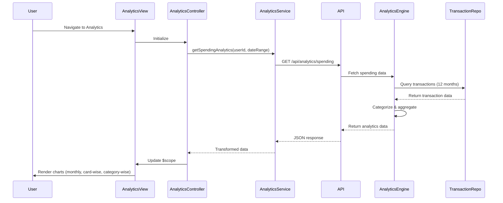

# Low-Level Design: QE-9288 - Spending Analytics and Insights

## a. Architecture Mapping

- **User Interface** → AngularJS Module: `spendingAnalytics.module.js` with Controller: `AnalyticsController`
- **Analytics Service** → AngularJS Service: `AnalyticsService` (handles API calls and data transformation)
- **Transaction Categorization Service** → REST API endpoint: `/api/transactions/categorize`
- **Analytics Engine** → REST API endpoint: `/api/analytics/spending`
- **Transaction Data Repository** → Backend data layer (accessed via REST APIs)
- **Data Visualization Library** → Angular-Chart.js directive integration

**Recommended Folder Structure:**
```
/app
  /modules
    /spending-analytics
      /controllers
      /services
      /directives
      /views
  /shared
    /services
    /directives
```

## b. Component Specifications

| Name | Artifact Type | Responsibility | Key Dependencies |
|------|---------------|----------------|------------------|
| AnalyticsController | Controller | Manages analytics view state, handles user interactions, coordinates data fetching | AnalyticsService, $scope, $filter |
| AnalyticsService | Service | Fetches spending data from REST APIs, transforms data for visualization | $http, $q, CacheService |
| CategoryChartDirective | Directive | Renders category-wise spending pie/bar chart using Chart.js | AnalyticsService, Chart.js |
| TrendChartDirective | Directive | Renders monthly spend trend line chart | AnalyticsService, Chart.js |
| CardWiseChartDirective | Directive | Renders card-wise spending distribution chart | AnalyticsService, Chart.js |
| SpendingModel | Factory | Defines spending data model structure and validation | None |
| DateRangeFilter | Filter | Filters analytics data by date range (12 months default) | None |

## c. Data Model

**SpendingAnalytics Object:**
```javascript
{
  userId: String,
  dateRange: { startDate: Date, endDate: Date },
  monthlyTrends: Array<{ month: String, amount: Number }>,
  cardWiseSpending: Array<{ cardId: String, cardName: String, amount: Number }>,
  categoryWiseSpending: Array<{ category: String, amount: Number, percentage: Number }>,
  categories: Array<String> // ['Food & Dining', 'Fuel', 'Shopping', 'Travel', 'Entertainment', 'Utilities', 'Healthcare', 'Education', 'Miscellaneous']
}
```

## d. Data Flow

User navigates to the analytics view, triggering AnalyticsController initialization. The controller calls AnalyticsService.getSpendingAnalytics(), which makes REST API calls to `/api/analytics/spending` with userId and date range parameters. The backend Analytics Engine retrieves transaction data from the Transaction Data Repository, applies categorization via the Transaction Categorization Service, and computes aggregated metrics (monthly trends, card-wise, category-wise). The service returns JSON data to the controller, which binds it to $scope. Chart directives (CategoryChartDirective, TrendChartDirective, CardWiseChartDirective) watch the scope data and render interactive visualizations using Chart.js, updating the UI within 2 seconds.

## e. Primary Sequence Diagram



## f. Implementation Notes

- Use AngularJS Dependency Injection for all services and controllers to ensure testability and modularity.
- Implement Chart.js via angular-chart directive for responsive, interactive visualizations with built-in tooltips and legends.
- Cache analytics data using $cacheFactory with 5-minute TTL to reduce API calls and improve performance.
- Use ES6 arrow functions and promises ($q) for cleaner asynchronous API handling.
- Apply lazy loading for the spending-analytics module to optimize initial page load time.

## g. Error Handling

HTTP interceptor captures API errors (4xx/5xx), displays user-friendly notifications via toastr, and logs errors to console; try/catch in service methods for data transformation errors.

## h. Security Notes

Requires token-based auth via existing SSO; API endpoints validate user session and enforce user-specific data access.