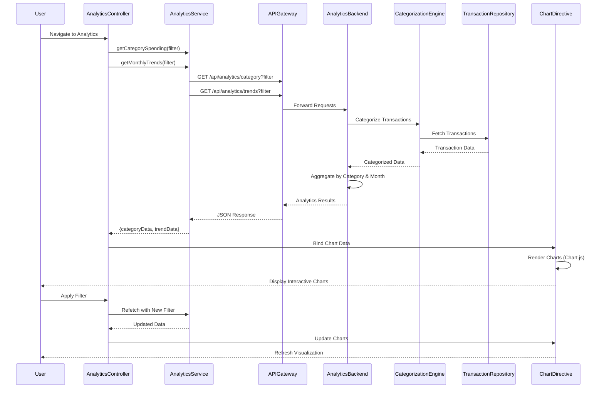

# Low-Level Design: QE-9289 - Spending Analytics and Insights

## a. Architecture Mapping

**AngularJS Artifact Mapping:**
- Analytics UI Layer → AngularJS Module: `creditCard.analytics` with Controller: `AnalyticsController`
- Analytics Service → AngularJS Service: `AnalyticsService` (handles analytics API calls)
- Transaction Categorization Engine → Backend service consumed via AngularJS Service: `CategorizationService`
- Data Analytics Service → Backend service consumed via AnalyticsService
- Visualization Library → AngularJS Directive: `spendingChart` (wraps Chart.js or D3.js)
- Filter/Drill-down → AngularJS Component: `analyticsFilter` (date range, card, category selectors)

**Recommended Folder Structure:**
```
app/
├── modules/
│   └── analytics/
│       ├── analytics.module.js
│       ├── analytics.controller.js
│       ├── analytics.html
│       ├── components/
│       │   └── analytics-filter.component.js
│       └── directives/
│           └── spending-chart.directive.js
├── services/
│   ├── analytics.service.js
│   └── categorization.service.js
├── models/
│   └── spending.model.js
└── assets/
    ├── js/
    │   └── chart.min.js
    └── css/
        └── analytics.css
```

## b. Component Specifications

| Component Name | Artifact Type | Responsibility | Key Dependencies |
|----------------|---------------|----------------|------------------|
| creditCard.analytics | Module | Root module for analytics feature, declares all analytics components | angular, ui.router, chart.js |
| AnalyticsController | Controller | Manages analytics view state, fetches spending data, handles filter changes | AnalyticsService, CategorizationService, $scope, $filter |
| AnalyticsService | Service | Fetches category-wise and monthly trend data from Analytics API | ApiService, $http, $q |
| CategorizationService | Service | Retrieves transaction categories and category metadata | ApiService, $http |
| spendingChart | Directive | Renders interactive charts (pie for categories, line for trends) using Chart.js | Chart.js library |
| analyticsFilter | Component | Provides date range picker, card selector, and category filter UI with two-way binding | None |

## c. Data Model

**CategorySpending Model:**
```javascript
{
  category: String,
  totalAmount: Number,
  transactionCount: Number,
  percentage: Number
}
```

**MonthlyTrend Model:**
```javascript
{
  month: String (YYYY-MM),
  totalSpend: Number,
  categoryBreakdown: Array<{category: String, amount: Number}>
}
```

**CardWiseSpending Model:**
```javascript
{
  cardId: String,
  cardName: String,
  totalSpend: Number,
  categorySpending: Array<CategorySpending>
}
```

**AnalyticsFilter Model:**
```javascript
{
  startDate: Date,
  endDate: Date,
  selectedCards: Array<String>,
  selectedCategories: Array<String>
}
```

## d. Data Flow

User navigates to analytics page → AnalyticsController initializes with default filter (last 12 months, all cards, all categories) → AnalyticsService.getCategorySpending(filter) and AnalyticsService.getMonthlyTrends(filter) called in parallel using $q.all() → API Gateway routes requests to Analytics Service → Analytics Service coordinates with Transaction Categorization Engine to retrieve categorized transactions from Transaction Data Repository and Data Analytics Service to perform aggregations → Response returns CategorySpending array and MonthlyTrend array → AnalyticsController processes data and binds to $scope → spendingChart directive renders pie chart for category breakdown and line chart for monthly trends → User changes filter via analyticsFilter component → $watch triggers re-fetch with new filter parameters → Charts update with sub-3-second rendering via directive's update method.

## e. Primary Sequence Diagram



## f. Implementation Notes

- Use Chart.js wrapped in AngularJS directive with isolated scope for reusable chart components
- Implement $watch on filter object in AnalyticsController to trigger data refresh on filter changes
- Use ES6 arrow functions and promises for cleaner async handling in services
- Leverage AngularJS $filter service for date formatting and currency display in charts
- Implement lazy loading for Chart.js library using ocLazyLoad to optimize initial page load

## g. Error Handling

Interceptor-based error handling with try/catch in controller for chart rendering failures, displaying user-friendly error messages via Bootstrap alert component.

## h. Security Notes

Standard input validation and secure API calls assumed, with token-based authentication inherited from ApiService interceptor.