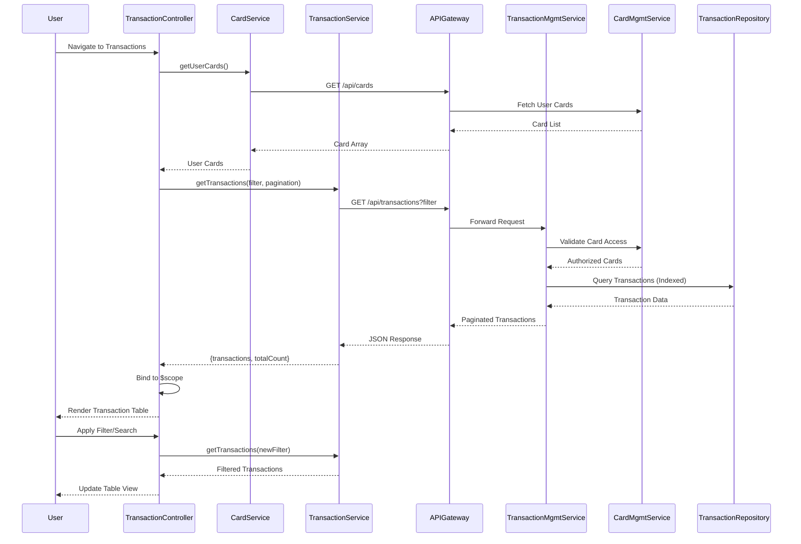

# Low-Level Design: QE-9290 - Transaction Management and Tracking

## a. Architecture Mapping

**AngularJS Artifact Mapping:**
- Transaction UI Layer → AngularJS Module: `creditCard.transactions` with Controller: `TransactionController`
- Transaction Management Service → AngularJS Service: `TransactionService` (handles transaction API calls)
- Card Management Service → AngularJS Service: `CardService` (provides card metadata)
- Transaction Filtering → AngularJS Component: `transactionFilter` (search and filter controls)
- Transaction List Display → AngularJS Directive: `transactionList` (renders paginated transaction table)

**Recommended Folder Structure:**
```
app/
├── modules/
│   └── transactions/
│       ├── transactions.module.js
│       ├── transactions.controller.js
│       ├── transactions.html
│       ├── components/
│       │   └── transaction-filter.component.js
│       └── directives/
│           └── transaction-list.directive.js
├── services/
│   ├── transaction.service.js
│   └── card.service.js
├── models/
│   └── transaction.model.js
└── assets/
    └── css/
        └── transactions.css
```

## b. Component Specifications

| Component Name | Artifact Type | Responsibility | Key Dependencies |
|----------------|---------------|----------------|------------------|
| creditCard.transactions | Module | Root module for transaction management feature | angular, ui.router |
| TransactionController | Controller | Manages transaction view, handles filtering, search, and pagination | TransactionService, CardService, $scope, $filter |
| TransactionService | Service | Fetches transaction data from API with filtering and pagination support | ApiService, $http, $q |
| CardService | Service | Retrieves user's card list and card metadata for transaction segregation | ApiService, $http |
| transactionFilter | Component | Provides date range, card selector, merchant search, and amount filter UI | None |
| transactionList | Directive | Renders paginated transaction table with sorting and card-wise grouping | None |

## c. Data Model

**Transaction Model:**
```javascript
{
  transactionId: String,
  cardId: String,
  cardName: String,
  date: Date,
  merchant: String,
  category: String,
  amount: Number,
  currency: String,
  status: String
}
```

**TransactionFilter Model:**
```javascript
{
  startDate: Date,
  endDate: Date,
  cardIds: Array<String>,
  merchant: String,
  minAmount: Number,
  maxAmount: Number,
  category: String
}
```

**PaginationState Model:**
```javascript
{
  currentPage: Number,
  pageSize: Number,
  totalRecords: Number,
  sortBy: String,
  sortOrder: String
}
```

## d. Data Flow

User navigates to transactions page → TransactionController initializes and calls CardService.getUserCards() to fetch card list → TransactionController calls TransactionService.getTransactions(filter, pagination) with default filter (last 30 days, all cards) → TransactionService sends GET request to API Gateway (/api/transactions?filter&page) → API Gateway routes to Transaction Management Service → Transaction Management Service queries Card Management Service for user's card IDs, then fetches transactions from Transaction Data Repository with indexed query for sub-1-second response → Response returns paginated Transaction array → TransactionController binds transactions to $scope → transactionList directive renders table with card-wise grouping option → User applies filter or search via transactionFilter component → $watch triggers TransactionService.getTransactions() with updated filter → Service returns filtered results → Directive updates table view with smooth transition.

## e. Primary Sequence Diagram



## f. Implementation Notes

- Use AngularJS $http service with query parameter serialization for filter and pagination
- Implement debounce on merchant search input using $timeout to avoid excessive API calls (300ms delay)
- Use AngularJS $filter for client-side sorting when result set is small (<100 records)
- Leverage Bootstrap table-responsive class for mobile-friendly transaction table
- Implement infinite scroll or pagination using ui-bootstrap pagination directive

## g. Error Handling

Interceptor-based error handling with try/catch in controller, displaying error messages via Bootstrap alert for API failures and empty state UI for no results.

## h. Security Notes

Requires token-based auth via existing SSO with server-side validation ensuring users can only access their own card transactions.