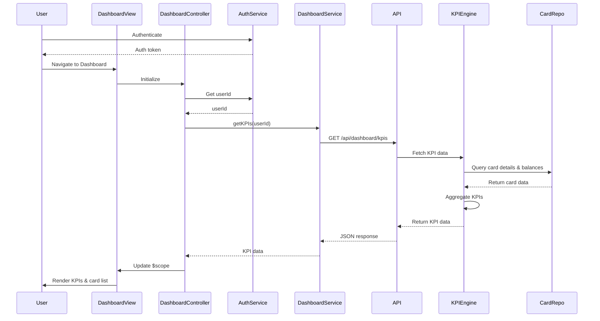

# Low-Level Design: QE-9291 - Dashboard KPIs and Credit Card Overview

## a. Architecture Mapping

- **User Interface** → AngularJS Module: `dashboard.module.js` with Controller: `DashboardController`
- **Dashboard Service** → AngularJS Service: `DashboardService` (handles API calls for KPI data)
- **KPI Aggregation Engine** → REST API endpoint: `/api/dashboard/kpis`
- **Credit Card Data Repository** → Backend data layer (accessed via REST APIs)
- **User Authentication Service** → AngularJS Service: `AuthService` (manages user session and tokens)

**Recommended Folder Structure:**
```
/app
  /modules
    /dashboard
      /controllers
      /services
      /views
      /components
  /shared
    /services
    /directives
```

## b. Component Specifications

| Name | Artifact Type | Responsibility | Key Dependencies |
|------|---------------|----------------|------------------|
| DashboardController | Controller | Manages dashboard state, fetches KPI data, handles multi-card display | DashboardService, AuthService, $scope |
| DashboardService | Service | Fetches KPI data from REST API, caches results, handles data refresh | $http, $q, $interval |
| KpiCardDirective | Directive | Renders individual KPI card (Monthly Spend, Credit Limit, Available Credit, Outstanding) | None |
| CreditCardListDirective | Directive | Displays list of user's credit cards with summary info | DashboardService |
| DashboardModel | Factory | Defines KPI and credit card data model structure | None |
| RefreshService | Service | Manages periodic dashboard refresh (5-minute interval) | $interval, DashboardService |

## c. Data Model

**DashboardKPI Object:**
```javascript
{
  userId: String,
  monthlySpend: Number,
  totalCreditLimit: Number,
  availableCredit: Number,
  outstandingAmount: Number,
  creditCards: Array<{
    cardId: String,
    cardName: String,
    cardNumber: String, // masked (e.g., **** **** **** 1234)
    creditLimit: Number,
    availableCredit: Number,
    outstandingAmount: Number,
    monthlySpend: Number
  }>,
  lastUpdated: Date
}
```

## d. Data Flow

User authenticates via AuthService and navigates to the dashboard. DashboardController initializes and calls DashboardService.getKPIs(), which sends a GET request to `/api/dashboard/kpis` with userId from the auth token. The backend KPI Aggregation Engine queries the Credit Card Data Repository for card details, balances, limits, and transaction summaries, computes aggregated KPIs (Monthly Spend, Total Credit Limit, Available Credit, Outstanding Amount), and returns JSON response. DashboardService caches the data and passes it to the controller, which binds it to $scope. The view renders KPI cards and credit card list using directives, ensuring responsive layout via Bootstrap grid. RefreshService triggers periodic updates every 5 minutes.

## e. Primary Sequence Diagram



## f. Implementation Notes

- Use AngularJS DI for all services and controllers; inject AuthService to ensure authenticated requests.
- Implement responsive design using Bootstrap 3 grid system (col-xs, col-sm, col-md, col-lg) for mobile/tablet/desktop support.
- Use $interval service for periodic dashboard refresh (5 minutes); clear interval on scope destroy to prevent memory leaks.
- Apply WCAG 2.1 compliance: semantic HTML5, ARIA labels, keyboard navigation, sufficient color contrast.
- Cache KPI data in DashboardService using $cacheFactory with 5-minute TTL to meet 2-second load requirement.

## g. Error Handling

HTTP interceptor captures API errors, displays user-friendly error messages via toastr, and provides retry option; try/catch in service methods for data parsing errors.

## h. Security Notes

Requires token-based auth via existing SSO; API endpoints validate JWT tokens and enforce user-specific data access.