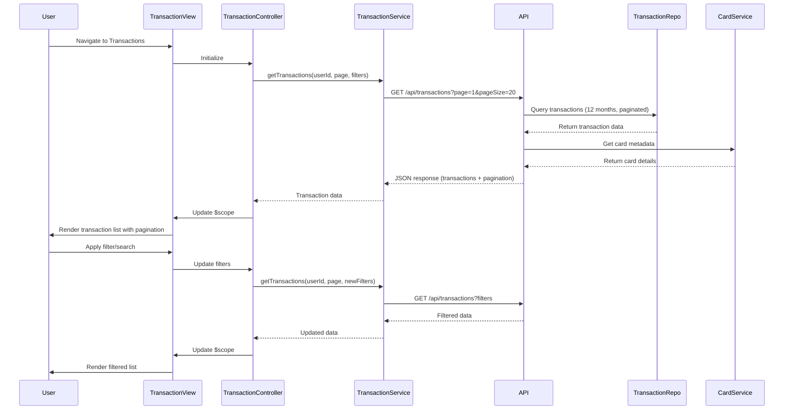

# Low-Level Design: QE-9292 - Transaction Management and Monitoring

## a. Architecture Mapping

- **User Interface** → AngularJS Module: `transactions.module.js` with Controller: `TransactionController`
- **Transaction Management Service** → AngularJS Service: `TransactionService` (handles API calls for transaction data)
- **Transaction Data Repository** → Backend data layer accessed via REST API: `/api/transactions`
- **Credit Card Service** → REST API endpoint: `/api/creditcards`
- **Authentication Service** → AngularJS Service: `AuthService` (manages user session)

**Recommended Folder Structure:**
```
/app
  /modules
    /transactions
      /controllers
      /services
      /views
      /filters
  /shared
    /services
    /directives
```

## b. Component Specifications

| Name | Artifact Type | Responsibility | Key Dependencies |
|------|---------------|----------------|------------------|
| TransactionController | Controller | Manages transaction list view, handles pagination, filtering, and search | TransactionService, AuthService, $scope, $filter |
| TransactionService | Service | Fetches transaction data from REST API, handles pagination and filtering logic | $http, $q |
| TransactionListDirective | Directive | Renders paginated transaction list with sorting and filtering UI | TransactionService |
| TransactionDetailModal | Directive | Displays detailed view of a selected transaction in a modal | None |
| TransactionModel | Factory | Defines transaction data model structure and validation | None |
| PaginationService | Service | Manages pagination state (page number, page size, total records) | None |
| TransactionFilterService | Service | Applies client-side and server-side filtering (date range, card, amount, merchant) | None |

## c. Data Model

**Transaction Object:**
```javascript
{
  transactionId: String,
  userId: String,
  cardId: String,
  cardName: String,
  date: Date,
  merchant: String,
  amount: Number,
  category: String,
  description: String,
  status: String // ['Posted', 'Pending']
}
```

**PaginationMetadata:**
```javascript
{
  currentPage: Number,
  pageSize: Number, // default 20-50
  totalRecords: Number,
  totalPages: Number
}
```

## d. Data Flow

User authenticates via AuthService and navigates to the transaction list view. TransactionController initializes and calls TransactionService.getTransactions() with pagination parameters (page, pageSize) and optional filters (dateRange, cardId, searchTerm). The service sends a GET request to `/api/transactions` with query parameters. The backend Transaction Management Service queries the Transaction Data Repository for historical records (minimum 12 months), applies filters, and returns paginated JSON response with transaction data and pagination metadata. The Credit Card Service provides card metadata to link transactions to specific cards. TransactionService returns data to the controller, which binds it to $scope. The view renders the transaction list using TransactionListDirective with pagination controls, search input, and filter dropdowns. User interactions (page change, filter, search) trigger new API calls, updating the view within 3 seconds.

## e. Primary Sequence Diagram



## f. Implementation Notes

- Use AngularJS DI for all services and controllers; inject AuthService to ensure authenticated requests with JWT tokens.
- Implement server-side pagination to handle large transaction volumes; default page size 20-50 transactions.
- Use AngularJS $filter service for client-side search on transaction list (merchant, amount, date) to improve UX.
- Apply debounce (300ms) on search input using ng-model-options to reduce API calls during typing.
- Use UI Bootstrap modal directive for transaction detail view with transaction metadata and category information.

## g. Error Handling

HTTP interceptor captures API errors (4xx/5xx), displays user-friendly notifications via toastr, and provides retry option; try/catch in service methods for data transformation errors.

## h. Security Notes

Requires token-based auth via existing SSO; API endpoints validate JWT tokens and enforce user-specific transaction data access.