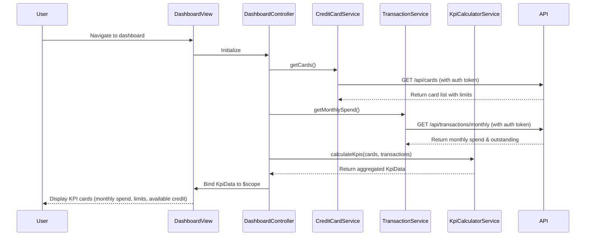

# Low-Level Design: Dashboard and KPI Management
**Epic ID:** QE-9353

---

## a. Architecture Mapping

- **Dashboard Module** (`app.dashboard`) → Main AngularJS module containing dashboard feature
- **DashboardController** → Orchestrates KPI display, handles user interactions, manages view state
- **CreditCardService** → Factory for fetching credit card data from Credit Card Data Service REST API
- **TransactionService** → Factory for fetching aggregated transaction data from Transaction Processing Service REST API
- **KpiCalculatorService** → Service for client-side KPI calculations (available credit = limit - outstanding)
- **dashboardKpiDirective** → Directive for rendering individual KPI cards with real-time refresh capability

**Recommended Folder Structure:**
```
app/
├── dashboard/
│   ├── dashboard.module.js
│   ├── dashboard.controller.js
│   ├── dashboard.html
│   ├── directives/
│   │   └── dashboard-kpi.directive.js
│   └── services/
│       ├── credit-card.service.js
│       ├── transaction.service.js
│       └── kpi-calculator.service.js
├── shared/
│   └── auth.service.js
└── assets/
    └── css/
        └── dashboard.css
```

---

## b. Component Specifications

| Name | Artifact Type | Responsibility | Key Dependencies |
|------|---------------|----------------|------------------|
| `app.dashboard` | Module | Encapsulates dashboard feature with routing and DI configuration | `ngRoute`, `app.shared` |
| `DashboardController` | Controller | Fetches and aggregates KPI data, manages dashboard state, handles refresh | `CreditCardService`, `TransactionService`, `KpiCalculatorService`, `$scope`, `$interval` |
| `CreditCardService` | Factory | Fetches user's credit card list with limits and balances via REST API | `$http`, `$q`, `AuthService` |
| `TransactionService` | Factory | Fetches aggregated monthly spend and outstanding amounts via REST API | `$http`, `$q`, `AuthService` |
| `KpiCalculatorService` | Service | Calculates derived KPIs (available credit, utilization %) from raw data | None |
| `dashboardKpiDirective` | Directive | Renders individual KPI card with label, value, and trend indicator | `$filter` |
| `AuthService` | Factory (shared) | Provides authentication token for secure API calls | `$http`, `$window` |

---

## c. Data Model

**CreditCard Model:**
```javascript
{
  cardId: String,
  cardNumber: String (masked),
  cardType: String,
  creditLimit: Number,
  outstandingAmount: Number,
  availableCredit: Number (calculated),
  lastUpdated: Date
}
```

**KpiData Model:**
```javascript
{
  monthlySpend: Number,
  totalCreditLimit: Number,
  totalAvailableCredit: Number,
  totalOutstanding: Number,
  utilizationPercentage: Number (calculated),
  cardCount: Number
}
```

---

## d. Data Flow

User navigates to dashboard → `DashboardController` initializes and calls `CreditCardService.getCards()` and `TransactionService.getMonthlySpend()` → Services make parallel REST API calls with auth token → On success, `KpiCalculatorService` aggregates card data (sum limits, sum outstanding) and calculates available credit → Aggregated `KpiData` object is bound to `$scope` → `dashboardKpiDirective` instances render individual KPI cards using Bootstrap grid → `$interval` triggers periodic refresh every 30 seconds, re-fetching data and updating view.

---

## e. Primary Sequence Diagram



---

## f. Implementation Notes

- Use AngularJS Factory pattern for services with promise-based API calls (`$http` returns promises, handle with `.then()` and `.catch()`).
- Implement dependency injection in controller: `DashboardController.$inject = ['$scope', '$interval', 'CreditCardService', 'TransactionService', 'KpiCalculatorService'];`
- Use `$interval` for auto-refresh every 30 seconds; cancel interval on `$scope.$on('$destroy')` to prevent memory leaks.
- Leverage Bootstrap grid (`col-md-3`) for responsive KPI card layout; use CSS3 media queries for mobile optimization.
- Cache API responses in services using `$cacheFactory` with 2-minute TTL to reduce redundant calls and meet 2-second load time NFR.

---

## g. Error Handling

HTTP interceptor-based error handling with `$httpProvider.interceptors` to catch 401/403 (redirect to login), 500 (show user-friendly error toast using Bootstrap alert component), and network errors (retry logic with exponential backoff).

---

## h. Security Notes

Requires token-based authentication via existing SSO; `AuthService` injects bearer token in `Authorization` header for all API calls; sensitive card data (full card number) never exposed to client.