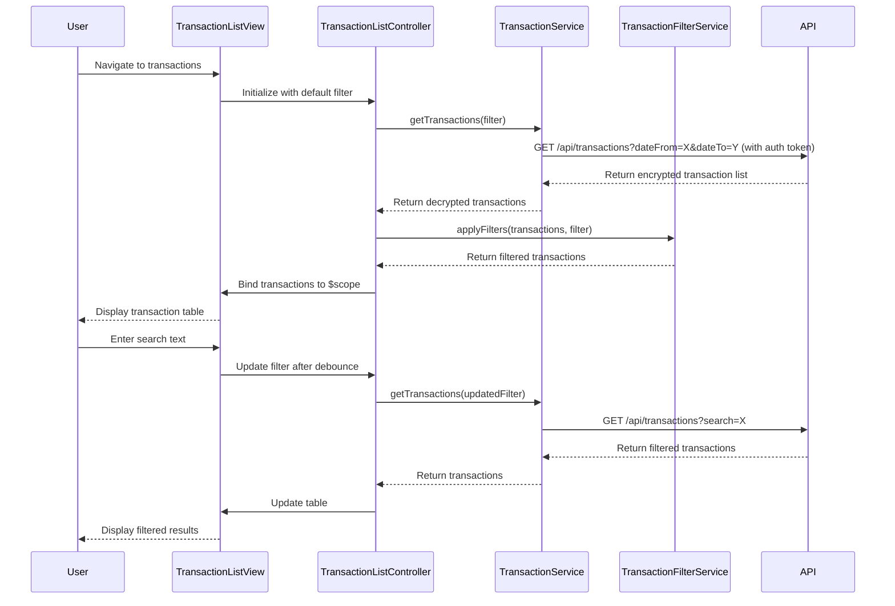

# Low-Level Design: Transaction Management and Monitoring
**Epic ID:** QE-9354

---

## a. Architecture Mapping

- **Transaction Module** (`app.transactions`) → Main AngularJS module for transaction management feature
- **TransactionListController** → Manages transaction list view, search/filter state, and pagination
- **TransactionDetailController** → Displays detailed view of a single transaction
- **TransactionService** → Factory for fetching transaction data from Transaction Data Service REST API
- **TransactionFilterService** → Service for client-side filtering and search logic
- **transactionListDirective** → Directive for rendering transaction table with sorting and filtering
- **transactionSearchDirective** → Directive for search input with debounce and autocomplete

**Recommended Folder Structure:**
```
app/
├── transactions/
│   ├── transactions.module.js
│   ├── transaction-list.controller.js
│   ├── transaction-detail.controller.js
│   ├── transaction-list.html
│   ├── transaction-detail.html
│   ├── directives/
│   │   ├── transaction-list.directive.js
│   │   └── transaction-search.directive.js
│   └── services/
│       ├── transaction.service.js
│       └── transaction-filter.service.js
├── shared/
│   └── auth.service.js
└── assets/
    └── css/
        └── transactions.css
```

---

## b. Component Specifications

| Name | Artifact Type | Responsibility | Key Dependencies |
|------|---------------|----------------|------------------|
| `app.transactions` | Module | Encapsulates transaction feature with routing and DI configuration | `ngRoute`, `app.shared` |
| `TransactionListController` | Controller | Fetches transaction list, manages search/filter state, handles pagination | `TransactionService`, `TransactionFilterService`, `$scope`, `$routeParams` |
| `TransactionDetailController` | Controller | Fetches and displays single transaction details by ID | `TransactionService`, `$scope`, `$routeParams` |
| `TransactionService` | Factory | Fetches transaction data (list, details) from REST API with encryption support | `$http`, `$q`, `AuthService` |
| `TransactionFilterService` | Service | Applies client-side filters (date range, amount, merchant, category) and search | None |
| `transactionListDirective` | Directive | Renders transaction table with sortable columns and row selection | `$filter` |
| `transactionSearchDirective` | Directive | Search input with 300ms debounce and merchant autocomplete | `$timeout` |
| `AuthService` | Factory (shared) | Provides authentication token for secure API calls | `$http`, `$window` |

---

## c. Data Model

**Transaction Model:**
```javascript
{
  transactionId: String,
  cardId: String,
  cardNumber: String (masked),
  date: Date,
  merchant: String,
  category: String,
  amount: Number,
  currency: String,
  status: String, // 'posted', 'pending'
  description: String
}
```

**TransactionFilter Model:**
```javascript
{
  dateFrom: Date,
  dateTo: Date,
  cardIds: Array<String>,
  categories: Array<String>,
  minAmount: Number,
  maxAmount: Number,
  searchText: String
}
```

---

## d. Data Flow

User navigates to transaction list view → `TransactionListController` initializes with default filter (last 30 days) → `TransactionService.getTransactions(filter)` makes REST API call with query params → API returns encrypted transaction data, decrypted by service → `TransactionFilterService` applies client-side filters if needed → Filtered transaction array is bound to `$scope` → `transactionListDirective` renders table using Bootstrap table component → User enters search text in `transactionSearchDirective` → After 300ms debounce, filter is updated and `TransactionService` re-fetches data → User clicks transaction row → Navigate to detail view with `transactionId` → `TransactionDetailController` fetches single transaction via `TransactionService.getTransactionById(id)` → Detail view displays full transaction information.

---

## e. Primary Sequence Diagram



---

## f. Implementation Notes

- Use AngularJS Factory pattern for `TransactionService` with promise-based `$http` calls; implement response decryption using CryptoJS library.
- Implement search debounce in `transactionSearchDirective` using `$timeout` (cancel previous timeout on each keystroke, trigger search after 300ms idle).
- Leverage `ng-repeat` with `track by transactionId` for efficient list rendering; use `limitTo` filter for client-side pagination.
- Store filter state in `$routeParams` to enable deep linking and browser back/forward navigation.
- Use `$cacheFactory` to cache transaction list for 1 minute; invalidate cache on filter change to ensure fresh data.

---

## g. Error Handling

HTTP interceptor-based error handling with user notification via Bootstrap toast component; implement try/catch in decryption logic with fallback to display raw data if decryption fails.

---

## h. Security Notes

Requires token-based auth via existing SSO; all transaction data transmitted over HTTPS with AES-256 encryption; `TransactionService` decrypts data client-side using shared key from secure session storage.