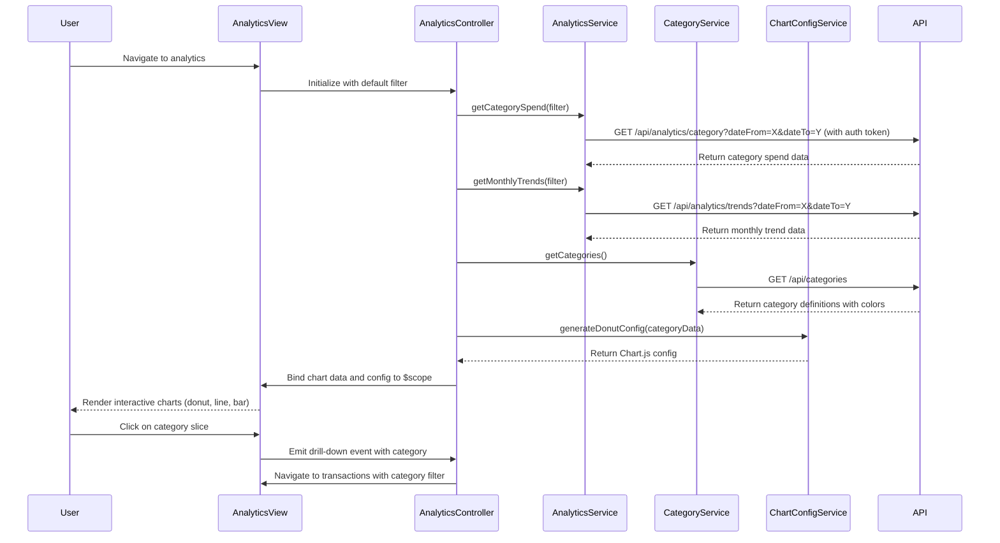

# Low-Level Design: Spending Analytics and Insights
**Epic ID:** QE-9355

---

## a. Architecture Mapping

- **Analytics Module** (`app.analytics`) → Main AngularJS module for spending analytics feature
- **AnalyticsController** → Manages analytics view state, chart data preparation, and user interactions
- **AnalyticsService** → Factory for fetching aggregated analytics data from Analytics Service REST API
- **CategoryService** → Factory for fetching category definitions and mappings
- **ChartConfigService** → Service for generating Chart.js configuration objects for different chart types
- **categoryChartDirective** → Directive for rendering category-wise spending pie/donut chart
- **trendChartDirective** → Directive for rendering monthly spend trend line chart
- **cardComparisonDirective** → Directive for rendering card-wise spend comparison bar chart

**Recommended Folder Structure:**
```
app/
├── analytics/
│   ├── analytics.module.js
│   ├── analytics.controller.js
│   ├── analytics.html
│   ├── directives/
│   │   ├── category-chart.directive.js
│   │   ├── trend-chart.directive.js
│   │   └── card-comparison.directive.js
│   └── services/
│       ├── analytics.service.js
│       ├── category.service.js
│       └── chart-config.service.js
├── shared/
│   └── auth.service.js
└── assets/
    ├── css/
    │   └── analytics.css
    └── libs/
        └── chart.js
```

---

## b. Component Specifications

| Name | Artifact Type | Responsibility | Key Dependencies |
|------|---------------|----------------|------------------|
| `app.analytics` | Module | Encapsulates analytics feature with routing, DI, and Chart.js integration | `ngRoute`, `app.shared`, `chart.js` |
| `AnalyticsController` | Controller | Fetches analytics data, prepares chart datasets, manages filter state (date range, card selection) | `AnalyticsService`, `CategoryService`, `ChartConfigService`, `$scope`, `$filter` |
| `AnalyticsService` | Factory | Fetches pre-aggregated analytics data (category totals, monthly trends, card-wise spend) from REST API | `$http`, `$q`, `AuthService` |
| `CategoryService` | Factory | Fetches category definitions and color mappings for consistent chart rendering | `$http`, `$q` |
| `ChartConfigService` | Service | Generates Chart.js config objects with responsive settings, tooltips, and drill-down event handlers | None |
| `categoryChartDirective` | Directive | Renders interactive donut chart for category-wise spending with drill-down to transaction list | `ChartConfigService`, `$location` |
| `trendChartDirective` | Directive | Renders line chart for monthly spend trends with multi-card comparison overlay | `ChartConfigService` |
| `cardComparisonDirective` | Directive | Renders horizontal bar chart comparing spend across cards for selected category | `ChartConfigService` |
| `AuthService` | Factory (shared) | Provides authentication token for secure API calls | `$http`, `$window` |

---

## c. Data Model

**CategorySpend Model:**
```javascript
{
  category: String, // 'Food & Dining', 'Fuel', etc.
  amount: Number,
  percentage: Number,
  transactionCount: Number,
  color: String // Hex color for chart
}
```

**MonthlyTrend Model:**
```javascript
{
  month: String, // 'YYYY-MM'
  totalSpend: Number,
  cardBreakdown: Array<{cardId: String, amount: Number}>
}
```

**CardSpend Model:**
```javascript
{
  cardId: String,
  cardNumber: String (masked),
  totalSpend: Number,
  categoryBreakdown: Array<{category: String, amount: Number}>
}
```

---

## d. Data Flow

User navigates to analytics dashboard → `AnalyticsController` initializes with default filter (last 6 months, all cards) → `AnalyticsService.getCategorySpend(filter)`, `AnalyticsService.getMonthlyTrends(filter)`, and `AnalyticsService.getCardComparison(filter)` make parallel REST API calls → API returns pre-aggregated data from data warehouse → `CategoryService.getCategories()` fetches category definitions with color mappings → `ChartConfigService` generates Chart.js config objects for each chart type → Chart data and config are bound to `$scope` → Directives (`categoryChartDirective`, `trendChartDirective`, `cardComparisonDirective`) render interactive charts using Chart.js → User clicks on category slice in donut chart → Directive emits drill-down event with category filter → `AnalyticsController` navigates to transaction list view with category filter applied.

---

## e. Primary Sequence Diagram



---

## f. Implementation Notes

- Use Chart.js 2.x library integrated via AngularJS directive wrapper; initialize chart in directive's `link` function with `new Chart(ctx, config)`.
- Implement responsive chart sizing using Chart.js `maintainAspectRatio: true` and Bootstrap grid for layout; use CSS3 media queries for mobile optimization.
- Leverage `$q.all()` to parallelize API calls for category spend, monthly trends, and card comparison data to meet 3-second rendering NFR.
- Implement drill-down by binding click event handler in Chart.js config (`onClick: function(evt, item) {...}`) and using `$location.path()` to navigate with query params.
- Cache analytics data in `AnalyticsService` using `$cacheFactory` with 5-minute TTL; invalidate cache on filter change.

---

## g. Error Handling

HTTP interceptor-based error handling with fallback to display empty chart state and user-friendly error message using Bootstrap alert; implement try/catch in chart rendering with graceful degradation to table view if Chart.js fails.

---

## h. Security Notes

Requires token-based auth via existing SSO; analytics API endpoints validate user's card ownership server-side to prevent unauthorized data access; no sensitive transaction details exposed in aggregated analytics data.