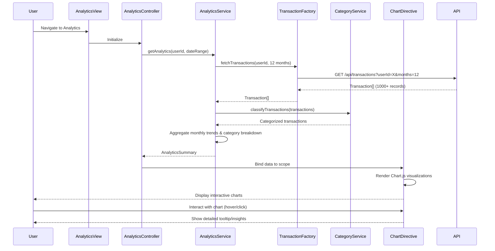

# Low-Level Design: QE-9411 - Spending Analytics and Transaction Insights

## a. Architecture Mapping

- **User Interface** → AngularJS Module: `spendingAnalytics.module` with Controller: `AnalyticsViewController`
- **Analytics Visualization Module** → AngularJS Controller: `AnalyticsVisualizationController` + Directive: `spendingChart`
- **Analytics Processing Engine** → AngularJS Service: `AnalyticsProcessingService`
- **Transaction Data Service** → AngularJS Factory: `TransactionDataFactory` (REST API wrapper)
- **Category Classification Service** → AngularJS Service: `CategoryClassificationService`
- **Data Visualization Library** → Third-party integration: Chart.js via Directive wrapper

**Recommended Folder Structure:**
```
app/
├── modules/
│   └── spending-analytics/
│       ├── controllers/
│       ├── services/
│       ├── directives/
│       ├── factories/
│       └── views/
├── shared/
│   ├── services/
│   └── factories/
└── assets/
    └── css/
```

## b. Component Specifications

| Component Name | Artifact Type | Responsibility | Key Dependencies |
|----------------|---------------|----------------|------------------|
| spendingAnalytics.module | Module | Root module for spending analytics feature | angular, ngRoute, chart.js |
| AnalyticsViewController | Controller | Manages analytics view state and user interactions | AnalyticsProcessingService, $scope |
| AnalyticsVisualizationController | Controller | Handles chart rendering and data binding | AnalyticsProcessingService, CategoryClassificationService, $scope |
| AnalyticsProcessingService | Service | Aggregates and processes transaction data for analytics | TransactionDataFactory, CategoryClassificationService, $q |
| TransactionDataFactory | Factory | Fetches transaction data via REST API | $http, $q |
| CategoryClassificationService | Service | Classifies transactions into 9 predefined categories | None |
| spendingChart | Directive | Renders interactive spending charts using Chart.js | Chart.js library |
| monthlyTrendChart | Directive | Displays monthly spend trend visualization | Chart.js library |
| categoryBreakdownChart | Directive | Shows category-wise spending breakdown | Chart.js library |

## c. Data Model

**Transaction Model:**
```javascript
class Transaction {
  id: String
  cardId: String
  amount: Number
  category: String // Food & Dining, Fuel, Shopping, Travel, Entertainment, Utilities, Healthcare, Education, Miscellaneous
  date: Date
  description: String
  merchantName: String
}
```

**Analytics Summary Model:**
```javascript
class AnalyticsSummary {
  userId: String
  monthlyTrends: Array<{month: String, totalSpend: Number}>
  categoryBreakdown: Array<{category: String, amount: Number, percentage: Number}>
  totalTransactions: Number
  dateRange: {start: Date, end: Date}
}
```

**Category Model:**
```javascript
const CATEGORIES = [
  'Food & Dining', 'Fuel', 'Shopping', 'Travel', 
  'Entertainment', 'Utilities', 'Healthcare', 'Education', 'Miscellaneous'
]
```

## d. Data Flow

User navigates to spending analytics view → AnalyticsViewController initializes and calls AnalyticsProcessingService.getAnalytics() → Service invokes TransactionDataFactory.fetchTransactions() which makes REST API call to retrieve 12 months of transaction history → CategoryClassificationService categorizes each transaction → AnalyticsProcessingService aggregates data into monthly trends and category breakdowns → Processed AnalyticsSummary object is returned to controller → Controller binds data to $scope → spendingChart and categoryBreakdownChart directives render interactive visualizations using Chart.js → User interacts with charts (hover, click) triggering directive event handlers that update view with detailed insights.

## e. Primary Sequence Diagram



## f. Implementation Notes

- Use AngularJS 1.x dependency injection to inject services into controllers; follow module pattern for clean separation of concerns.
- Implement ES6 classes for models and use arrow functions in service methods for cleaner syntax and lexical `this` binding.
- Leverage $q promises for asynchronous REST API calls; chain .then() handlers for data transformation pipeline.
- Integrate Chart.js via custom AngularJS directives that watch scope data and re-render charts on data changes using $scope.$watch.
- Use $http interceptor to handle API authentication tokens and implement caching strategy ($cacheFactory) to meet 3-second rendering NFR.

## g. Error Handling

HTTP interceptor-based error handling with try/catch blocks in services; user-friendly error notifications displayed via toastr or Bootstrap alerts.

## h. Security Notes

Requires token-based authentication via existing SSO; all API calls include Authorization header with JWT token.