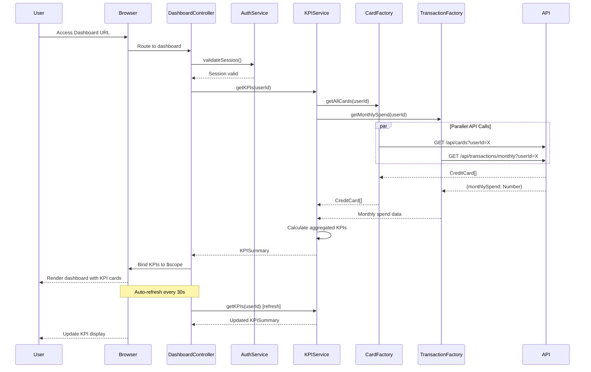

# Low-Level Design: QE-9412 - Credit Card Dashboard and KPI Management

## a. Architecture Mapping

- **User Web/Mobile Client** → AngularJS SPA with responsive Bootstrap layout
- **Dashboard UI Layer** → AngularJS Module: `dashboard.module` with Controller: `DashboardController`
- **KPI Aggregation Service** → AngularJS Service: `KPIAggregationService`
- **Credit Card Data Service** → AngularJS Factory: `CreditCardDataFactory` (REST API wrapper)
- **Transaction Processing Service** → AngularJS Factory: `TransactionProcessingFactory` (REST API wrapper)
- **User Authentication Service** → AngularJS Service: `AuthService` with HTTP interceptor

**Recommended Folder Structure:**
```
app/
├── modules/
│   └── dashboard/
│       ├── controllers/
│       ├── services/
│       ├── factories/
│       ├── directives/
│       └── views/
├── shared/
│   ├── auth/
│   ├── interceptors/
│   └── services/
└── assets/
    └── css/
```

## b. Component Specifications

| Component Name | Artifact Type | Responsibility | Key Dependencies |
|----------------|---------------|----------------|------------------|
| dashboard.module | Module | Root module for dashboard feature | angular, ngRoute, ui.bootstrap |
| DashboardController | Controller | Manages dashboard state, KPI display, and real-time refresh | KPIAggregationService, AuthService, $scope, $interval |
| KPIAggregationService | Service | Aggregates KPIs (monthly spend, credit limit, available credit, outstanding) from multiple sources | CreditCardDataFactory, TransactionProcessingFactory, $q |
| CreditCardDataFactory | Factory | Fetches credit card details and balances via REST API | $http, $q |
| TransactionProcessingFactory | Factory | Retrieves transaction data for spend calculations via REST API | $http, $q |
| AuthService | Service | Handles user authentication and token management | $http, $window |
| AuthInterceptor | Factory | Intercepts HTTP requests to inject auth tokens | $q, $window |
| kpiCard | Directive | Reusable component to display individual KPI metrics | None |
| dashboardRefresh | Directive | Handles real-time data refresh logic | $interval |

## c. Data Model

**KPI Model:**
```javascript
class KPISummary {
  userId: String
  monthlySpend: Number
  totalCreditLimit: Number
  availableCredit: Number
  outstandingAmount: Number
  lastUpdated: Date
  cardCount: Number
}
```

**Credit Card Model:**
```javascript
class CreditCard {
  cardId: String
  cardNumber: String // masked
  cardType: String
  creditLimit: Number
  availableCredit: Number
  outstandingBalance: Number
  issuerName: String
}
```

**User Session Model:**
```javascript
class UserSession {
  userId: String
  token: String
  expiresAt: Date
  refreshToken: String
}
```

## d. Data Flow

User accesses dashboard URL → Angular router loads DashboardController → AuthService validates user session and redirects to login if invalid → DashboardController calls KPIAggregationService.getKPIs() → Service makes parallel REST API calls via CreditCardDataFactory.getAllCards() and TransactionProcessingFactory.getMonthlySpend() using $q.all() → API responses return card details and transaction summaries → KPIAggregationService calculates totalCreditLimit (sum of all card limits), availableCredit (sum of available across cards), outstandingAmount (sum of balances), and monthlySpend (from transaction service) → KPISummary object is returned to controller → Controller binds KPIs to $scope → View renders KPI cards using Bootstrap grid and kpiCard directive → $interval triggers periodic refresh every 30 seconds calling KPIAggregationService again → Updated KPIs are bound to scope and UI updates reactively.

## e. Primary Sequence Diagram



## f. Implementation Notes

- Use AngularJS module pattern with dependency injection for all services, factories, and controllers to ensure testability and maintainability.
- Implement $http interceptor (AuthInterceptor) to automatically inject JWT tokens in Authorization header for all API requests.
- Use $q.all() to make parallel REST API calls to CreditCardDataFactory and TransactionProcessingFactory for optimal performance to meet 2-second load time.
- Leverage Bootstrap responsive grid system (col-xs, col-sm, col-md, col-lg) for adaptive layout across desktop, tablet, and mobile devices.
- Implement real-time refresh using $interval service with configurable refresh rate; ensure proper cleanup in $scope.$on('$destroy') to prevent memory leaks.

## g. Error Handling

HTTP interceptor captures API errors (4xx, 5xx); try/catch in service methods with user-friendly error messages displayed via Bootstrap modal or alert component.

## h. Security Notes

Requires token-based authentication via existing SSO; AuthService manages JWT tokens with automatic refresh; all sensitive data transmitted over HTTPS.