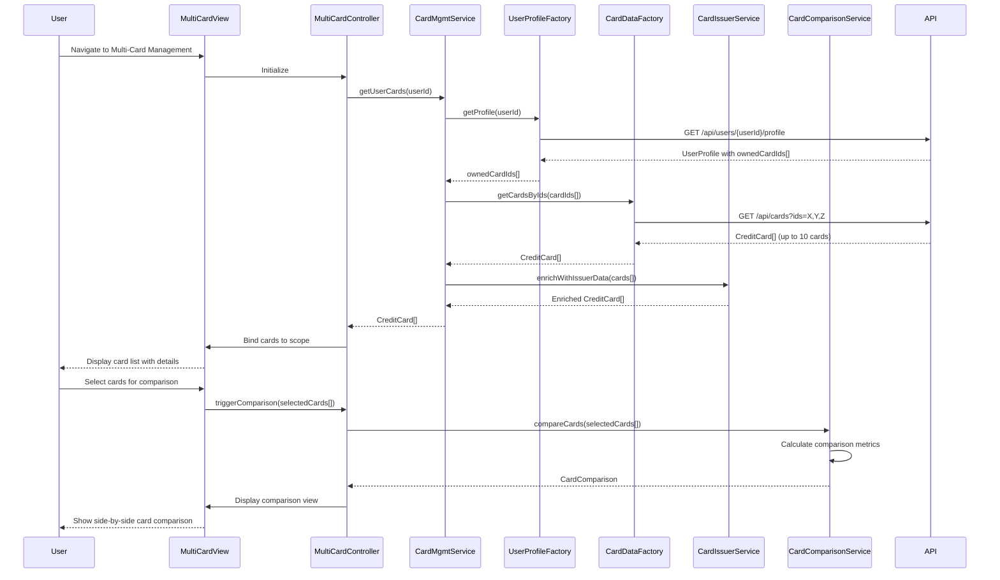

# Low-Level Design: QE-9413 - Multi-Card Management and Monitoring

## a. Architecture Mapping

- **User Interface** → AngularJS Module: `multiCardManagement.module` with Controller: `MultiCardController`
- **Multi-Card Management Module** → AngularJS Controller: `MultiCardController` + Service: `CardManagementService`
- **Card Data Repository** → AngularJS Factory: `CardDataFactory` (REST API wrapper)
- **Card Issuer Information Service** → AngularJS Service: `CardIssuerService`
- **User Profile Service** → AngularJS Factory: `UserProfileFactory` (REST API wrapper)
- **Card Comparison Engine** → AngularJS Service: `CardComparisonService`

**Recommended Folder Structure:**
```
app/
├── modules/
│   └── multi-card/
│       ├── controllers/
│       ├── services/
│       ├── factories/
│       ├── directives/
│       └── views/
├── shared/
│   ├── services/
│   └── factories/
└── assets/
    └── css/
```

## b. Component Specifications

| Component Name | Artifact Type | Responsibility | Key Dependencies |
|----------------|---------------|----------------|------------------|
| multiCardManagement.module | Module | Root module for multi-card management feature | angular, ngRoute, ui.bootstrap |
| MultiCardController | Controller | Manages multi-card view state, selection, filtering, and comparison | CardManagementService, CardComparisonService, $scope |
| CardManagementService | Service | Orchestrates card data retrieval and management operations | CardDataFactory, UserProfileFactory, CardIssuerService, $q |
| CardDataFactory | Factory | Fetches card details, balances, and transaction data via REST API | $http, $q |
| UserProfileFactory | Factory | Retrieves user profile and card ownership data via REST API | $http, $q |
| CardIssuerService | Service | Provides card issuer metadata (branding, logos, card type info) | None (static data or cached) |
| CardComparisonService | Service | Compares multiple cards and generates comparison metrics | None |
| cardListItem | Directive | Renders individual card display with details and status | None |
| cardFilter | Directive | Provides filtering UI for card selection by type, issuer, or status | None |
| cardComparison | Directive | Displays side-by-side card comparison view | CardComparisonService |

## c. Data Model

**Credit Card Model:**
```javascript
class CreditCard {
  cardId: String
  userId: String
  cardNumber: String // masked (e.g., "****1234")
  cardType: String // Visa, Mastercard, Amex
  issuerName: String
  creditLimit: Number
  availableCredit: Number
  outstandingBalance: Number
  status: String // Active, Blocked, Expired
  expiryDate: Date
  cardWiseSpend: Number
  lastTransactionDate: Date
}
```

**Card Comparison Model:**
```javascript
class CardComparison {
  cards: Array<CreditCard>
  comparisonMetrics: {
    highestLimit: {cardId: String, limit: Number}
    lowestUtilization: {cardId: String, utilization: Number}
    highestSpend: {cardId: String, spend: Number}
  }
}
```

**User Profile Model:**
```javascript
class UserProfile {
  userId: String
  ownedCardIds: Array<String>
  preferences: Object
}
```

## d. Data Flow

User authenticates and navigates to multi-card management interface → MultiCardController initializes and calls CardManagementService.getUserCards() → Service first calls UserProfileFactory.getProfile() to retrieve user's card ownership list → Service then calls CardDataFactory.getCardsByIds() with owned card IDs to fetch detailed card information (limits, balances, status) → CardIssuerService enriches card data with issuer branding and metadata → CardManagementService returns array of CreditCard objects to controller → Controller binds cards to $scope → View renders card list using cardListItem directive with Bootstrap cards layout → User applies filters via cardFilter directive which updates $scope.filteredCards → User selects multiple cards for comparison → Controller calls CardComparisonService.compareCards() → Service calculates comparison metrics (utilization rates, spend patterns, limit comparisons) → cardComparison directive displays side-by-side comparison view with visual indicators for best/worst performing cards.

## e. Primary Sequence Diagram



## f. Implementation Notes

- Use AngularJS dependency injection to wire all services, factories, and controllers; follow single responsibility principle for each component.
- Implement ES6 classes for CreditCard and CardComparison models with getter methods for calculated fields (e.g., utilizationRate = outstandingBalance / creditLimit).
- Use $q promises for asynchronous API calls; leverage $q.all() for parallel data fetching when loading multiple card details.
- Create reusable cardListItem directive with isolated scope to encapsulate card display logic; use Bootstrap card component for consistent styling.
- Implement client-side filtering using AngularJS filters; bind filter criteria to $scope and use ng-repeat with filter expression for real-time filtering without API calls.

## g. Error Handling

HTTP interceptor-based error handling with try/catch in service methods; display user-friendly error messages using Bootstrap alerts or toastr notifications.

## h. Security Notes

Requires token-based authentication via existing SSO; card ownership validation performed server-side; sensitive card data (full card numbers) never transmitted to client.