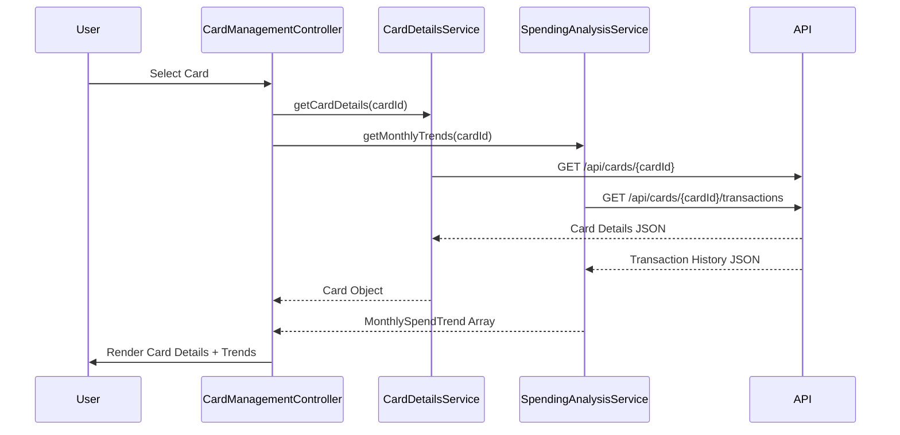

# Low-Level Design: Multiple Credit Card Management and Viewing
**Epic ID:** QE-9443

## a. Architecture Mapping

- **Module:** `creditCardApp.cardManagement` - Main module for multi-card management features
- **Controller:** `CardManagementController` - Handles card selection, navigation, and UI state management
- **Service:** `CardDetailsService` - Retrieves individual card metadata (number, type, limit, balance) via REST API
- **Service:** `SpendingAnalysisService` - Fetches transaction history and calculates monthly spend trends per card
- **Directive:** `cardListView` - Renders organized grid/list of all credit cards with selection capability
- **Factory:** `CardDataRepository` - Caches card data and manages API calls to backend endpoints

**Recommended Folder Structure:**
```
/app
  /modules
    /card-management
      /controllers
        card-management.controller.js
      /services
        card-details.service.js
        spending-analysis.service.js
      /directives
        card-list-view.directive.js
      /factories
        card-data-repository.factory.js
      /views
        card-management.html
        card-details.html
```

## b. Component Specifications

| Component Name | Artifact Type | Responsibility | Key Dependencies |
|----------------|---------------|----------------|------------------|
| CardManagementController | Controller | Manages card selection state, triggers data loading, coordinates view updates | CardDetailsService, SpendingAnalysisService, $scope |
| CardDetailsService | Service | Fetches card metadata from REST API endpoint `/api/cards/{cardId}` | $http, $q |
| SpendingAnalysisService | Service | Retrieves transaction history and calculates monthly trends from `/api/cards/{cardId}/transactions` | $http, $q, moment.js |
| cardListView | Directive | Renders card list/grid with selection handlers and visual indicators | CardManagementController |
| CardDataRepository | Factory | Provides caching layer for card data, manages API state and error handling | $http, localStorageService |

## c. Data Model

**Card Object:**
```javascript
{
  cardId: String,
  cardNumber: String (masked),
  cardType: String, // 'Visa', 'Mastercard', 'Amex'
  creditLimit: Number,
  availableCredit: Number,
  outstandingBalance: Number,
  cardholderName: String,
  expiryDate: String, // 'MM/YY'
  isActive: Boolean
}
```

**MonthlySpendTrend Object:**
```javascript
{
  cardId: String,
  month: String, // 'YYYY-MM'
  totalSpend: Number,
  transactionCount: Number,
  categoryBreakdown: Array<{category: String, amount: Number}>
}
```

## d. Data Flow

User opens card management view → `CardManagementController` initializes and calls `CardDataRepository.getAllCards()` → Factory retrieves card list from `/api/cards` and renders via `cardListView` directive → User selects specific card → Controller invokes `CardDetailsService.getCardDetails(cardId)` and `SpendingAnalysisService.getMonthlyTrends(cardId)` in parallel → Services fetch data via REST APIs → Controller updates `$scope` with card details and trend data → View renders individual card details, spending charts, and monthly trend visualizations → User can switch cards triggering same flow with new cardId.

## e. Primary Sequence Diagram



## f. Implementation Notes

- Use AngularJS Dependency Injection for all services and factories with explicit array notation for minification safety
- Implement `$q.all()` pattern for parallel API calls when loading card details and spending analysis simultaneously
- Apply `ng-repeat` with `track by cardId` for performant card list rendering with large datasets
- Use `$http` interceptors for centralized auth token injection and response error handling
- Leverage `angular-chart.js` or similar for rendering monthly spend trend visualizations with responsive configuration

## g. Error Handling

HTTP interceptor-based error handling with user-friendly notifications via toastr; API failures fall back to cached data when available.

## h. Security Notes

Requires token-based auth via existing SSO; card numbers always masked in UI; all API calls include authorization headers.