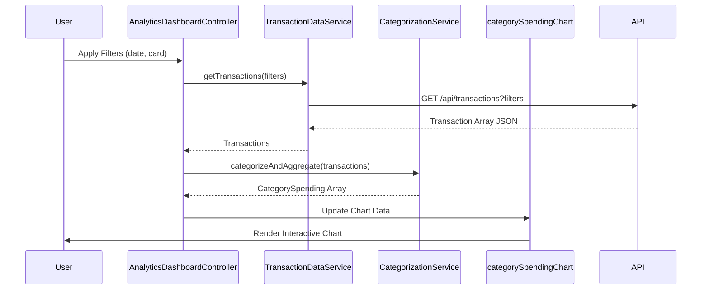

# Low-Level Design: Transaction Analytics and Category-wise Spending Insights
**Epic ID:** QE-9444

## a. Architecture Mapping

- **Module:** `creditCardApp.analytics` - Main module for transaction analytics and category insights
- **Controller:** `AnalyticsDashboardController` - Manages filter state, user interactions, and chart rendering coordination
- **Service:** `TransactionDataService` - Fetches transaction history from REST API with filtering parameters
- **Service:** `CategorizationService` - Maps transactions to predefined categories and calculates aggregated spending
- **Directive:** `categorySpendingChart` - Renders interactive pie/bar charts for category-wise breakdown
- **Factory:** `VisualizationFactory` - Configures and initializes Chart.js/D3.js instances with responsive settings

**Recommended Folder Structure:**
```
/app
  /modules
    /analytics
      /controllers
        analytics-dashboard.controller.js
      /services
        transaction-data.service.js
        categorization.service.js
      /directives
        category-spending-chart.directive.js
      /factories
        visualization.factory.js
      /views
        analytics-dashboard.html
```

## b. Component Specifications

| Component Name | Artifact Type | Responsibility | Key Dependencies |
|----------------|---------------|----------------|------------------|
| AnalyticsDashboardController | Controller | Manages filter selections (date, card, category), triggers data refresh, updates chart data | TransactionDataService, CategorizationService, $scope |
| TransactionDataService | Service | Fetches transactions from `/api/transactions` with query params for filtering | $http, $q |
| CategorizationService | Service | Groups transactions by category, calculates totals, returns aggregated spending objects | None (pure logic) |
| categorySpendingChart | Directive | Renders interactive charts using VisualizationFactory, handles drill-down events | VisualizationFactory, $timeout |
| VisualizationFactory | Factory | Provides Chart.js configuration templates and chart instance management | Chart.js library |

## c. Data Model

**Transaction Object:**
```javascript
{
  transactionId: String,
  cardId: String,
  amount: Number,
  category: String, // 'Food & Dining', 'Fuel', 'Shopping', 'Travel', 'Entertainment', 'Utilities', 'Healthcare', 'Education', 'Miscellaneous'
  merchantName: String,
  transactionDate: String, // ISO 8601
  description: String
}
```

**CategorySpending Object:**
```javascript
{
  category: String,
  totalAmount: Number,
  transactionCount: Number,
  percentageOfTotal: Number,
  transactions: Array<Transaction>
}
```

## d. Data Flow

User accesses analytics dashboard → `AnalyticsDashboardController` initializes with default filters (current month, all cards) → Controller calls `TransactionDataService.getTransactions(filters)` → Service fetches transaction data from `/api/transactions?startDate=X&endDate=Y&cardId=Z` → Raw transactions returned to controller → Controller invokes `CategorizationService.categorizeAndAggregate(transactions)` → Service groups by category and calculates totals → Controller updates `$scope.categoryData` → `categorySpendingChart` directive renders interactive pie/bar chart via `VisualizationFactory` → User changes filters or clicks chart segment → Controller refreshes data and updates visualizations.

## e. Primary Sequence Diagram



## f. Implementation Notes

- Use AngularJS DI with explicit array notation for all components to ensure minification compatibility
- Implement debouncing on filter changes using `$timeout` to avoid excessive API calls during rapid user input
- Apply `$scope.$watch` on filter model with deep comparison for automatic data refresh on filter changes
- Leverage Chart.js `onClick` handlers within directive to implement drill-down from category to transaction list
- Use `ng-if` to conditionally render chart types (pie vs bar) based on user preference or data volume

## g. Error Handling

Interceptor-based error handling with try/catch blocks in categorization logic; user notified via toast on API failures.

## h. Security Notes

Standard input validation and secure API calls assumed; token-based authentication required for all transaction data requests.