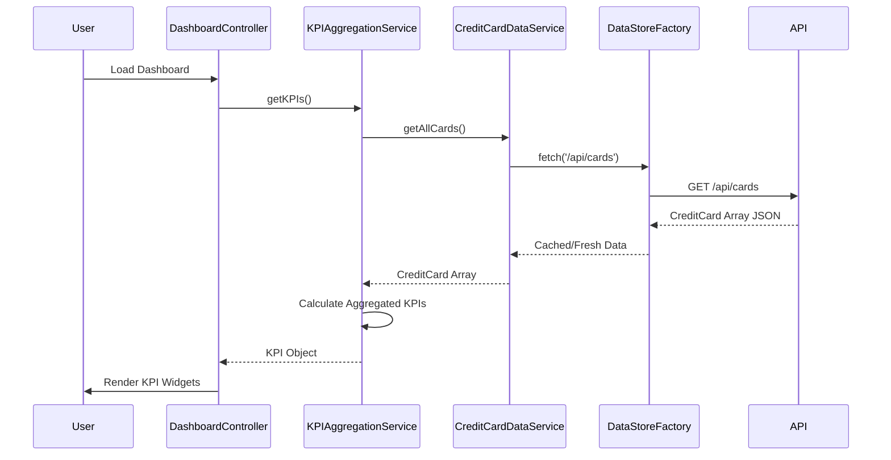

# Low-Level Design: Dashboard KPIs and Credit Card Overview
**Epic ID:** QE-9445

## a. Architecture Mapping

- **Module:** `creditCardApp.dashboard` - Main module for KPI dashboard functionality
- **Controller:** `DashboardController` - Manages KPI data loading, refresh logic, and responsive layout state
- **Service:** `KPIAggregationService` - Fetches and calculates aggregated KPIs (total spend, limit, available credit, outstanding)
- **Service:** `CreditCardDataService` - Retrieves raw card data from REST API endpoint
- **Directive:** `kpiWidget` - Renders individual KPI metric with icon, value, and trend indicator
- **Factory:** `DataStoreFactory` - Manages API calls to backend data store and implements caching strategy

**Recommended Folder Structure:**
```
/app
  /modules
    /dashboard
      /controllers
        dashboard.controller.js
      /services
        kpi-aggregation.service.js
        credit-card-data.service.js
      /directives
        kpi-widget.directive.js
      /factories
        data-store.factory.js
      /views
        dashboard.html
```

## b. Component Specifications

| Component Name | Artifact Type | Responsibility | Key Dependencies |
|----------------|---------------|----------------|------------------|
| DashboardController | Controller | Orchestrates KPI data loading, manages auto-refresh interval, handles responsive breakpoints | KPIAggregationService, $scope, $interval |
| KPIAggregationService | Service | Aggregates card data into KPIs (sum limits, calculate available credit, total outstanding) | CreditCardDataService |
| CreditCardDataService | Service | Fetches all card details from `/api/cards` endpoint | $http, $q |
| kpiWidget | Directive | Displays single KPI with formatted value, label, icon, and optional trend arrow | None (presentational) |
| DataStoreFactory | Factory | Provides centralized data access with caching and refresh logic | $http, $cacheFactory |

## c. Data Model

**KPI Object:**
```javascript
{
  monthlySpend: Number,
  totalCreditLimit: Number,
  availableCredit: Number,
  outstandingAmount: Number,
  cardCount: Number,
  lastUpdated: String // ISO 8601 timestamp
}
```

**CreditCard Object:**
```javascript
{
  cardId: String,
  cardNumber: String (masked),
  creditLimit: Number,
  currentBalance: Number,
  availableCredit: Number,
  monthlySpend: Number,
  outstandingAmount: Number
}
```

## d. Data Flow

User navigates to dashboard → `DashboardController` initializes and calls `KPIAggregationService.getKPIs()` → Service invokes `CreditCardDataService.getAllCards()` → Data service fetches from `/api/cards` via `DataStoreFactory` → Factory returns cached data if fresh, otherwise makes HTTP request → Raw card array returned to aggregation service → Service calculates total spend (sum of monthlySpend), total limit (sum of creditLimit), available credit (sum of availableCredit), outstanding (sum of outstandingAmount) → KPI object returned to controller → Controller updates `$scope.kpis` → View renders four `kpiWidget` directives with respective KPI values → Auto-refresh via `$interval` repeats flow every 60 seconds.

## e. Primary Sequence Diagram



## f. Implementation Notes

- Use AngularJS DI with explicit array notation for minification safety across all components
- Implement `$interval` service for auto-refresh with 60-second interval, canceling on `$scope.$on('$destroy')` to prevent memory leaks
- Apply Bootstrap grid system (col-xs, col-sm, col-md, col-lg) in view template for responsive KPI widget layout
- Use `$cacheFactory` in DataStoreFactory with TTL-based invalidation for optimized API call frequency
- Leverage `ng-class` in kpiWidget directive to apply conditional styling based on KPI thresholds (e.g., high utilization warning)

## g. Error Handling

HTTP interceptor handles API errors with fallback to cached data; user notified via inline error message on dashboard.

## h. Security Notes

Requires token-based auth via existing SSO; all API endpoints secured with authorization headers injected via interceptor.