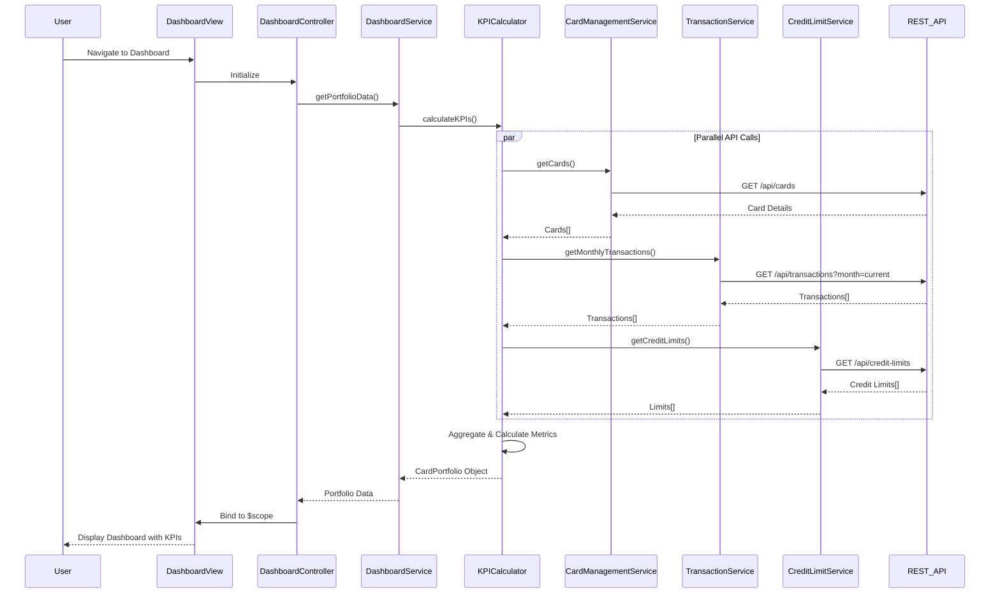

# Low-Level Design: Credit Card Portfolio Management and Dashboard KPIs
**Epic ID:** QE-9449

## a. Architecture Mapping

- **Dashboard Module** → AngularJS Module (`app.dashboard`)
- **Dashboard Controller** → AngularJS Controller (`DashboardController`)
- **Dashboard Service** → AngularJS Service (`DashboardService`)
- **KPI Calculation Engine** → AngularJS Factory (`KPICalculator`)
- **Card Management Integration** → AngularJS Service (`CardManagementService`)
- **Transaction Integration** → AngularJS Service (`TransactionService`)
- **Credit Limit Integration** → AngularJS Service (`CreditLimitService`)
- **KPI Widget** → AngularJS Directive (`kpiWidget`)
- **Card Portfolio View** → AngularJS Directive (`cardPortfolio`)

**Recommended Folder Structure:**
```
/app
  /dashboard
    dashboard.module.js
    dashboard.controller.js
    dashboard.service.js
    kpi-calculator.factory.js
  /services
    card-management.service.js
    transaction.service.js
    credit-limit.service.js
  /directives
    kpi-widget.directive.js
    card-portfolio.directive.js
  /views
    dashboard.html
```

## b. Component Specifications

| Component Name | Artifact Type | Responsibility | Key Dependencies |
|----------------|---------------|----------------|------------------|
| DashboardModule | Module | Registers dashboard components and configures routing | angular, ui.router |
| DashboardController | Controller | Orchestrates dashboard view, manages KPI refresh logic | DashboardService, $scope, $interval |
| DashboardService | Service | Coordinates KPI data retrieval and aggregation | KPICalculator, CardManagementService, TransactionService, CreditLimitService, $q |
| KPICalculator | Factory | Computes monthly spend, available credit, outstanding amounts | $filter |
| CardManagementService | Service | Fetches card details via REST API | $http, API_ENDPOINTS |
| TransactionService | Service | Fetches transaction data for spend and outstanding calculations | $http, API_ENDPOINTS |
| CreditLimitService | Service | Fetches credit limit data via REST API | $http, API_ENDPOINTS |
| kpiWidget | Directive | Renders individual KPI metric with value and label | None |
| cardPortfolio | Directive | Displays multi-card summary with card-level details | None |

## c. Data Model

**CardPortfolio (JS Object):**
```javascript
{
  cards: [
    {
      cardId: String,
      cardNumber: String (masked),
      cardType: String,
      creditLimit: Number,
      availableCredit: Number,
      outstandingAmount: Number
    }
  ],
  totalCreditLimit: Number,
  totalAvailableCredit: Number,
  totalOutstanding: Number,
  monthlySpend: Number,
  lastUpdated: Date
}
```

## d. Data Flow

User navigates to dashboard → DashboardController initializes and calls DashboardService.getPortfolioData() → DashboardService invokes KPICalculator which makes parallel REST API calls via CardManagementService, TransactionService, and CreditLimitService → Services return card details, transaction summaries, and credit limits → KPICalculator aggregates data (sums credit limits, calculates available credit, computes monthly spend from transactions) → Aggregated CardPortfolio object is returned to DashboardController → Controller binds data to $scope → View renders KPI widgets and card portfolio using directives → $interval triggers periodic refresh every 30 seconds to update KPIs in real-time.

## e. Primary Sequence Diagram



## f. Implementation Notes

- Use AngularJS 1.x module pattern with dependency injection for all services and controllers
- Implement $q.all() for parallel REST API calls to minimize load time and meet 2-second NFR
- Use $interval for 30-second auto-refresh; cancel on $scope.$on('$destroy') to prevent memory leaks
- Apply Bootstrap grid system (col-xs/sm/md/lg) for responsive layout across devices
- Implement custom directives with isolated scope for reusable KPI widgets and card portfolio components

## g. Error Handling

HTTP interceptor captures API errors; display user-friendly notifications via toastr or Bootstrap alerts; retry failed requests once before showing error.

## h. Security Notes

Requires token-based auth via existing SSO; include auth token in $http headers for all API calls.