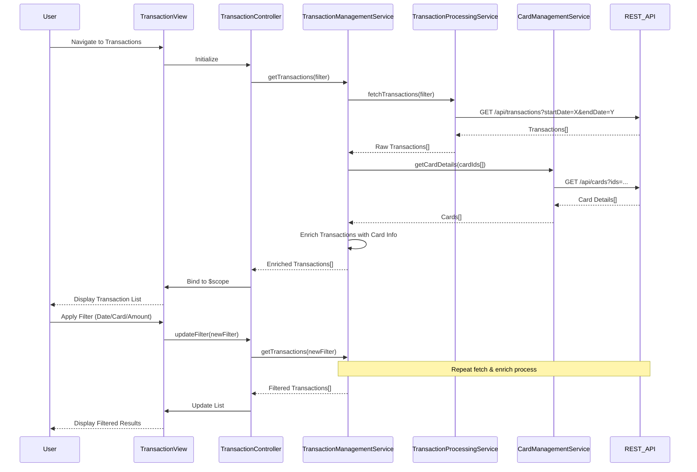

# Low-Level Design: Transaction Monitoring and Viewing
**Epic ID:** QE-9450

## a. Architecture Mapping

- **Transaction Module** → AngularJS Module (`app.transactions`)
- **Transaction Controller** → AngularJS Controller (`TransactionController`)
- **Transaction Management Service** → AngularJS Service (`TransactionManagementService`)
- **Transaction Processing Integration** → AngularJS Service (`TransactionProcessingService`)
- **Card Management Integration** → AngularJS Service (`CardManagementService`)
- **Transaction List View** → AngularJS Directive (`transactionList`)
- **Transaction Detail View** → AngularJS Directive (`transactionDetail`)
- **Filter Component** → AngularJS Directive (`transactionFilter`)

**Recommended Folder Structure:**
```
/app
  /transactions
    transactions.module.js
    transaction.controller.js
    transaction-management.service.js
  /services
    transaction-processing.service.js
    card-management.service.js
  /directives
    transaction-list.directive.js
    transaction-detail.directive.js
    transaction-filter.directive.js
  /views
    transactions.html
```

## b. Component Specifications

| Component Name | Artifact Type | Responsibility | Key Dependencies |
|----------------|---------------|----------------|------------------|
| TransactionsModule | Module | Registers transaction components and routing | angular, ui.router |
| TransactionController | Controller | Manages transaction view state, filtering, sorting | TransactionManagementService, $scope, $filter |
| TransactionManagementService | Service | Orchestrates transaction retrieval, filtering, and card association | TransactionProcessingService, CardManagementService, $q |
| TransactionProcessingService | Service | Fetches transaction data via REST API | $http, API_ENDPOINTS |
| CardManagementService | Service | Retrieves card associations for transactions | $http, API_ENDPOINTS |
| transactionList | Directive | Renders paginated transaction list with sorting | None |
| transactionDetail | Directive | Displays detailed view of selected transaction | None |
| transactionFilter | Directive | Provides UI for date range, card, amount filtering | None |

## c. Data Model

**Transaction (JS Object):**
```javascript
{
  transactionId: String,
  cardId: String,
  cardNumber: String (masked),
  merchantName: String,
  category: String,
  amount: Number,
  currency: String,
  transactionDate: Date,
  postingDate: Date,
  description: String,
  status: String
}
```

**TransactionFilter (JS Object):**
```javascript
{
  startDate: Date,
  endDate: Date,
  cardIds: Array<String>,
  minAmount: Number,
  maxAmount: Number,
  categories: Array<String>,
  sortBy: String,
  sortOrder: String
}
```

## d. Data Flow

User navigates to transaction view → TransactionController initializes and calls TransactionManagementService.getTransactions(filter) → Service queries TransactionProcessingService with filter parameters → TransactionProcessingService makes REST API call GET /api/transactions with query params → API returns transaction array → TransactionManagementService enriches transactions with card details from CardManagementService → Enriched transaction list is sorted/filtered per user criteria → Controller binds transactions to $scope → transactionList directive renders paginated table → User applies filters via transactionFilter directive → Controller updates filter object and re-fetches data → User selects transaction → transactionDetail directive displays full transaction details in modal or side panel.

## e. Primary Sequence Diagram



## f. Implementation Notes

- Use AngularJS $filter service for client-side sorting and secondary filtering after API fetch
- Implement server-side pagination with query params (page, pageSize) to handle large datasets efficiently
- Use ui-router resolve to pre-fetch transaction data before view renders for better UX
- Apply Bootstrap table-responsive class for mobile-friendly transaction list display
- Cache card details in CardManagementService using simple object map to avoid redundant API calls

## g. Error Handling

HTTP interceptor-based error handling with user notification via toast; retry logic for transient failures.

## h. Security Notes

Standard input validation and secure API calls assumed; auth token included in all requests.