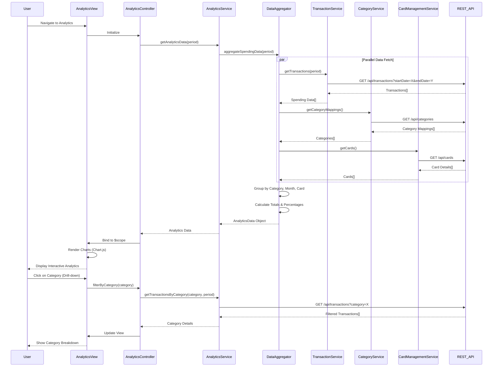

# Low-Level Design: Spending Analytics and Insights
**Epic ID:** QE-9451

## a. Architecture Mapping

- **Analytics Module** → AngularJS Module (`app.analytics`)
- **Analytics Controller** → AngularJS Controller (`AnalyticsController`)
- **Analytics Service** → AngularJS Service (`AnalyticsService`)
- **Data Aggregation Engine** → AngularJS Factory (`DataAggregator`)
- **Transaction Integration** → AngularJS Service (`TransactionService`)
- **Category Classification Integration** → AngularJS Service (`CategoryService`)
- **Card Management Integration** → AngularJS Service (`CardManagementService`)
- **Category Chart Directive** → AngularJS Directive (`categoryChart`)
- **Trend Chart Directive** → AngularJS Directive (`trendChart`)
- **Card Spend Chart Directive** → AngularJS Directive (`cardSpendChart`)

**Recommended Folder Structure:**
```
/app
  /analytics
    analytics.module.js
    analytics.controller.js
    analytics.service.js
    data-aggregator.factory.js
  /services
    transaction.service.js
    category.service.js
    card-management.service.js
  /directives
    category-chart.directive.js
    trend-chart.directive.js
    card-spend-chart.directive.js
  /views
    analytics.html
```

## b. Component Specifications

| Component Name | Artifact Type | Responsibility | Key Dependencies |
|----------------|---------------|----------------|------------------|
| AnalyticsModule | Module | Registers analytics components and routing | angular, ui.router, chart.js |
| AnalyticsController | Controller | Manages analytics view state and user interactions | AnalyticsService, $scope, $filter |
| AnalyticsService | Service | Coordinates data retrieval and aggregation for analytics | DataAggregator, TransactionService, CategoryService, CardManagementService, $q |
| DataAggregator | Factory | Aggregates transactions by category, month, and card | $filter |
| TransactionService | Service | Fetches spending data via REST API | $http, API_ENDPOINTS |
| CategoryService | Service | Retrieves category classifications via REST API | $http, API_ENDPOINTS |
| CardManagementService | Service | Fetches card-wise data via REST API | $http, API_ENDPOINTS |
| categoryChart | Directive | Renders interactive pie/donut chart for category-wise spending | Chart.js |
| trendChart | Directive | Renders line chart for monthly spend trends | Chart.js |
| cardSpendChart | Directive | Renders bar chart for card-wise spend analysis | Chart.js |

## c. Data Model

**AnalyticsData (JS Object):**
```javascript
{
  categorySpend: [
    { category: String, amount: Number, percentage: Number }
  ],
  monthlyTrend: [
    { month: String, totalSpend: Number }
  ],
  cardWiseSpend: [
    { cardId: String, cardNumber: String, totalSpend: Number }
  ],
  totalSpend: Number,
  period: { startDate: Date, endDate: Date }
}
```

**Category Enum:**
```javascript
['Food & Dining', 'Fuel', 'Shopping', 'Travel', 'Entertainment', 'Utilities', 'Healthcare', 'Education', 'Miscellaneous']
```

## d. Data Flow

User navigates to analytics view → AnalyticsController initializes and calls AnalyticsService.getAnalyticsData(period) → AnalyticsService invokes DataAggregator which makes parallel REST API calls via TransactionService, CategoryService, and CardManagementService → TransactionService returns spending data, CategoryService provides category mappings, CardManagementService returns card details → DataAggregator processes transactions, groups by category (9 predefined categories), aggregates monthly totals, and calculates card-wise spend → Aggregated AnalyticsData object is returned to AnalyticsController → Controller binds data to $scope → Chart directives (categoryChart, trendChart, cardSpendChart) render interactive visualizations using Chart.js → User applies filters (date range, card selection) via UI controls → Controller updates filter and re-fetches data → Charts update with drill-down capability to show detailed breakdowns.

## e. Primary Sequence Diagram



## f. Implementation Notes

- Use Chart.js library integrated via angular-chart.js wrapper for responsive, interactive visualizations
- Implement client-side caching in AnalyticsService with TTL (5 minutes) to meet 3-second load time for repeat views
- Use $q.all() for parallel API calls to minimize data fetch time
- Apply lodash/underscore groupBy and reduce functions in DataAggregator for efficient aggregation
- Implement drill-down via chart onClick events that trigger controller methods to fetch detailed data

## g. Error Handling

Interceptor-based error handling with graceful fallback to cached data if available; user notification on fetch failure.

## h. Security Notes

Requires token-based auth via existing SSO; all API calls include auth headers.