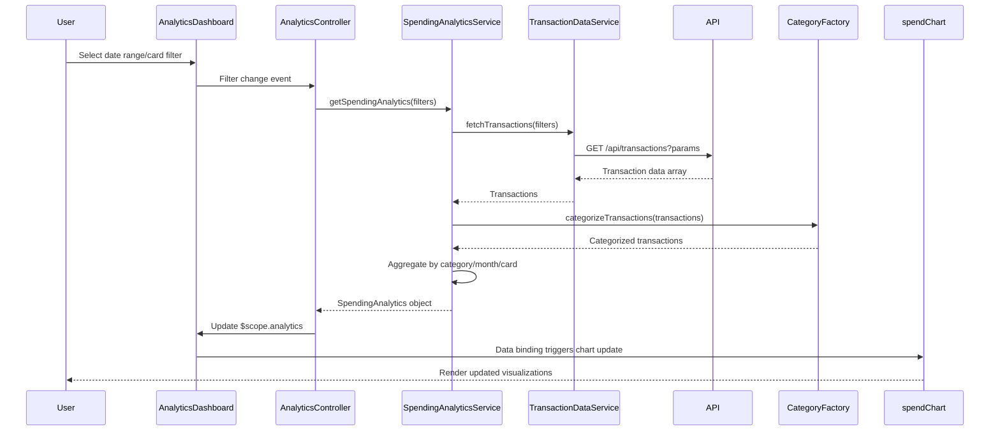

# Low-Level Design: QE-9452 - Spending Analytics and Visualization

## a. Architecture Mapping

- **Analytics Dashboard UI** → AngularJS Module (`app.analytics`) with HTML5 views and Bootstrap responsive grid
- **Analytics Controller** → AngularJS Controller (`AnalyticsController`) managing view state and user interactions
- **Spending Analytics Service** → AngularJS Service (`SpendingAnalyticsService`) for business logic and data aggregation
- **Categorization Engine** → AngularJS Factory (`CategoryFactory`) providing category classification logic
- **Visualization Renderer** → AngularJS Directive (`spendChart`) wrapping chart library (Chart.js/D3.js)
- **Transaction Data Repository** → AngularJS Service (`TransactionDataService`) handling REST API calls

**Recommended Folder Structure:**
```
app/
├── modules/analytics/
│   ├── controllers/analytics.controller.js
│   ├── services/spending-analytics.service.js
│   ├── services/transaction-data.service.js
│   ├── factories/category.factory.js
│   ├── directives/spend-chart.directive.js
│   └── views/analytics-dashboard.html
├── shared/
│   └── constants/categories.constant.js
└── app.module.js
```

## b. Component Specifications

| Component Name | Artifact Type | Responsibility | Key Dependencies |
|----------------|---------------|----------------|------------------|
| AnalyticsController | Controller | Manages analytics view state, handles user filter selections, coordinates data refresh | SpendingAnalyticsService, $scope |
| SpendingAnalyticsService | Service | Aggregates transaction data by category/card/month, calculates spending totals and trends | TransactionDataService, CategoryFactory, $q |
| TransactionDataService | Service | Fetches transaction data from REST API, caches results | $http, $q |
| CategoryFactory | Factory | Provides category definitions (9 categories), maps transactions to categories | CATEGORIES constant |
| spendChart | Directive | Renders interactive spending charts (bar/pie/line), handles chart interactions | Chart.js/D3.js library |
| CATEGORIES | Constant | Defines 9 spending categories: Food & Dining, Fuel, Shopping, Travel, Entertainment, Utilities, Healthcare, Education, Miscellaneous | None |

## c. Data Model

**SpendingAnalytics (JS Object):**
```javascript
{
  categorySpend: Array<{category: String, amount: Number, percentage: Number}>,
  monthlyTrend: Array<{month: String, amount: Number}>,
  cardWiseSpend: Array<{cardId: String, cardName: String, amount: Number}>,
  totalSpend: Number,
  period: {startDate: Date, endDate: Date}
}
```

**Transaction (JS Object):**
```javascript
{
  id: String,
  cardId: String,
  date: Date,
  amount: Number,
  merchant: String,
  category: String,
  description: String
}
```

**Category (Constant):**
```javascript
{
  code: String,
  name: String,
  icon: String
}
```

## d. Data Flow

User selects date range/card filter on Analytics Dashboard → AnalyticsController captures filter parameters and invokes SpendingAnalyticsService → Service calls TransactionDataService to fetch transactions via REST API (`GET /api/transactions?cardId=X&startDate=Y&endDate=Z`) → CategoryFactory classifies each transaction into one of 9 categories → SpendingAnalyticsService aggregates data by category, month, and card → Aggregated analytics object returned to Controller → Controller updates $scope model → spendChart directive re-renders visualizations (category pie chart, monthly trend line chart, card comparison bar chart) with updated data using two-way binding.

## e. Primary Sequence Diagram



## f. Implementation Notes

- Use AngularJS Dependency Injection to inject services and factories into controllers and directives
- Implement ES6 classes for services with arrow functions for cleaner promise chains
- Leverage $q promises for async operations; use Promise.all for parallel transaction fetching across multiple cards
- Wrap Chart.js in custom directive with isolated scope for reusable chart components
- Use Bootstrap grid system (col-md-4, col-sm-6, col-xs-12) for responsive chart layout across devices

## g. Error Handling

HTTP interceptor captures API errors; display user-friendly notifications via toast service; fallback to cached data when available.

## h. Security Notes

Requires token-based auth via existing SSO; validate card ownership before fetching transactions.