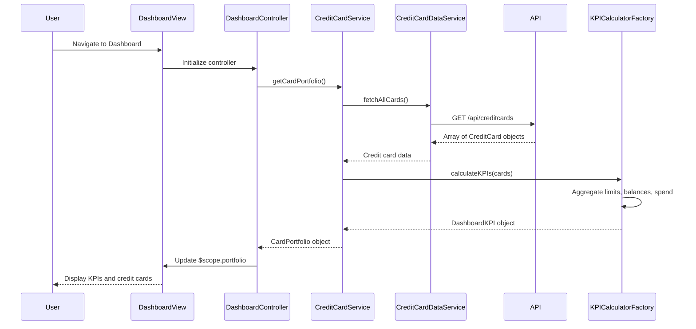

# Low-Level Design: QE-9453 - Credit Card Portfolio and KPI Dashboard

## a. Architecture Mapping

- **Dashboard UI** → AngularJS Module (`app.dashboard`) with HTML5 views and Bootstrap responsive cards
- **Dashboard Controller** → AngularJS Controller (`DashboardController`) managing KPI display and card list
- **Credit Card Service** → AngularJS Service (`CreditCardService`) for credit card data operations and business logic
- **KPI Calculation Engine** → AngularJS Factory (`KPICalculatorFactory`) computing financial metrics
- **Credit Card Data Repository** → AngularJS Service (`CreditCardDataService`) handling REST API integration

**Recommended Folder Structure:**
```
app/
├── modules/dashboard/
│   ├── controllers/dashboard.controller.js
│   ├── services/credit-card.service.js
│   ├── services/credit-card-data.service.js
│   ├── factories/kpi-calculator.factory.js
│   └── views/dashboard.html
├── shared/
│   └── components/kpi-card.component.js
└── app.module.js
```

## b. Component Specifications

| Component Name | Artifact Type | Responsibility | Key Dependencies |
|----------------|---------------|----------------|------------------|
| DashboardController | Controller | Manages dashboard state, displays credit cards and KPIs, handles refresh actions | CreditCardService, $scope |
| CreditCardService | Service | Orchestrates credit card data retrieval, invokes KPI calculations, manages card portfolio state | CreditCardDataService, KPICalculatorFactory, $q |
| CreditCardDataService | Service | Fetches credit card details, balances, and limits from REST API | $http, $q |
| KPICalculatorFactory | Factory | Calculates monthly spend, total credit limit, available credit, outstanding amount from card data | None |
| kpiCard | Component | Reusable component to display individual KPI with icon, label, and value | None |

## c. Data Model

**CreditCard (JS Object):**
```javascript
{
  cardId: String,
  cardNumber: String,
  cardName: String,
  cardType: String,
  creditLimit: Number,
  currentBalance: Number,
  availableCredit: Number,
  lastUpdated: Date
}
```

**DashboardKPI (JS Object):**
```javascript
{
  monthlySpend: Number,
  totalCreditLimit: Number,
  availableCredit: Number,
  outstandingAmount: Number
}
```

**CardPortfolio (JS Object):**
```javascript
{
  cards: Array<CreditCard>,
  kpis: DashboardKPI,
  lastRefresh: Date
}
```

## d. Data Flow

User navigates to Dashboard → DashboardController initializes and calls CreditCardService.getCardPortfolio() → CreditCardService invokes CreditCardDataService to fetch all user credit cards via REST API (`GET /api/creditcards`) → API returns array of credit card objects with balances and limits → CreditCardService passes card data to KPICalculatorFactory → Factory aggregates data to compute monthly spend (sum of current balances), total credit limit (sum of all limits), available credit (sum of available credit per card), and outstanding amount (sum of balances) → CreditCardService returns CardPortfolio object to Controller → Controller updates $scope.portfolio → View renders KPI cards using kpiCard component and displays credit card list with Bootstrap responsive grid.

## e. Primary Sequence Diagram



## f. Implementation Notes

- Use AngularJS module pattern with explicit dependency injection (array notation for minification safety)
- Implement CreditCardService as singleton service to maintain portfolio state across navigation
- Use ES6 array methods (reduce, map) in KPICalculatorFactory for efficient aggregation
- Leverage Bootstrap grid (col-lg-3 col-md-6 col-sm-12) for responsive KPI card layout
- Implement $interval for optional auto-refresh of dashboard data every 5 minutes

## g. Error Handling

HTTP interceptor catches API failures; display error toast and retry option; gracefully degrade to last known data if available.

## h. Security Notes

Requires token-based auth via existing SSO; mask card numbers in UI (show last 4 digits only).