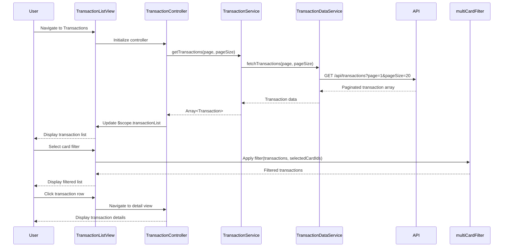

# Low-Level Design: QE-9454 - Transaction Management and Monitoring

## a. Architecture Mapping

- **Transaction View UI** → AngularJS Module (`app.transactions`) with HTML5 table/list views and Bootstrap styling
- **Transaction Controller** → AngularJS Controller (`TransactionController`) managing transaction list and detail views
- **Transaction Management Service** → AngularJS Service (`TransactionService`) for transaction operations and filtering
- **Multi-Card Filter** → AngularJS Filter (`multiCardFilter`) enabling card-based transaction filtering
- **Transaction Data Repository** → AngularJS Service (`TransactionDataService`) handling REST API calls

**Recommended Folder Structure:**
```
app/
├── modules/transactions/
│   ├── controllers/transaction.controller.js
│   ├── services/transaction.service.js
│   ├── services/transaction-data.service.js
│   ├── filters/multi-card.filter.js
│   └── views/
│       ├── transaction-list.html
│       └── transaction-detail.html
└── app.module.js
```

## b. Component Specifications

| Component Name | Artifact Type | Responsibility | Key Dependencies |
|----------------|---------------|----------------|------------------|
| TransactionController | Controller | Manages transaction list/detail views, handles pagination, card filter selection, and detail navigation | TransactionService, $scope, $routeParams |
| TransactionService | Service | Retrieves and caches transaction data, applies filters, manages transaction state | TransactionDataService, $q |
| TransactionDataService | Service | Fetches transaction history from REST API with pagination and filtering support | $http, $q |
| multiCardFilter | Filter | Filters transaction array by selected card IDs | None |

## c. Data Model

**Transaction (JS Object):**
```javascript
{
  transactionId: String,
  cardId: String,
  cardName: String,
  date: Date,
  amount: Number,
  merchant: String,
  category: String,
  description: String,
  status: String
}
```

**TransactionListState (JS Object):**
```javascript
{
  transactions: Array<Transaction>,
  selectedCardIds: Array<String>,
  pagination: {currentPage: Number, pageSize: Number, totalCount: Number},
  sortBy: String,
  sortOrder: String
}
```

## d. Data Flow

User navigates to Transaction List view → TransactionController initializes and calls TransactionService.getTransactions() → Service invokes TransactionDataService to fetch transactions via REST API (`GET /api/transactions?page=1&pageSize=20`) → API returns paginated transaction array → TransactionService caches data and returns to Controller → Controller updates $scope.transactionList → User selects card filter → multiCardFilter applied to transaction array via ng-repeat filter → Filtered transactions displayed in Bootstrap table → User clicks transaction row → Controller navigates to detail view with transactionId → Detail view displays full transaction information.

## e. Primary Sequence Diagram



## f. Implementation Notes

- Use AngularJS $routeProvider for navigation between list and detail views
- Implement pagination using Bootstrap pagination component with ng-repeat and limitTo filter
- Use ES6 arrow functions in TransactionService for cleaner promise handling
- Leverage AngularJS custom filter (multiCardFilter) for client-side card filtering with optimal performance
- Implement infinite scroll as optional enhancement using ng-infinite-scroll directive

## g. Error Handling

HTTP interceptor catches API errors; display error message with retry button; maintain last successful transaction list in cache.

## h. Security Notes

Requires token-based auth via existing SSO; validate user owns requested cards before displaying transactions.