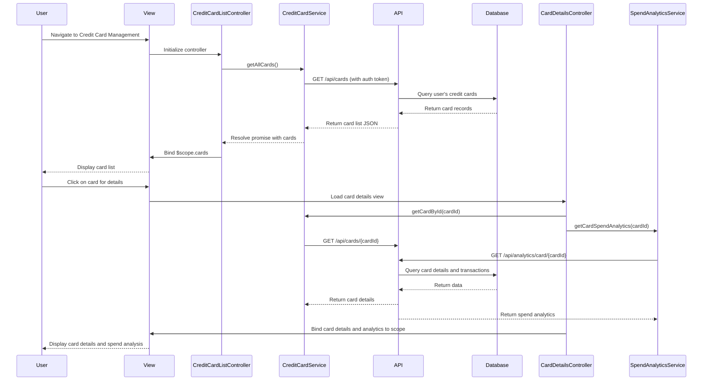

# Low-Level Design: Credit Card Management and Tracking
**Epic ID:** QE-9473  
**Application Stack:** AngularJS 1.x, JavaScript ES6, HTML5, CSS3, Bootstrap, REST APIs, MVC Architecture

---

## a. Architecture Mapping

- **Credit Card Management UI** → AngularJS Module (`creditCardModule`) + Controller (`CreditCardListController`, `CardDetailsController`)
- **Card List Display** → AngularJS View (HTML template) + Directive (`cardListDirective`)
- **Card Data Retrieval** → AngularJS Service (`CreditCardService`) calling REST API
- **Card-wise Spend Analysis** → AngularJS Controller (`CardAnalyticsController`) + Service (`SpendAnalyticsService`)
- **User Authentication** → AngularJS Factory (`AuthFactory`) with token-based authentication
- **Card Selection/Filtering** → AngularJS Filter (`cardFilter`) + Controller logic

**Recommended Folder Structure:**
```
app/
├── modules/
│   └── creditCard/
│       ├── controllers/
│       │   ├── CreditCardListController.js
│       │   ├── CardDetailsController.js
│       │   └── CardAnalyticsController.js
│       ├── services/
│       │   ├── CreditCardService.js
│       │   └── SpendAnalyticsService.js
│       ├── directives/
│       │   └── cardListDirective.js
│       ├── filters/
│       │   └── cardFilter.js
│       ├── views/
│       │   ├── card-list.html
│       │   └── card-details.html
│       └── creditCardModule.js
├── shared/
│   └── factories/
│       └── AuthFactory.js
└── app.js
```

---

## b. Component Specifications

| Component Name | Artifact Type | Responsibility | Key Dependencies |
|---|---|---|---|
| `creditCardModule` | Module | Root module for credit card management features | `ngRoute`, `AuthFactory` |
| `CreditCardListController` | Controller | Manages card list display, fetches all user cards, handles card selection | `CreditCardService`, `$scope` |
| `CardDetailsController` | Controller | Displays individual card details, credit limit, balance, and card-specific spending | `CreditCardService`, `SpendAnalyticsService`, `$routeParams` |
| `CardAnalyticsController` | Controller | Handles card-wise spend analysis and visualization | `SpendAnalyticsService`, `$scope` |
| `CreditCardService` | Service | Fetches card data from REST API, manages card CRUD operations | `$http`, `AuthFactory` |
| `SpendAnalyticsService` | Service | Retrieves and calculates card-wise spending data from transaction API | `$http`, `$q` |
| `cardListDirective` | Directive | Renders card list with card thumbnails, limits, and balances | `CreditCardService` |
| `cardFilter` | Filter | Filters cards by type, status, or search term | None |
| `AuthFactory` | Factory | Manages authentication tokens and secure API calls | `$window`, `$http` |

---

## c. Data Model

**CreditCard Object:**
```javascript
{
  cardId: String,
  cardNumber: String,        // Masked (e.g., "**** **** **** 1234")
  cardHolderName: String,
  cardType: String,          // "Visa", "MasterCard", "Amex"
  creditLimit: Number,
  availableCredit: Number,
  outstandingBalance: Number,
  expiryDate: String,        // "MM/YY"
  status: String             // "Active", "Blocked", "Expired"
}
```

**CardSpendAnalytics Object:**
```javascript
{
  cardId: String,
  monthlySpend: Number,
  totalTransactions: Number,
  categoryBreakdown: Array   // [{category: String, amount: Number}]
}
```

---

## d. Data Flow

User navigates to the Credit Card Management view → `CreditCardListController` initializes and calls `CreditCardService.getAllCards()` → Service sends GET request to `/api/cards` with auth token → API returns card list → Controller binds data to `$scope.cards` → View renders card list using `cardListDirective` → User selects a card → `CardDetailsController` fetches card details and spending data via `CreditCardService` and `SpendAnalyticsService` → Services call `/api/cards/{cardId}` and `/api/analytics/card/{cardId}` → Data is bound to scope → View updates with card details and spend analysis.

---

## e. Primary Sequence Diagram



---

## f. Implementation Notes

- Use AngularJS Dependency Injection to inject `CreditCardService`, `SpendAnalyticsService`, and `AuthFactory` into controllers.
- Implement `$http` interceptor in `AuthFactory` to attach authentication tokens to all API requests automatically.
- Use `$routeProvider` in `creditCardModule` to define routes for card list (`/cards`) and card details (`/cards/:cardId`).
- Apply Bootstrap grid system and card components for responsive card list layout across devices.
- Use AngularJS `$q` service in `SpendAnalyticsService` to handle multiple parallel API calls and aggregate results.

---

## g. Error Handling

HTTP interceptor-based error handling with user-friendly notifications via AngularJS `$exceptionHandler` and toast/alert service for API failures.

---

## h. Security Notes

Requires token-based authentication via existing SSO; all card data transmitted over HTTPS with encrypted storage of sensitive card information.

---

**End of LLD for QE-9473**