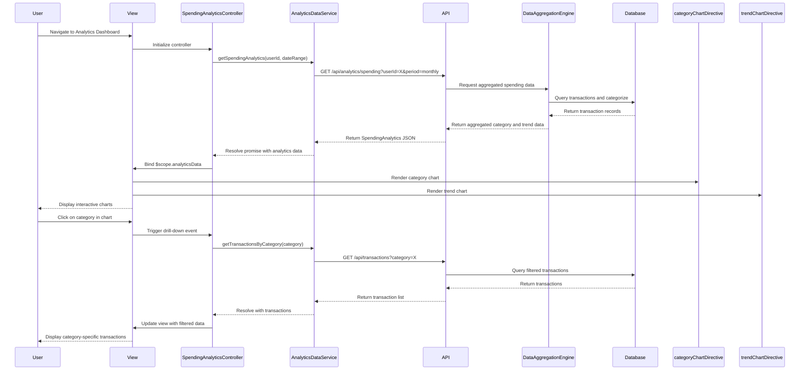

# Low-Level Design: Analytics and Spending Insights
**Epic ID:** QE-9474  
**Application Stack:** AngularJS 1.x, JavaScript ES6, HTML5, CSS3, Bootstrap, REST APIs, MVC Architecture

---

## a. Architecture Mapping

- **Analytics UI with Charts** → AngularJS Module (`analyticsModule`) + Controller (`SpendingAnalyticsController`, `CategoryChartController`)
- **Category-wise Spending Visualization** → AngularJS Directive (`categoryChartDirective`) using Chart.js
- **Monthly Spend Trend Analysis** → AngularJS Controller (`TrendAnalyticsController`) + Directive (`trendChartDirective`)
- **Data Aggregation** → AngularJS Service (`AnalyticsDataService`) calling REST API
- **Transaction Categorization** → AngularJS Service (`TransactionService`) for fetching categorized transactions
- **Filtering and Drill-down** → AngularJS Filter (`categoryFilter`, `dateRangeFilter`) + Controller logic

**Recommended Folder Structure:**
```
app/
├── modules/
│   └── analytics/
│       ├── controllers/
│       │   ├── SpendingAnalyticsController.js
│       │   ├── CategoryChartController.js
│       │   └── TrendAnalyticsController.js
│       ├── services/
│       │   ├── AnalyticsDataService.js
│       │   └── TransactionService.js
│       ├── directives/
│       │   ├── categoryChartDirective.js
│       │   └── trendChartDirective.js
│       ├── filters/
│       │   ├── categoryFilter.js
│       │   └── dateRangeFilter.js
│       ├── views/
│       │   ├── analytics-dashboard.html
│       │   └── category-breakdown.html
│       └── analyticsModule.js
└── app.js
```

---

## b. Component Specifications

| Component Name | Artifact Type | Responsibility | Key Dependencies |
|---|---|---|---|
| `analyticsModule` | Module | Root module for analytics and spending insights features | `ngRoute`, `chart.js` |
| `SpendingAnalyticsController` | Controller | Manages overall analytics dashboard, fetches spending data, coordinates chart rendering | `AnalyticsDataService`, `$scope` |
| `CategoryChartController` | Controller | Handles category-wise spending chart data and interactions | `AnalyticsDataService`, `$scope` |
| `TrendAnalyticsController` | Controller | Manages monthly spend trend visualization and filtering | `AnalyticsDataService`, `TransactionService`, `$scope` |
| `AnalyticsDataService` | Service | Fetches aggregated spending data from REST API, caches results | `$http`, `$q` |
| `TransactionService` | Service | Retrieves categorized transaction data from API | `$http` |
| `categoryChartDirective` | Directive | Renders interactive pie/bar chart for category-wise spending using Chart.js | `AnalyticsDataService` |
| `trendChartDirective` | Directive | Renders line chart for monthly spend trends | `AnalyticsDataService` |
| `categoryFilter` | Filter | Filters transactions by spending category | None |
| `dateRangeFilter` | Filter | Filters data by date range for drill-down analysis | None |

---

## c. Data Model

**CategorySpending Object:**
```javascript
{
  category: String,          // "Food & Dining", "Fuel", "Shopping", etc.
  totalAmount: Number,
  transactionCount: Number,
  percentage: Number         // Percentage of total spend
}
```

**MonthlyTrend Object:**
```javascript
{
  month: String,             // "2024-01", "2024-02", etc.
  totalSpend: Number,
  categoryBreakdown: Array   // [{category: String, amount: Number}]
}
```

**SpendingAnalytics Object:**
```javascript
{
  userId: String,
  period: String,            // "monthly", "yearly"
  categories: Array,         // Array of CategorySpending objects
  trends: Array              // Array of MonthlyTrend objects
}
```

---

## d. Data Flow

User navigates to Analytics Dashboard → `SpendingAnalyticsController` initializes and calls `AnalyticsDataService.getSpendingAnalytics()` → Service sends GET request to `/api/analytics/spending` with date range and user ID → API aggregates transaction data by category and returns JSON → Service resolves promise and caches data → Controller binds data to `$scope.analyticsData` → View renders category charts via `categoryChartDirective` and trend charts via `trendChartDirective` → User interacts with chart (e.g., clicks category) → Controller applies `categoryFilter` and updates view with filtered transactions → UI updates dynamically.

---

## e. Primary Sequence Diagram



---

## f. Implementation Notes

- Use Chart.js library integrated via AngularJS directive for rendering responsive pie, bar, and line charts.
- Implement AngularJS `$http` service with caching enabled in `AnalyticsDataService` to minimize redundant API calls.
- Use ES6 arrow functions and `const`/`let` for cleaner service and controller code.
- Apply Bootstrap responsive grid for chart layout; ensure charts resize dynamically using Chart.js responsive configuration.
- Leverage AngularJS two-way data binding to update charts in real-time when filters are applied.

---

## g. Error Handling

Interceptor-based error handling with try/catch in service methods; display user-friendly error messages via toast notifications on chart load failures.

---

## h. Security Notes

Standard input validation and secure API calls assumed; analytics data access restricted by authenticated user session.

---

**End of LLD for QE-9474**