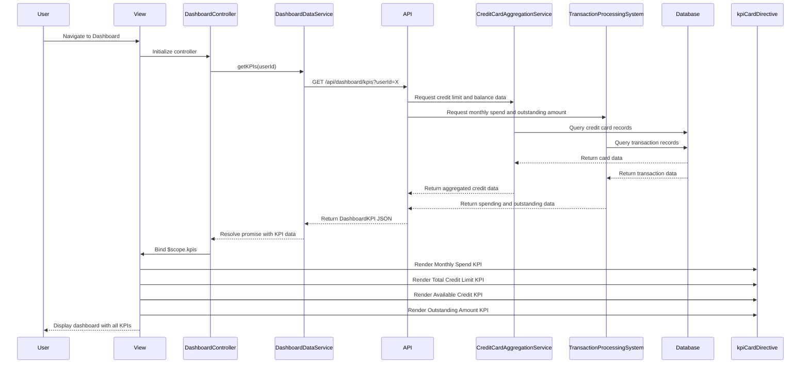

# Low-Level Design: Dashboard and KPI Management
**Epic ID:** QE-9475  
**Application Stack:** AngularJS 1.x, JavaScript ES6, HTML5, CSS3, Bootstrap, REST APIs, MVC Architecture

---

## a. Architecture Mapping

- **Dashboard UI Layer** → AngularJS Module (`dashboardModule`) + Controller (`DashboardController`)
- **Monthly Spend KPI** → AngularJS Directive (`kpiCardDirective`) bound to controller data
- **Total Credit Limit KPI** → AngularJS Directive (`kpiCardDirective`) bound to controller data
- **Available Credit KPI** → AngularJS Directive (`kpiCardDirective`) bound to controller data
- **Outstanding Amount KPI** → AngularJS Directive (`kpiCardDirective`) bound to controller data
- **Data Aggregation** → AngularJS Service (`DashboardDataService`) calling REST API
- **Real-time Data Refresh** → AngularJS Service (`DataRefreshService`) with `$interval`

**Recommended Folder Structure:**
```
app/
├── modules/
│   └── dashboard/
│       ├── controllers/
│       │   └── DashboardController.js
│       ├── services/
│       │   ├── DashboardDataService.js
│       │   └── DataRefreshService.js
│       ├── directives/
│       │   └── kpiCardDirective.js
│       ├── views/
│       │   └── dashboard.html
│       └── dashboardModule.js
└── app.js
```

---

## b. Component Specifications

| Component Name | Artifact Type | Responsibility | Key Dependencies |
|---|---|---|---|
| `dashboardModule` | Module | Root module for dashboard and KPI management | `ngRoute` |
| `DashboardController` | Controller | Fetches and manages KPI data, coordinates data refresh, binds data to view | `DashboardDataService`, `DataRefreshService`, `$scope` |
| `DashboardDataService` | Service | Fetches aggregated KPI data from REST API, caches results | `$http`, `$q` |
| `DataRefreshService` | Service | Manages periodic data refresh using `$interval` for near-real-time updates | `$interval`, `DashboardDataService` |
| `kpiCardDirective` | Directive | Renders individual KPI card with title, value, and icon; reusable across all KPIs | None |

---

## c. Data Model

**DashboardKPI Object:**
```javascript
{
  monthlySpend: Number,
  totalCreditLimit: Number,
  availableCredit: Number,
  outstandingAmount: Number,
  lastUpdated: String        // ISO timestamp
}
```

---

## d. Data Flow

User navigates to Dashboard → `DashboardController` initializes and calls `DashboardDataService.getKPIs()` → Service sends GET request to `/api/dashboard/kpis` with user ID → API aggregates data from credit card and transaction systems → API returns KPI JSON → Service resolves promise and caches data → Controller binds data to `$scope.kpis` → View renders four KPI cards using `kpiCardDirective` → `DataRefreshService` triggers periodic refresh every 5 minutes via `$interval` → Service re-fetches KPI data → Controller updates `$scope.kpis` → View updates dynamically.

---

## e. Primary Sequence Diagram



---

## f. Implementation Notes

- Use AngularJS Dependency Injection to inject `DashboardDataService` and `DataRefreshService` into `DashboardController`.
- Implement `$http` service with caching in `DashboardDataService` to optimize repeated API calls.
- Use `$interval` in `DataRefreshService` to poll `/api/dashboard/kpis` every 5-15 minutes for near-real-time updates.
- Apply Bootstrap grid system (e.g., `col-md-3`) for responsive KPI card layout across desktop, tablet, and mobile.
- Use reusable `kpiCardDirective` with isolated scope to render each KPI with dynamic title, value, and icon.

---

## g. Error Handling

Interceptor-based error handling with user notification via toast/alert on API failure; fallback to cached KPI data if refresh fails.

---

## h. Security Notes

Requires token-based auth via existing SSO; all KPI data transmitted over HTTPS with user session validation.

---

**End of LLD for QE-9475**