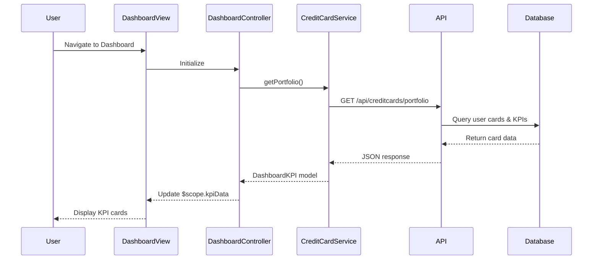

# Low-Level Design: Dashboard KPIs and Credit Card Overview
**Epic ID:** QE-9476  
**Tech Stack:** AngularJS 1.x, JavaScript ES6, HTML5, CSS3, Bootstrap, REST APIs, MVC Architecture

---

## a. Architecture Mapping

- **Dashboard Module** → AngularJS Module (`creditCard.dashboard`)
- **Dashboard Controller** → AngularJS Controller (`DashboardController`)
- **Credit Card Data Service** → AngularJS Service (`CreditCardService`)
- **Authentication Service** → AngularJS Service (`AuthService`)
- **Dashboard View** → HTML5 template with Bootstrap responsive grid

**Folder Structure:**
```
/app
  /modules
    /dashboard
      dashboard.module.js
      dashboard.controller.js
      dashboard.html
  /services
    creditCard.service.js
    auth.service.js
  /models
    creditCard.model.js
```

---

## b. Component Specifications

| Component Name | Artifact Type | Responsibility | Key Dependencies |
|---|---|---|---|
| `creditCard.dashboard` | Module | Declares dashboard module and routes | `ngRoute`, `creditCard.services` |
| `DashboardController` | Controller | Manages dashboard state, fetches KPI data, handles user interactions | `CreditCardService`, `$scope` |
| `CreditCardService` | Service | Fetches credit card portfolio data via REST API, caches card details | `$http`, `$q`, `AuthService` |
| `AuthService` | Service | Manages user authentication and session tokens | `$http`, `$window` |
| `dashboard.html` | View Template | Renders KPI cards (Monthly Spend, Credit Limit, Available Credit, Outstanding) with Bootstrap grid | `DashboardController` |

---

## c. Data Model

**CreditCard Model:**
```javascript
{
  cardId: String,
  cardNumber: String,
  cardType: String,
  creditLimit: Number,
  availableCredit: Number,
  outstandingAmount: Number,
  monthlySpend: Number,
  lastUpdated: Date
}
```

**DashboardKPI Model:**
```javascript
{
  totalCreditLimit: Number,
  totalAvailableCredit: Number,
  totalOutstanding: Number,
  currentMonthSpend: Number,
  cards: Array<CreditCard>
}
```

---

## d. Data Flow

User accesses dashboard → `AuthService` validates session → `DashboardController` initializes and calls `CreditCardService.getPortfolio()` → Service sends GET request to `/api/creditcards/portfolio` → Backend returns aggregated KPI data and card list → Service transforms response into `DashboardKPI` model → Controller updates `$scope.kpiData` → View renders KPI cards using Bootstrap responsive grid with two-way data binding → User sees real-time portfolio overview across all cards.

---

## e. Primary Sequence Diagram



---

## f. Implementation Notes

- Use AngularJS Dependency Injection to inject `CreditCardService` and `AuthService` into `DashboardController`
- Implement REST API calls using `$http` service with promise-based error handling
- Apply Bootstrap grid system (col-xs-12, col-sm-6, col-md-3) for responsive KPI card layout
- Use AngularJS `$q` service for promise chaining and aggregating multiple API calls if needed
- Implement controller-as syntax for cleaner scope management and ES6 class-based controllers

---

## g. Error Handling

HTTP interceptor captures API errors; controller displays user-friendly error messages via Bootstrap alerts with retry option.

---

## h. Security Notes

Requires token-based authentication via existing SSO; AuthService manages JWT tokens in session storage with secure API calls.

---