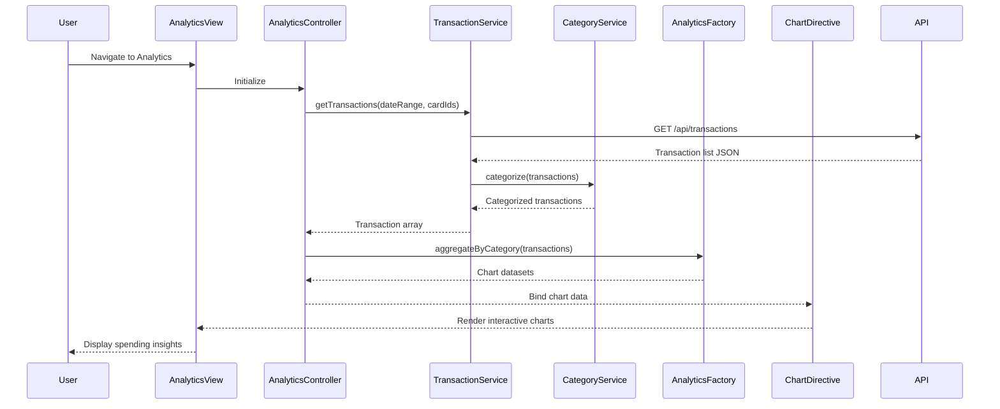

# Low-Level Design: Spending Analytics and Insights
**Epic ID:** QE-9477  
**Tech Stack:** AngularJS 1.x, JavaScript ES6, HTML5, CSS3, Bootstrap, REST APIs, MVC Architecture

---

## a. Architecture Mapping

- **Analytics Module** → AngularJS Module (`creditCard.analytics`)
- **Analytics Controller** → AngularJS Controller (`AnalyticsController`)
- **Transaction Data Service** → AngularJS Service (`TransactionService`)
- **Analytics Engine** → AngularJS Factory (`AnalyticsFactory`)
- **Category Classification Service** → AngularJS Service (`CategoryService`)
- **Chart Directive** → AngularJS Directive (`spendingChart`)

**Folder Structure:**
```
/app
  /modules
    /analytics
      analytics.module.js
      analytics.controller.js
      analytics.html
  /services
    transaction.service.js
    category.service.js
  /factories
    analytics.factory.js
  /directives
    spendingChart.directive.js
  /models
    transaction.model.js
```

---

## b. Component Specifications

| Component Name | Artifact Type | Responsibility | Key Dependencies |
|---|---|---|---|
| `creditCard.analytics` | Module | Declares analytics module and routes | `ngRoute`, `chart.js`, `creditCard.services` |
| `AnalyticsController` | Controller | Manages analytics state, triggers data aggregation, handles chart interactions | `TransactionService`, `AnalyticsFactory`, `$scope` |
| `TransactionService` | Service | Fetches transaction data via REST API for specified date ranges and cards | `$http`, `$q` |
| `CategoryService` | Service | Classifies transactions into 9 predefined categories | `TransactionService` |
| `AnalyticsFactory` | Factory | Aggregates transaction data by category, month, and card; prepares chart datasets | `CategoryService` |
| `spendingChart` | Directive | Renders interactive charts using Chart.js library with responsive behavior | `AnalyticsFactory` |

---

## c. Data Model

**Transaction Model:**
```javascript
{
  transactionId: String,
  cardId: String,
  amount: Number,
  merchant: String,
  category: String,
  date: Date,
  description: String
}
```

**CategorySpend Model:**
```javascript
{
  category: String,
  totalAmount: Number,
  transactionCount: Number,
  percentage: Number
}
```

**MonthlyTrend Model:**
```javascript
{
  month: String,
  totalSpend: Number,
  categoryBreakdown: Array<CategorySpend>
}
```

---

## d. Data Flow

User accesses analytics dashboard → `AnalyticsController` calls `TransactionService.getTransactions(dateRange, cardIds)` → Service requests GET `/api/transactions?from=X&to=Y&cards=Z` → Backend returns transaction list → `CategoryService` categorizes each transaction into one of 9 categories → `AnalyticsFactory` aggregates data by category, month, and card → Factory generates chart-ready datasets → `spendingChart` directive renders interactive Chart.js visualizations (pie for category, line for monthly trend, bar for card-wise) → User interacts with responsive charts to explore spending insights.

---

## e. Primary Sequence Diagram



---

## f. Implementation Notes

- Use Chart.js library integrated via AngularJS directive for interactive, responsive visualizations
- Implement `AnalyticsFactory` with ES6 classes for data aggregation logic using Array.reduce() and Map structures
- Use AngularJS `$http` with promise chaining for sequential API calls (transactions → categorization → aggregation)
- Apply Bootstrap responsive utilities to ensure charts adapt to mobile, tablet, and desktop viewports
- Leverage AngularJS watchers in directive to update charts dynamically when date range or card selection changes

---

## g. Error Handling

HTTP interceptor with try/catch in service layer; user notified via Bootstrap toast notifications on data fetch failures.

---

## h. Security Notes

Standard input validation and secure API calls assumed; category classification performed client-side on authenticated user data.

---