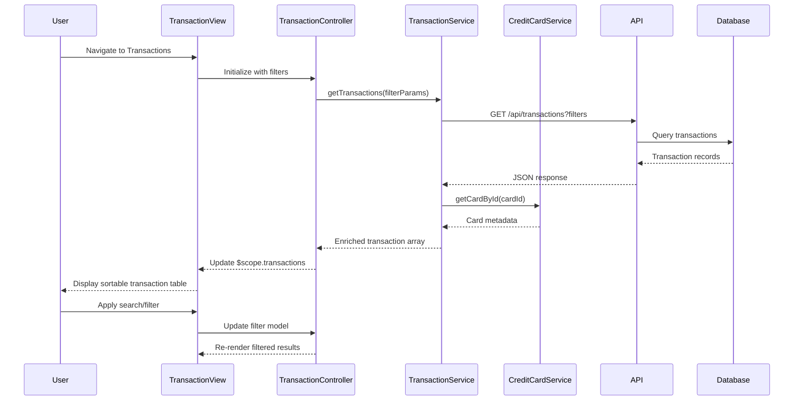

# Low-Level Design: Transaction Management and Viewing
**Epic ID:** QE-9478  
**Tech Stack:** AngularJS 1.x, JavaScript ES6, HTML5, CSS3, Bootstrap, REST APIs, MVC Architecture

---

## a. Architecture Mapping

- **Transaction Management Module** → AngularJS Module (`creditCard.transactions`)
- **Transaction Controller** → AngularJS Controller (`TransactionController`)
- **Transaction Data Service** → AngularJS Service (`TransactionService`)
- **Credit Card Service** → AngularJS Service (`CreditCardService`)
- **Transaction Filter** → AngularJS Filter (`transactionFilter`)
- **Transaction List View** → HTML5 template with Bootstrap table

**Folder Structure:**
```
/app
  /modules
    /transactions
      transactions.module.js
      transactions.controller.js
      transactions.html
      transactionDetail.html
  /services
    transaction.service.js
    creditCard.service.js
  /filters
    transaction.filter.js
  /models
    transaction.model.js
```

---

## b. Component Specifications

| Component Name | Artifact Type | Responsibility | Key Dependencies |
|---|---|---|---|
| `creditCard.transactions` | Module | Declares transaction module and routes for list and detail views | `ngRoute`, `creditCard.services` |
| `TransactionController` | Controller | Manages transaction list state, handles search/filter, navigates to detail view | `TransactionService`, `CreditCardService`, `$scope`, `$routeParams` |
| `TransactionService` | Service | Fetches transaction history via REST API, supports filtering by date/amount/merchant/category | `$http`, `$q` |
| `CreditCardService` | Service | Provides card metadata to associate transactions with specific cards | `$http` |
| `transactionFilter` | Filter | Client-side filtering logic for search term matching across transaction attributes | None |
| `transactions.html` | View Template | Renders sortable Bootstrap table with search input and filter controls | `TransactionController` |

---

## c. Data Model

**Transaction Model:**
```javascript
{
  transactionId: String,
  cardId: String,
  cardName: String,
  amount: Number,
  merchant: String,
  category: String,
  date: Date,
  description: String,
  status: String
}
```

**TransactionFilter Model:**
```javascript
{
  searchTerm: String,
  dateFrom: Date,
  dateTo: Date,
  cardId: String,
  minAmount: Number,
  maxAmount: Number
}
```

---

## d. Data Flow

User navigates to transaction list → `TransactionController` initializes and calls `TransactionService.getTransactions(filterParams)` → Service sends GET request to `/api/transactions?cardId=X&from=Y&to=Z` → Backend returns transaction array → Service enriches transactions with card names via `CreditCardService.getCardById()` → Controller updates `$scope.transactions` → View renders sortable Bootstrap table with search input → User applies filters or search term → `transactionFilter` updates displayed results client-side → User clicks transaction row → Controller navigates to detail view with `transactionId` route parameter.

---

## e. Primary Sequence Diagram



---

## f. Implementation Notes

- Use AngularJS `ng-repeat` with `orderBy` and custom `transactionFilter` for client-side sorting and filtering
- Implement `TransactionService` with caching strategy using `$cacheFactory` to minimize redundant API calls
- Apply Bootstrap table-responsive class for mobile-friendly transaction list display
- Use AngularJS `$routeParams` to pass `transactionId` to detail view and fetch individual transaction details
- Leverage ES6 template literals for dynamic API endpoint construction with filter parameters

---

## g. Error Handling

Interceptor-based error handling with user notification via Bootstrap modal on API failures; retry mechanism for failed requests.

---

## h. Security Notes

Requires token-based auth via existing SSO; transaction data filtered server-side by authenticated user context.

---