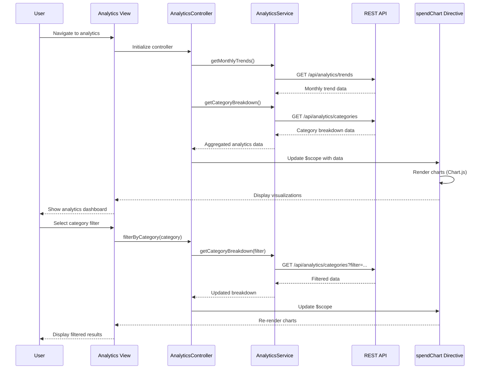

# Low-Level Design: QE-9485 - Analytics and Spending Insights

## a. Architecture Mapping

- **Analytics Dashboard Module** → AngularJS Module (`app.analytics`)
- **Analytics Controller** → AngularJS Controller (`AnalyticsController`) - manages dashboard state and user interactions
- **Analytics Service** → AngularJS Service (`AnalyticsService`) - handles API calls to Analytics Engine
- **Category Filter Directive** → AngularJS Directive (`categoryFilter`) - provides category selection UI
- **Chart Visualization Directive** → AngularJS Directive (`spendChart`) - renders interactive charts using Chart.js
- **Transaction Repository** → REST API integration via `$http` service

**Recommended Folder Structure:**
```
/app
  /analytics
    analytics.module.js
    analytics.controller.js
    analytics.service.js
    /directives
      category-filter.directive.js
      spend-chart.directive.js
    /views
      analytics-dashboard.html
```

## b. Component Specifications

| Name | Artifact Type | Responsibility | Key Dependencies |
|------|---------------|----------------|------------------|
| AnalyticsModule | Module | Registers analytics feature components and routes | angular, angular-route, chart.js |
| AnalyticsController | Controller | Manages analytics dashboard state, handles user interactions for category/period selection | AnalyticsService, $scope |
| AnalyticsService | Service | Fetches transaction data, aggregates by category, retrieves monthly trends via REST API | $http, $q, API_CONFIG |
| categoryFilter | Directive | Renders category selection UI with 9 predefined categories | $scope |
| spendChart | Directive | Renders interactive bar/line charts for spending visualization | Chart.js, $scope |
| TransactionAPI | REST Endpoint | Provides transaction data with category and date filters | Backend Analytics Engine |

## c. Data Model

**SpendingAnalytics (JS Object):**
```javascript
{
  userId: String,
  monthlyTrends: Array<{month: String, totalSpend: Number}>,
  categoryBreakdown: Array<{
    category: String, // 'Food & Dining', 'Fuel', 'Shopping', 'Travel', 'Entertainment', 'Utilities', 'Healthcare', 'Education', 'Miscellaneous'
    amount: Number,
    percentage: Number,
    transactionCount: Number
  }>,
  selectedPeriod: {startDate: Date, endDate: Date},
  selectedCategories: Array<String>
}
```

**Transaction (JS Object):**
```javascript
{
  transactionId: String,
  cardId: String,
  amount: Number,
  category: String,
  date: Date,
  merchant: String,
  description: String
}
```

## d. Data Flow

User accesses the analytics dashboard view which loads AnalyticsController. The controller initializes by calling AnalyticsService.getMonthlyTrends() and AnalyticsService.getCategoryBreakdown(), which make REST API calls to /api/analytics/trends and /api/analytics/categories respectively. The service receives aggregated transaction data from the backend Analytics Engine, which has pre-categorized transactions across 9 categories. The controller updates $scope with the returned data, triggering the spendChart directive to render interactive visualizations using Chart.js. When users interact with categoryFilter directive to select specific categories or time periods, the controller invokes AnalyticsService with updated filters, fetches refined data, and updates the UI with new visualizations.

## e. Primary Sequence Diagram



## f. Implementation Notes

- Use AngularJS Dependency Injection to inject AnalyticsService into AnalyticsController for testability and modularity
- Implement ES6 classes for services and controllers where compatible with AngularJS 1.x; use arrow functions for callbacks
- Integrate Chart.js via custom AngularJS directive with two-way data binding to $scope for reactive chart updates
- Use $http interceptors for centralized API error handling and loading state management
- Implement client-side caching in AnalyticsService using $cacheFactory to reduce redundant API calls for frequently accessed analytics data

## g. Error Handling

HTTP interceptor-based error handling with user-friendly notifications via Bootstrap modals/alerts for API failures; try/catch blocks in service layer for data transformation errors.

## h. Security Notes

Requires token-based auth via existing SSO; API endpoints validate user authorization before returning transaction data.