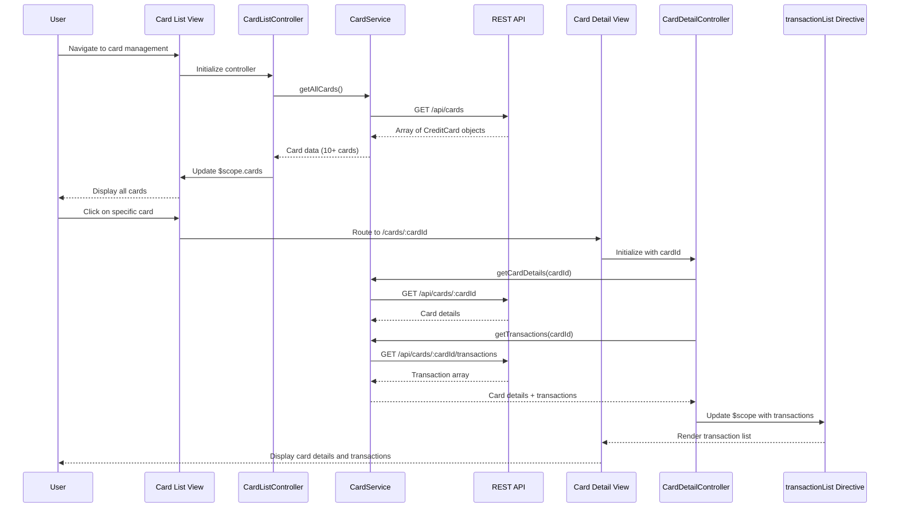

# Low-Level Design: QE-9486 - Multiple Credit Card Management

## a. Architecture Mapping

- **Card Management Module** → AngularJS Module (`app.cardManagement`)
- **Card List Controller** → AngularJS Controller (`CardListController`) - manages card list display and selection
- **Card Detail Controller** → AngularJS Controller (`CardDetailController`) - manages individual card detail view
- **Card Service** → AngularJS Service (`CardService`) - handles API calls for card data and transactions
- **Card Comparison Directive** → AngularJS Directive (`cardComparison`) - renders side-by-side card comparison UI
- **Transaction List Directive** → AngularJS Directive (`transactionList`) - displays paginated transaction history per card

**Recommended Folder Structure:**
```
/app
  /card-management
    card-management.module.js
    card-list.controller.js
    card-detail.controller.js
    card.service.js
    /directives
      card-comparison.directive.js
      transaction-list.directive.js
    /views
      card-list.html
      card-detail.html
```

## b. Component Specifications

| Name | Artifact Type | Responsibility | Key Dependencies |
|------|---------------|----------------|------------------|
| CardManagementModule | Module | Registers card management components and routing | angular, angular-route |
| CardListController | Controller | Manages list of all user cards, handles filtering and selection | CardService, $scope, $location |
| CardDetailController | Controller | Manages single card detail view with spend analysis and transactions | CardService, $scope, $routeParams |
| CardService | Service | Fetches card data, transaction history, performs card-wise spend calculations via REST API | $http, $q, API_CONFIG |
| cardComparison | Directive | Renders comparison table for multiple selected cards | $scope |
| transactionList | Directive | Displays paginated transaction list with sorting and filtering | $scope, $filter |
| CardAPI | REST Endpoint | Provides card details, balances, and transaction history | Backend Card Management Service |

## c. Data Model

**CreditCard (JS Object):**
```javascript
{
  cardId: String,
  cardNumber: String, // masked
  cardHolderName: String,
  cardType: String, // 'Visa', 'MasterCard', 'Amex'
  creditLimit: Number,
  availableCredit: Number,
  outstandingAmount: Number,
  monthlySpend: Number,
  issuer: String,
  expiryDate: String,
  status: String // 'Active', 'Blocked', 'Inactive'
}
```

**CardTransaction (JS Object):**
```javascript
{
  transactionId: String,
  cardId: String,
  amount: Number,
  date: Date,
  merchant: String,
  category: String,
  description: String,
  transactionType: String // 'Debit', 'Credit'
}
```

**CardComparison (JS Object):**
```javascript
{
  cards: Array<CreditCard>,
  comparisonMetrics: Array<{metric: String, values: Array<Number>}>
}
```

## d. Data Flow

User navigates to card management interface which loads CardListController. The controller calls CardService.getAllCards() which makes a REST API call to /api/cards to retrieve all user cards. The service returns an array of CreditCard objects, and the controller updates $scope.cards to render the card list view. When user selects a specific card, $location service routes to card detail view with cardId parameter, loading CardDetailController. This controller calls CardService.getCardDetails(cardId) and CardService.getTransactions(cardId) to fetch detailed card information and transaction history. The transactionList directive renders paginated transactions. For comparison, user selects multiple cards triggering CardListController to populate a comparison array, and the cardComparison directive displays side-by-side metrics. All filtering and sorting operations are handled client-side using AngularJS $filter service after initial data load.

## e. Primary Sequence Diagram



## f. Implementation Notes

- Use AngularJS routing ($routeProvider) to handle navigation between card list and card detail views with cardId as route parameter
- Implement lazy loading for transaction history using pagination; load initial 20 transactions and fetch more on scroll/button click
- Use ES6 template literals in CardService for dynamic API endpoint construction with card IDs
- Implement client-side filtering using AngularJS $filter service for card search and transaction filtering to minimize API calls
- Cache card list data in CardService using $cacheFactory with 5-minute TTL to improve performance for repeated navigation

## g. Error Handling

HTTP interceptor captures API errors; service layer wraps $http promises with try/catch; user notified via Bootstrap alert components for card data fetch failures.

## h. Security Notes

Requires token-based auth via existing SSO; card numbers are masked on client-side; API validates user owns requested cards before returning data.