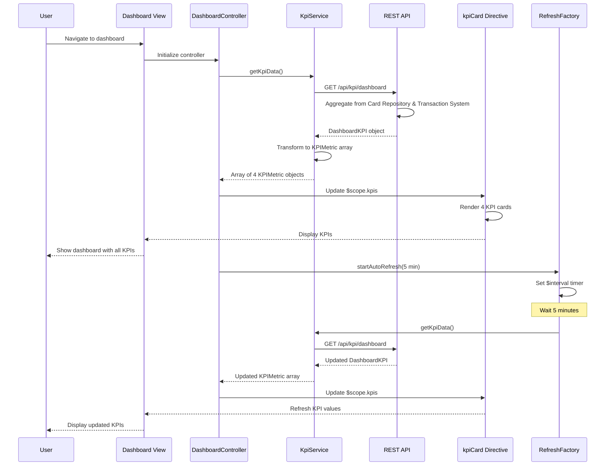

# Low-Level Design: QE-9487 - Dashboard and KPI Management

## a. Architecture Mapping

- **Dashboard Module** → AngularJS Module (`app.dashboard`)
- **Dashboard Controller** → AngularJS Controller (`DashboardController`) - manages KPI state and refresh logic
- **KPI Service** → AngularJS Service (`KpiService`) - handles API calls to KPI Aggregation Service
- **KPI Card Directive** → AngularJS Directive (`kpiCard`) - renders individual KPI metric cards
- **Refresh Service** → AngularJS Factory (`RefreshFactory`) - manages periodic data refresh using $interval
- **Credit Card Repository** → REST API integration via `$http` service

**Recommended Folder Structure:**
```
/app
  /dashboard
    dashboard.module.js
    dashboard.controller.js
    kpi.service.js
    refresh.factory.js
    /directives
      kpi-card.directive.js
    /views
      dashboard.html
```

## b. Component Specifications

| Name | Artifact Type | Responsibility | Key Dependencies |
|------|---------------|----------------|------------------|
| DashboardModule | Module | Registers dashboard components and default route | angular, angular-route |
| DashboardController | Controller | Manages dashboard state, triggers KPI data fetch and refresh | KpiService, RefreshFactory, $scope |
| KpiService | Service | Fetches aggregated KPI data (Monthly Spend, Total Credit Limit, Available Credit, Outstanding Amount) via REST API | $http, $q, API_CONFIG |
| kpiCard | Directive | Renders individual KPI metric with value, label, and trend indicator | $scope |
| RefreshFactory | Factory | Manages auto-refresh logic using $interval for near-real-time updates | $interval, $rootScope |
| KpiAPI | REST Endpoint | Provides aggregated KPI metrics across all user cards | Backend KPI Aggregation Service |

## c. Data Model

**DashboardKPI (JS Object):**
```javascript
{
  userId: String,
  monthlySpend: Number,
  totalCreditLimit: Number,
  availableCredit: Number,
  outstandingAmount: Number,
  lastUpdated: Date,
  cardCount: Number
}
```

**KPIMetric (JS Object):**
```javascript
{
  label: String, // 'Monthly Spend', 'Total Credit Limit', 'Available Credit', 'Outstanding Amount'
  value: Number,
  unit: String, // currency symbol
  trend: String, // 'up', 'down', 'neutral'
  icon: String // CSS class for icon
}
```

## d. Data Flow

User authenticates and navigates to dashboard which loads DashboardController. The controller initializes by calling KpiService.getKpiData() which makes a REST API call to /api/kpi/dashboard. The backend KPI Aggregation Service queries Credit Card Data Repository for all user cards' limits and balances, and queries Transaction Processing System for current month's spend, then returns aggregated metrics. KpiService receives the DashboardKPI object and transforms it into an array of KPIMetric objects. The controller updates $scope.kpis, triggering kpiCard directives to render four KPI cards (Monthly Spend, Total Credit Limit, Available Credit, Outstanding Amount) in a responsive grid layout using Bootstrap. RefreshFactory uses $interval to automatically call KpiService.getKpiData() every 5 minutes for near-real-time updates, updating the dashboard without user interaction.

## e. Primary Sequence Diagram



## f. Implementation Notes

- Use AngularJS $interval service in RefreshFactory to implement periodic KPI refresh every 5 minutes; cancel interval on $scope.$destroy to prevent memory leaks
- Implement responsive grid layout using Bootstrap grid system (col-md-3 for desktop, col-sm-6 for tablet, col-xs-12 for mobile) for KPI cards
- Use ES6 const/let in KpiService for immutable configuration values and block-scoped variables
- Implement optimistic UI updates: show loading spinner on kpiCard directive during refresh without blocking user interaction
- Use AngularJS $q service to handle promise-based async operations in KpiService with proper error propagation

## g. Error Handling

HTTP interceptor-based approach with $http; KpiService wraps API calls in try/catch; failed refresh attempts show non-intrusive toast notification without disrupting dashboard view.

## h. Security Notes

Requires token-based auth via existing SSO; API validates user session before returning aggregated KPI data.