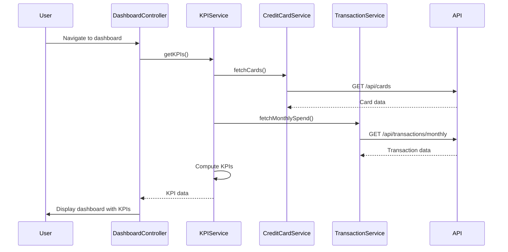

# Low-Level Design: Dashboard and KPI Management (QE-9500)

## a. Architecture Mapping

- **Dashboard Module** → AngularJS Module (`app.dashboard`)
- **Dashboard Controller** → AngularJS Controller (`DashboardController`)
- **KPI Service** → AngularJS Service (`KPIService`)
- **Auth Interceptor** → AngularJS Factory (`AuthInterceptor`)
- **Dashboard Widgets** → AngularJS Directives (`kpiWidget`, `progressBar`, `gaugeChart`)

**Folder Structure:**
```
/app
  /modules
    /dashboard
      dashboard.module.js
      dashboard.controller.js
      dashboard.html
  /services
    kpi.service.js
    creditcard.service.js
    transaction.service.js
  /directives
    kpi-widget.directive.js
  /interceptors
    auth.interceptor.js
```

## b. Component Specifications

| Name | Artifact Type | Responsibility | Key Dependencies |
|------|---------------|----------------|------------------|
| DashboardModule | Module | Registers dashboard feature module | angular, ui.router |
| DashboardController | Controller | Manages dashboard state and KPI display logic | KPIService, $scope, $interval |
| KPIService | Service | Aggregates KPI data from multiple services | CreditCardService, TransactionService, $http, $q |
| CreditCardService | Service | Fetches credit card details (limits, balances) | $http, API_CONFIG |
| TransactionService | Service | Retrieves monthly spending data | $http, API_CONFIG |
| kpiWidget | Directive | Renders individual KPI with visual indicator | - |
| AuthInterceptor | Factory | Adds auth token to API requests | $window, $q |

## c. Data Model

```javascript
// KPI Model
const KPIData = {
  monthlySpend: Number,          // Total spend for current month
  totalCreditLimit: Number,      // Sum of all card limits
  availableCredit: Number,       // Total limit - outstanding
  outstandingAmount: Number,     // Sum of all card balances
  lastUpdated: Date              // Timestamp of last refresh
};

// Credit Card Model
const CreditCard = {
  cardId: String,
  cardNumber: String,            // Masked format
  creditLimit: Number,
  currentBalance: Number,
  availableBalance: Number
};
```

## d. Data Flow

User logs in and navigates to dashboard → DashboardController initializes and calls KPIService.getKPIs() → KPIService makes parallel API calls via CreditCardService (GET /api/cards) and TransactionService (GET /api/transactions/monthly) → Services return card details and monthly transactions → KPIService computes totalCreditLimit (sum of card limits), outstandingAmount (sum of balances), availableCredit (limit - outstanding), and monthlySpend (sum of transaction amounts) → Computed KPIs are returned to controller → Controller binds data to view → kpiWidget directives render KPIs with progress bars and gauges → $interval triggers auto-refresh every 60 seconds to update KPIs.

## e. Primary Sequence Diagram



## f. Implementation Notes

- Use AngularJS dependency injection for all services and controllers
- Implement $q.all() for parallel API calls in KPIService to minimize load time
- Use $interval for auto-refresh with 60-second polling interval
- Apply Bootstrap grid system for responsive dashboard layout (col-md-3 for each KPI widget)
- Leverage ES6 arrow functions and const/let for cleaner service code

## g. Error Handling

HTTP interceptor captures API errors, displays user-friendly notifications via toastr, and logs errors to console.

## h. Security Notes

Requires token-based auth via existing SSO; AuthInterceptor attaches JWT to all API requests.