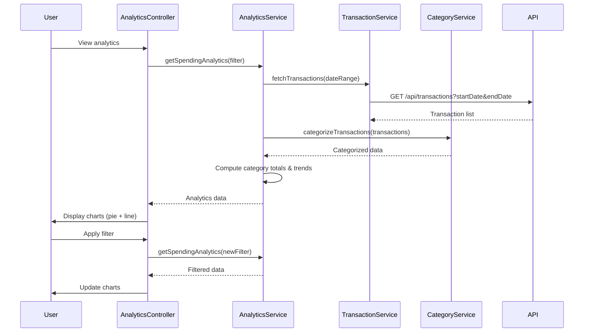

# Low-Level Design: Spending Analytics and Insights (QE-9501)

## a. Architecture Mapping

- **Analytics Module** → AngularJS Module (`app.analytics`)
- **Analytics Controller** → AngularJS Controller (`AnalyticsController`)
- **Analytics Service** → AngularJS Service (`AnalyticsService`)
- **Category Service** → AngularJS Service (`CategoryService`)
- **Chart Directives** → AngularJS Directives (`pieChart`, `lineChart`)

**Folder Structure:**
```
/app
  /modules
    /analytics
      analytics.module.js
      analytics.controller.js
      analytics.html
  /services
    analytics.service.js
    category.service.js
    transaction.service.js
  /directives
    pie-chart.directive.js
    line-chart.directive.js
  /filters
    date-range.filter.js
```

## b. Component Specifications

| Name | Artifact Type | Responsibility | Key Dependencies |
|------|---------------|----------------|------------------|
| AnalyticsModule | Module | Registers analytics feature module | angular, ui.router, chart.js |
| AnalyticsController | Controller | Manages analytics view state and user interactions | AnalyticsService, $scope, $filter |
| AnalyticsService | Service | Computes spending analytics and trends | TransactionService, CategoryService, $http, $q |
| CategoryService | Service | Categorizes transactions into 9 predefined categories | $http, API_CONFIG |
| TransactionService | Service | Fetches transaction data with date range filters | $http, API_CONFIG |
| pieChart | Directive | Renders category-wise spending breakdown using Chart.js | chart.js |
| lineChart | Directive | Renders monthly spending trend line chart | chart.js |

## c. Data Model

```javascript
// Category Spending Model
const CategorySpending = {
  category: String,              // One of 9 categories
  amount: Number,
  transactionCount: Number,
  percentage: Number             // % of total spend
};

// Monthly Trend Model
const MonthlyTrend = {
  month: String,                 // Format: 'YYYY-MM'
  totalSpend: Number,
  categoryBreakdown: Array       // Array of CategorySpending
};

// Analytics Filter Model
const AnalyticsFilter = {
  startDate: Date,
  endDate: Date,
  selectedCategories: Array      // Array of category names
};
```

## d. Data Flow

User navigates to analytics view → AnalyticsController initializes with default date range (last 12 months) → Controller calls AnalyticsService.getSpendingAnalytics(filter) → AnalyticsService fetches transactions via TransactionService (GET /api/transactions?startDate=X&endDate=Y) → CategoryService categorizes each transaction into one of 9 categories → AnalyticsService aggregates spending by category and computes monthly trends → Data returned to controller → pieChart directive renders category breakdown, lineChart directive renders monthly trend → User applies filter (date range or category) → Controller updates filter and re-calls AnalyticsService → Charts update with filtered data.

## e. Primary Sequence Diagram



## f. Implementation Notes

- Use Chart.js library integrated via angular-chart.js wrapper for visualization
- Implement client-side caching in AnalyticsService using $cacheFactory to avoid redundant API calls
- Use ES6 Array.reduce() for category aggregation and trend computation
- Apply AngularJS filters for date range selection and category filtering
- Leverage Bootstrap responsive grid for chart layout (col-md-6 for side-by-side charts)

## g. Error Handling

Try/catch blocks in service methods with user notification via alert or toastr for API failures.

## h. Security Notes

Standard input validation and secure API calls assumed.