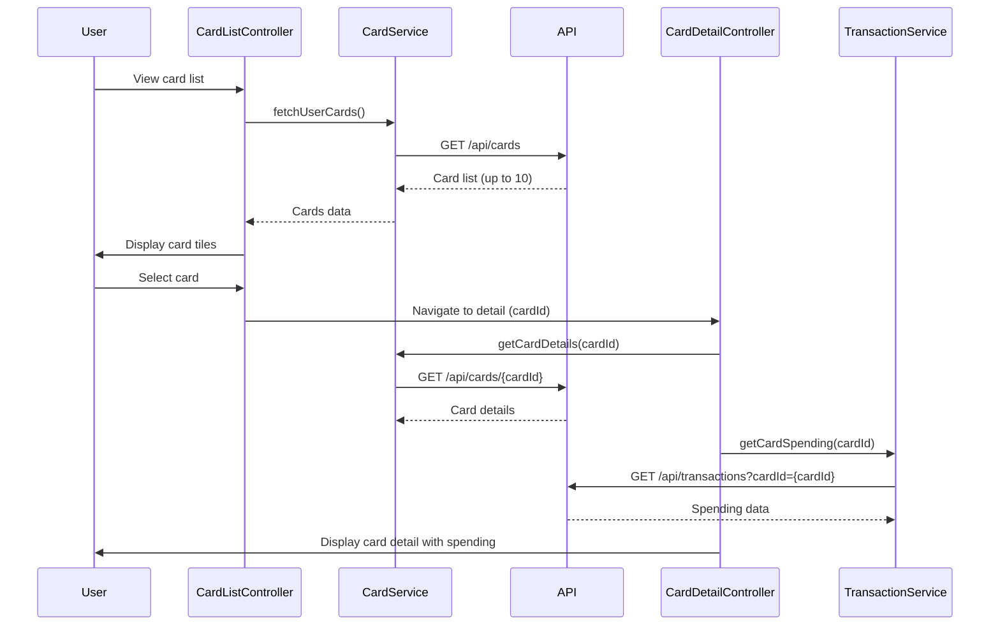

# Low-Level Design: Multi-Card Portfolio Management (QE-9502)

## a. Architecture Mapping

- **Card Management Module** → AngularJS Module (`app.cardManagement`)
- **Card List Controller** → AngularJS Controller (`CardListController`)
- **Card Detail Controller** → AngularJS Controller (`CardDetailController`)
- **Card Service** → AngularJS Service (`CardService`)
- **Card Display Directive** → AngularJS Directive (`cardTile`)

**Folder Structure:**
```
/app
  /modules
    /card-management
      card-management.module.js
      card-list.controller.js
      card-detail.controller.js
      card-list.html
      card-detail.html
  /services
    card.service.js
    transaction.service.js
  /directives
    card-tile.directive.js
```

## b. Component Specifications

| Name | Artifact Type | Responsibility | Key Dependencies |
|------|---------------|----------------|------------------|
| CardManagementModule | Module | Registers card management feature module | angular, ui.router |
| CardListController | Controller | Manages list of user's credit cards | CardService, $scope, $state |
| CardDetailController | Controller | Manages detailed view of selected card | CardService, TransactionService, $stateParams |
| CardService | Service | Fetches and manages credit card data | $http, $q, API_CONFIG |
| TransactionService | Service | Retrieves card-specific spending data | $http, API_CONFIG |
| cardTile | Directive | Renders individual card tile with key details | - |

## c. Data Model

```javascript
// Credit Card Model
const CreditCard = {
  cardId: String,
  cardNumber: String,            // Masked (e.g., **** **** **** 1234)
  cardType: String,              // Visa, MasterCard, etc.
  issuer: String,
  creditLimit: Number,
  currentBalance: Number,
  availableBalance: Number,
  dueDate: Date,
  minPayment: Number
};

// Card Spending Model
const CardSpending = {
  cardId: String,
  monthlySpend: Number,
  categoryBreakdown: Array,      // Array of {category: String, amount: Number}
  recentTransactions: Array      // Last 10 transactions
};
```

## d. Data Flow

User navigates to card management view → CardListController calls CardService.fetchUserCards() → CardService makes API call (GET /api/cards) → API returns list of user's credit cards (up to 10) → Controller binds cards to view → cardTile directives render each card with limit, balance, and usage → User selects a card → $state.go('cardDetail', {cardId: X}) → CardDetailController initializes with cardId from $stateParams → Controller calls CardService.getCardDetails(cardId) and TransactionService.getCardSpending(cardId) → Services fetch card details and spending data → Controller displays detailed card view with spending analysis.

## e. Primary Sequence Diagram



## f. Implementation Notes

- Use ui-router for state management (card list and card detail states)
- Implement card selection via $state.go() with cardId parameter
- Apply Bootstrap card component for cardTile directive styling
- Use AngularJS $q service for promise-based API calls
- Leverage ES6 template literals for dynamic card number masking

## g. Error Handling

HTTP interceptor handles API errors with fallback to cached data if available; user notified via inline error messages.

## h. Security Notes

Requires token-based auth via existing SSO; card numbers are masked on client-side.