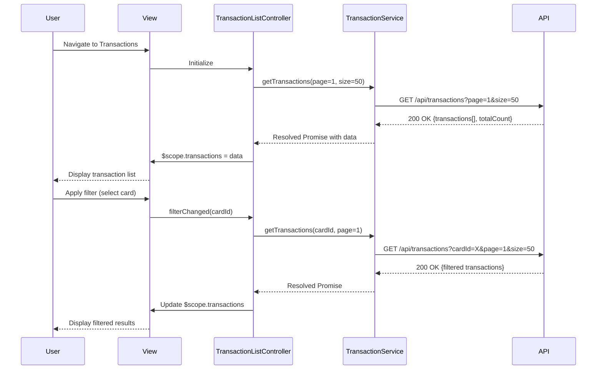

# Low-Level Design: QE-9503 - Transaction Management and Monitoring

## a. Architecture Mapping

- **Module:** `creditCard.transactions` - Main AngularJS module for transaction management
- **Controller:** `TransactionListController` - Manages transaction list view, filtering, and pagination
- **Controller:** `TransactionDetailController` - Handles individual transaction detail view
- **Service:** `TransactionService` - Orchestrates API calls to Transaction Management Service
- **Service:** `CreditCardService` - Retrieves card metadata for transaction enrichment
- **Factory:** `TransactionFilterFactory` - Manages filter state and query parameters
- **Directive:** `transactionCard` - Renders individual transaction item in list

**Folder Structure:**
```
/app
  /modules
    /transactions
      /controllers
      /services
      /directives
      /views
```

## b. Component Specifications

| Name | Artifact Type | Responsibility | Key Dependencies |
|------|---------------|----------------|------------------|
| TransactionListController | Controller | Manages transaction list, pagination, and filter application | TransactionService, TransactionFilterFactory, $scope |
| TransactionDetailController | Controller | Displays detailed transaction information for selected transaction | TransactionService, $routeParams, $scope |
| TransactionService | Service | Makes REST API calls to retrieve transaction data and histories | $http, $q, API_CONFIG |
| CreditCardService | Service | Retrieves credit card metadata to link transactions to cards | $http, $q, API_CONFIG |
| TransactionFilterFactory | Factory | Maintains filter state (card ID, date range) and builds query parameters | - |
| transactionCard | Directive | Renders transaction item with merchant, amount, date, category, card badge | - |
| PaginationDirective | Directive | Handles pagination controls and page navigation | - |

## c. Data Model

**Transaction Object:**
```javascript
{
  transactionId: String,
  cardId: String,
  cardName: String,
  merchantName: String,
  amount: Number,
  currency: String,
  transactionDate: Date,
  category: String,
  status: String
}
```

**Filter Object:**
```javascript
{
  cardId: String,
  startDate: Date,
  endDate: Date,
  page: Number,
  pageSize: Number
}
```

## d. Data Flow

User navigates to transaction view → TransactionListController initializes and calls TransactionService.getTransactions() with default pagination (page 1, 50 items) → TransactionService sends GET request to API Gateway `/api/transactions?page=1&size=50` → API returns paginated JSON response with transaction array and total count → Controller binds data to $scope.transactions → View renders transaction list using ng-repeat with transactionCard directive → User applies filter (e.g., selects card) → TransactionFilterFactory updates filter state → Controller calls TransactionService with updated query params → API returns filtered results → View updates with filtered transactions.

## e. Primary Sequence Diagram



## f. Implementation Notes

- Use AngularJS $http service with promise-based API calls; implement response interceptors for error handling
- Apply AngularJS Dependency Injection for all controllers, services, and factories
- Implement server-side pagination with query parameters; maintain page state in controller $scope
- Use ng-repeat with track by transactionId for optimized list rendering
- Integrate Bootstrap grid and card components for responsive transaction list layout

## g. Error Handling

HTTP interceptor captures API errors (4xx/5xx), logs to console, and displays user-friendly notification using Bootstrap alert component.

## h. Security Notes

Standard input validation and secure API calls assumed; token-based authentication via existing SSO.