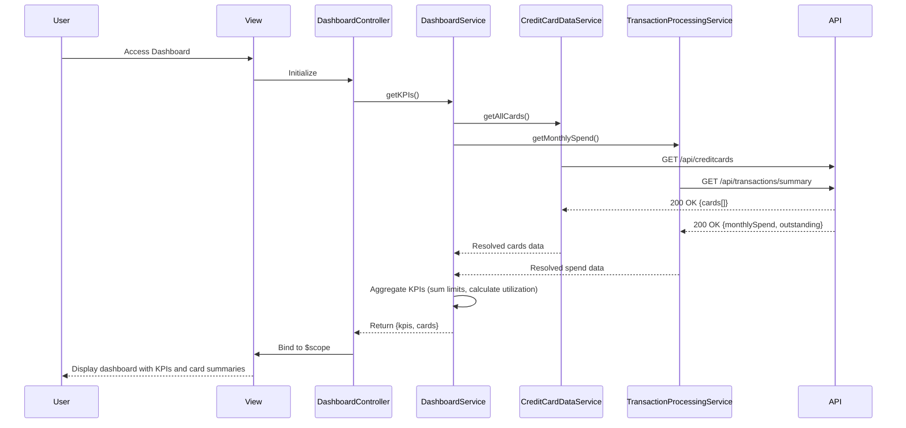

# Low-Level Design: QE-9504 - Dashboard KPIs and Credit Card Overview

## a. Architecture Mapping

- **Module:** `creditCard.dashboard` - Main AngularJS module for dashboard
- **Controller:** `DashboardController` - Manages KPI data loading and refresh logic
- **Service:** `DashboardService` - Aggregates KPI data from multiple backend services
- **Service:** `CreditCardDataService` - Retrieves card details, limits, and balances
- **Service:** `TransactionProcessingService` - Calculates monthly spend and outstanding amounts
- **Directive:** `kpiCard` - Renders individual KPI metric with icon and value
- **Directive:** `creditCardSummary` - Displays individual credit card summary tile

**Folder Structure:**
```
/app
  /modules
    /dashboard
      /controllers
      /services
      /directives
      /views
```

## b. Component Specifications

| Name | Artifact Type | Responsibility | Key Dependencies |
|------|---------------|----------------|------------------|
| DashboardController | Controller | Orchestrates KPI data loading, refresh, and aggregation logic | DashboardService, $scope, $interval |
| DashboardService | Service | Aggregates data from CreditCardDataService and TransactionProcessingService | CreditCardDataService, TransactionProcessingService, $q |
| CreditCardDataService | Service | Makes REST API calls to retrieve card details, credit limits, balances | $http, $q, API_CONFIG |
| TransactionProcessingService | Service | Retrieves monthly spend and outstanding amounts via REST API | $http, $q, API_CONFIG |
| kpiCard | Directive | Renders KPI metric tile with label, value, icon, and optional trend indicator | - |
| creditCardSummary | Directive | Displays credit card tile with card name, limit, available credit, utilization bar | - |

## c. Data Model

**KPI Object:**
```javascript
{
  totalCreditLimit: Number,
  availableCredit: Number,
  totalOutstanding: Number,
  monthlySpend: Number,
  creditUtilization: Number
}
```

**CreditCard Object:**
```javascript
{
  cardId: String,
  cardName: String,
  cardType: String,
  creditLimit: Number,
  currentBalance: Number,
  availableCredit: Number,
  outstandingAmount: Number
}
```

## d. Data Flow

User accesses dashboard → DashboardController initializes and calls DashboardService.getKPIs() → DashboardService makes parallel API calls using $q.all() to CreditCardDataService.getAllCards() and TransactionProcessingService.getMonthlySpend() → Both services send GET requests to respective API endpoints → API Gateway returns card data and transaction summaries → DashboardService aggregates data: sums credit limits, calculates total available credit, computes credit utilization percentage → Service returns aggregated KPI object to controller → Controller binds to $scope.kpis and $scope.cards → View renders KPI cards and credit card summary tiles using directives with Bootstrap responsive grid → Auto-refresh enabled via $interval every 60 seconds.

## e. Primary Sequence Diagram



## f. Implementation Notes

- Use $q.all() for parallel API calls to minimize load time and meet 2-second NFR
- Implement AngularJS $interval service for auto-refresh every 60 seconds; cancel on $scope.$destroy
- Apply Bootstrap responsive grid (col-md-3, col-sm-6, col-xs-12) for KPI cards to ensure mobile/tablet/desktop responsiveness
- Use AngularJS filters for currency formatting and percentage display
- Implement loading spinner directive during data fetch using ng-show

## g. Error Handling

HTTP interceptor-based error handling with try/catch in service layer; display Bootstrap alert on API failure with retry option.

## h. Security Notes

Requires token-based auth via existing SSO; API calls include Authorization header with JWT token.