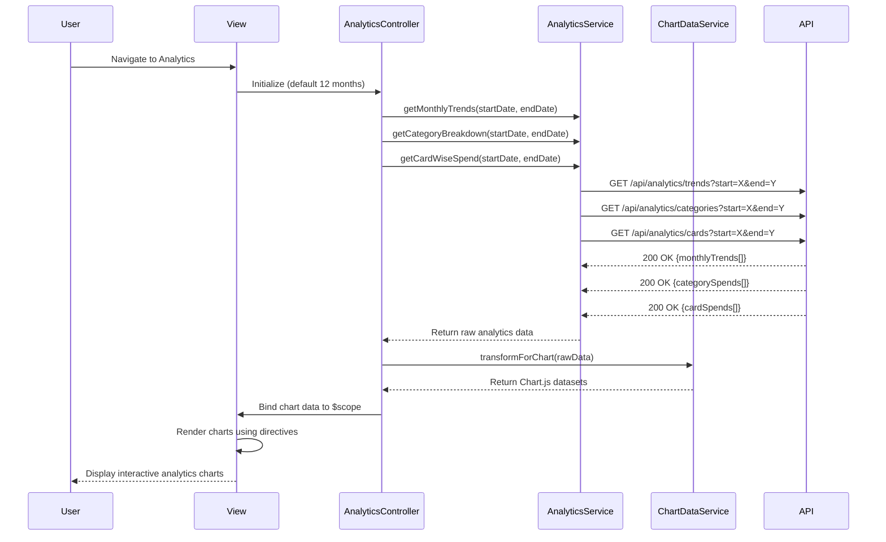

# Low-Level Design: QE-9505 - Spending Analytics and Insights

## a. Architecture Mapping

- **Module:** `creditCard.analytics` - Main AngularJS module for analytics and insights
- **Controller:** `AnalyticsController` - Manages analytics view, chart data binding, and user interactions
- **Service:** `AnalyticsService` - Retrieves pre-aggregated analytics data from Analytics Engine
- **Service:** `ChartDataService` - Transforms API response into chart-ready data structures
- **Factory:** `CategoryFactory` - Maintains list of nine spending categories as constants
- **Directive:** `monthlyTrendChart` - Renders line chart for monthly spend trends using Chart.js
- **Directive:** `categoryBreakdownChart` - Renders pie/bar chart for category-wise spending
- **Directive:** `cardWiseChart` - Renders bar chart for card-wise spend analysis

**Folder Structure:**
```
/app
  /modules
    /analytics
      /controllers
      /services
      /directives
      /views
```

## b. Component Specifications

| Name | Artifact Type | Responsibility | Key Dependencies |
|------|---------------|----------------|------------------|
| AnalyticsController | Controller | Manages analytics view state, date range selection, chart data loading | AnalyticsService, ChartDataService, $scope |
| AnalyticsService | Service | Makes REST API calls to retrieve monthly trends, card-wise, and category-wise analytics | $http, $q, API_CONFIG |
| ChartDataService | Service | Transforms raw API data into Chart.js-compatible datasets and labels | CategoryFactory |
| CategoryFactory | Factory | Provides constant list of nine categories and category metadata | - |
| monthlyTrendChart | Directive | Renders interactive line chart for monthly spend trends over 12 months | Chart.js library |
| categoryBreakdownChart | Directive | Renders pie or bar chart for category-wise spending breakdown | Chart.js library |
| cardWiseChart | Directive | Renders bar chart comparing spend across multiple credit cards | Chart.js library |

## c. Data Model

**MonthlyTrend Object:**
```javascript
{
  month: String,
  totalSpend: Number
}
```

**CategorySpend Object:**
```javascript
{
  category: String,
  amount: Number,
  percentage: Number
}
```

**CardSpend Object:**
```javascript
{
  cardId: String,
  cardName: String,
  totalSpend: Number
}
```

**Categories Constant:**
```javascript
['Food & Dining', 'Fuel', 'Shopping', 'Travel', 'Entertainment', 'Utilities', 'Healthcare', 'Education', 'Miscellaneous']
```

## d. Data Flow

User navigates to analytics view → AnalyticsController initializes with default 12-month range → Controller calls AnalyticsService.getMonthlyTrends(), getCategoryBreakdown(), and getCardWiseSpend() → AnalyticsService sends GET requests to API Gateway `/api/analytics/trends`, `/api/analytics/categories`, `/api/analytics/cards` with date range parameters → API returns pre-aggregated JSON data from Data Warehouse → ChartDataService transforms API responses into Chart.js datasets (labels, data arrays, colors) → Controller binds chart data to $scope → Directives (monthlyTrendChart, categoryBreakdownChart, cardWiseChart) render interactive charts using Chart.js with responsive configuration → User can interact with charts (hover for tooltips, click for drill-down) or change date range to refresh analytics.

## e. Primary Sequence Diagram



## f. Implementation Notes

- Integrate Chart.js library via CDN or npm; configure responsive: true and maintainAspectRatio: false for mobile compatibility
- Use AngularJS directive link function to initialize Chart.js instances and watch for data changes
- Implement lazy loading for chart data; render charts only when analytics view is active
- Apply ES6 arrow functions and template literals in ChartDataService for data transformation
- Use Bootstrap tabs or nav pills for switching between Monthly Trends, Category Breakdown, and Card-wise views

## g. Error Handling

Try/catch in service methods with user notification via Bootstrap toast; interceptor logs API errors to console.

## h. Security Notes

Standard input validation and secure API calls assumed; token-based authentication via existing SSO.