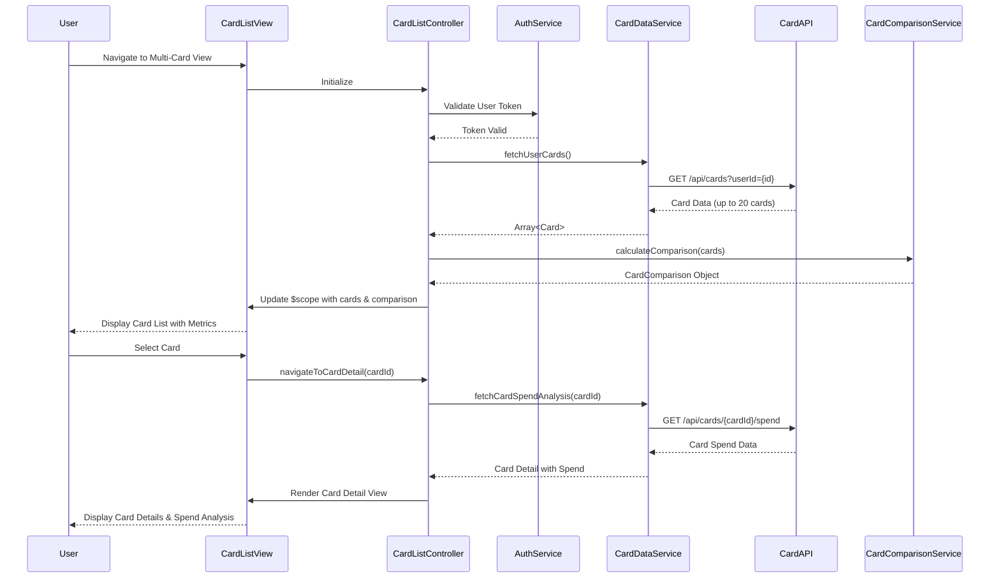

# Low-Level Design: Multi-Card Management and Viewing
**Epic ID:** QE-9506

## a. Architecture Mapping

- **AngularJS Module:** `creditCard.multiCardModule` - Main module for multi-card management
- **Controller:** `CardListController` - Manages card list display and user interactions
- **Controller:** `CardDetailController` - Handles individual card detail view
- **Service:** `CardDataService` - Fetches card data from Credit Card Data Repository via REST API
- **Service:** `CardComparisonService` - Processes card comparison metrics and analytics
- **Service:** `AuthService` - Handles user authentication and authorization
- **Factory:** `CardModel` - Defines card data structure and transformation logic
- **Directive:** `cardSummaryCard` - Reusable component for displaying individual card summary

**Recommended Folder Structure:**
```
/app
  /modules
    /multi-card
      /controllers (CardListController, CardDetailController)
      /services (CardDataService, CardComparisonService)
      /directives (cardSummaryCard)
      /factories (CardModel)
      /views (card-list.html, card-detail.html)
```

## b. Component Specifications

| Name | Artifact Type | Responsibility | Key Dependencies |
|------|---------------|----------------|------------------|
| creditCard.multiCardModule | Module | Encapsulates all multi-card management functionality | ngRoute, ngResource |
| CardListController | Controller | Manages card list rendering, filtering, and selection | CardDataService, CardComparisonService, $scope |
| CardDetailController | Controller | Displays individual card details and card-specific spend analysis | CardDataService, $routeParams, $scope |
| CardDataService | Service | Fetches card data from REST API with 300ms latency constraint | $http, $q, AuthService |
| CardComparisonService | Service | Calculates comparison metrics (spend, utilization, outstanding) across cards | CardDataService |
| AuthService | Service | Validates user authentication and manages secure card access | $http, $window |
| CardModel | Factory | Defines card object structure with masked card number display logic | None |
| cardSummaryCard | Directive | Renders reusable card summary component with spend and limit info | CardModel |

## c. Data Model

**Card Object:**
```javascript
{
  cardId: String,
  cardNumber: String,          // Masked format: "****1234"
  cardType: String,            // e.g., "Visa", "Mastercard"
  cardHolderName: String,
  creditLimit: Number,
  availableCredit: Number,
  outstandingAmount: Number,
  monthlySpend: Number,
  utilizationRate: Number,     // Calculated: (creditLimit - availableCredit) / creditLimit * 100
  lastUpdated: Date
}
```

**CardComparison Object:**
```javascript
{
  cards: Array<Card>,
  totalSpend: Number,
  averageUtilization: Number,
  highestSpendCard: Card,
  lowestUtilizationCard: Card
}
```

## d. Data Flow

User logs in and navigates to multi-card view → CardListController invokes CardDataService to fetch all user cards via REST API → AuthService validates token and authorizes request → CardDataService retrieves up to 20 cards from Credit Card Data Repository with sub-300ms latency → CardComparisonService processes card metrics (spend, utilization, outstanding) → CardListController updates $scope with card array → View renders card list using cardSummaryCard directive with masked card numbers → User selects a card → CardDetailController fetches card-specific spending data from Transaction Service → Detailed card view displays with spend analysis and comparison insights.

## e. Primary Sequence Diagram



## f. Implementation Notes

- Use AngularJS Dependency Injection to inject CardDataService and CardComparisonService into controllers for testability and modularity.
- Implement $http interceptor in AuthService to attach authentication tokens to all API requests automatically.
- Use $q promises in CardDataService for asynchronous API calls with error handling and timeout configuration (300ms constraint).
- Apply ng-repeat with track by cardId in card list view for optimized rendering of up to 20 cards.
- Implement CardModel factory with masking logic to display only last 4 digits of card numbers for security.

## g. Error Handling

Client-side error handling via $http interceptor with try/catch blocks in services; user notification through toast messages for API failures and timeout errors.

## h. Security Notes

Requires token-based authentication via existing SSO; card numbers stored encrypted and displayed masked with last 4 digits visible only.