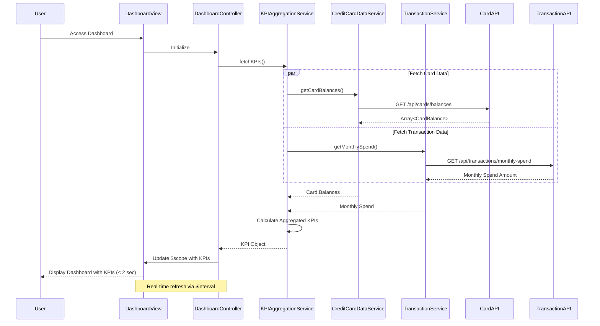

# Low-Level Design: Dashboard and KPI Management
**Epic ID:** QE-9507

## a. Architecture Mapping

- **AngularJS Module:** `creditCard.dashboardModule` - Main module for dashboard and KPI management
- **Controller:** `DashboardController` - Manages dashboard KPI display and real-time refresh
- **Service:** `KPIAggregationService` - Aggregates KPI data from multiple sources
- **Service:** `CreditCardDataService` - Fetches card balances, limits, and outstanding amounts via REST API
- **Service:** `TransactionService` - Retrieves monthly spend data via REST API
- **Factory:** `KPIModel` - Defines KPI data structure and calculation logic
- **Directive:** `kpiWidget` - Reusable component for displaying individual KPI metrics

**Recommended Folder Structure:**
```
/app
  /modules
    /dashboard
      /controllers (DashboardController)
      /services (KPIAggregationService, CreditCardDataService, TransactionService)
      /factories (KPIModel)
      /directives (kpiWidget)
      /views (dashboard.html)
```

## b. Component Specifications

| Name | Artifact Type | Responsibility | Key Dependencies |
|------|---------------|----------------|------------------|
| creditCard.dashboardModule | Module | Encapsulates dashboard and KPI functionality | ngRoute, ngResource |
| DashboardController | Controller | Manages KPI rendering, real-time refresh, and responsive layout | KPIAggregationService, $scope, $interval |
| KPIAggregationService | Service | Aggregates and calculates KPIs (monthly spend, total limit, available credit, outstanding) | CreditCardDataService, TransactionService, $q |
| CreditCardDataService | Service | Fetches card balances, limits, and outstanding amounts from REST API | $http, $q |
| TransactionService | Service | Retrieves monthly spend aggregations from REST API | $http, $q |
| KPIModel | Factory | Defines KPI object structure with calculation methods for derived metrics | None |
| kpiWidget | Directive | Renders individual KPI metric with label, value, and icon | KPIModel |

## c. Data Model

**KPI Object:**
```javascript
{
  monthlySpend: Number,
  totalCreditLimit: Number,
  availableCredit: Number,
  outstandingAmount: Number,
  utilizationRate: Number,     // Calculated: (totalCreditLimit - availableCredit) / totalCreditLimit * 100
  lastRefreshed: Date
}
```

**CardBalance Object:**
```javascript
{
  cardId: String,
  creditLimit: Number,
  availableCredit: Number,
  outstandingAmount: Number
}
```

## d. Data Flow

User accesses dashboard → DashboardController initializes and invokes KPIAggregationService → KPIAggregationService concurrently fetches card balances from CreditCardDataService and monthly spend from TransactionService via REST APIs → CreditCardDataService retrieves all card balances and limits → TransactionService calculates current month spend aggregation → KPIAggregationService aggregates total credit limit (sum across all cards), available credit (sum), outstanding amounts (sum), and monthly spend → KPIModel calculates derived metrics like utilization rate → DashboardController updates $scope with KPI data within 2-second load constraint → Dashboard UI renders KPIs using kpiWidget directive in responsive layout → $interval triggers periodic refresh for real-time data updates.

## e. Primary Sequence Diagram



## f. Implementation Notes

- Use $q.all() in KPIAggregationService to fetch card balances and monthly spend in parallel for optimal 2-second load time.
- Implement $interval in DashboardController for periodic KPI refresh (e.g., every 30 seconds) to maintain real-time data accuracy.
- Apply responsive CSS with Bootstrap grid system (col-xs, col-sm, col-md) for mobile and desktop layout support.
- Use AngularJS filters for currency formatting in kpiWidget directive to ensure consistent KPI display.
- Cache KPI data in KPIAggregationService with timestamp validation to reduce redundant API calls during refresh cycles.

## g. Error Handling

Interceptor-based error handling for API failures with fallback to cached KPI data and user notification via alert banner.

## h. Security Notes

Standard input validation and secure API calls assumed; token-based authentication required for accessing card and transaction data.