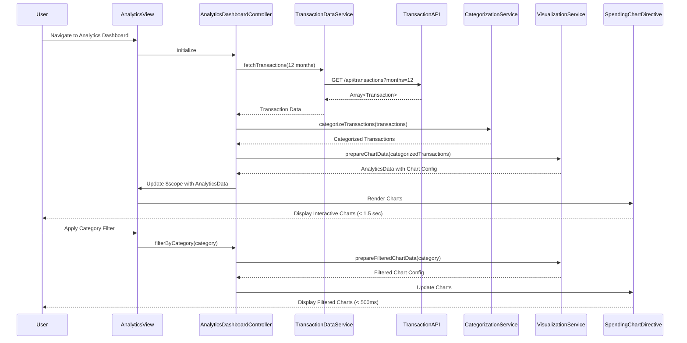

# Low-Level Design: Analytics and Category-wise Spending Insights
**Epic ID:** QE-9508

## a. Architecture Mapping

- **AngularJS Module:** `creditCard.analyticsModule` - Main module for analytics and spending insights
- **Controller:** `AnalyticsDashboardController` - Manages analytics view, filtering, and user interactions
- **Service:** `TransactionDataService` - Fetches historical transaction data (up to 12 months) via REST API
- **Service:** `CategorizationService` - Classifies transactions into 9 predefined categories
- **Service:** `VisualizationService` - Processes categorized data and prepares chart configurations
- **Factory:** `CategoryModel` - Defines category structure and spending aggregation logic
- **Directive:** `spendingChart` - Renders interactive charts using visualization library (e.g., Chart.js)
- **Directive:** `categoryFilter` - Provides interactive filtering UI for categories and time periods

**Recommended Folder Structure:**
```
/app
  /modules
    /analytics
      /controllers (AnalyticsDashboardController)
      /services (TransactionDataService, CategorizationService, VisualizationService)
      /factories (CategoryModel)
      /directives (spendingChart, categoryFilter)
      /views (analytics-dashboard.html)
```

## b. Component Specifications

| Name | Artifact Type | Responsibility | Key Dependencies |
|------|---------------|----------------|------------------|
| creditCard.analyticsModule | Module | Encapsulates analytics and spending insights functionality | ngRoute, ngResource, chart.js |
| AnalyticsDashboardController | Controller | Manages analytics view rendering, filtering interactions, and chart updates | TransactionDataService, CategorizationService, VisualizationService, $scope |
| TransactionDataService | Service | Fetches up to 12 months of transaction history from REST API | $http, $q |
| CategorizationService | Service | Classifies transactions into 9 categories (Food & Dining, Fuel, Shopping, Travel, Entertainment, Utilities, Healthcare, Education, Miscellaneous) | CategoryModel |
| VisualizationService | Service | Processes categorized data and generates chart configurations for rendering | CategoryModel, $filter |
| CategoryModel | Factory | Defines category structure with spending aggregation and trend calculation methods | None |
| spendingChart | Directive | Renders interactive charts (pie, bar, line) using Chart.js with 1.5-second rendering constraint | VisualizationService, chart.js |
| categoryFilter | Directive | Provides UI for filtering by category and month with sub-500ms response time | $scope |

## c. Data Model

**Transaction Object:**
```javascript
{
  transactionId: String,
  cardId: String,
  amount: Number,
  category: String,            // One of 9 predefined categories
  transactionDate: Date,
  merchantName: String,
  description: String
}
```

**CategorySpending Object:**
```javascript
{
  categoryName: String,        // e.g., "Food & Dining"
  totalSpend: Number,
  transactionCount: Number,
  percentageOfTotal: Number,
  monthlyTrend: Array<{month: String, amount: Number}>
}
```

**AnalyticsData Object:**
```javascript
{
  categories: Array<CategorySpending>,
  totalSpend: Number,
  timeRange: {startDate: Date, endDate: Date},
  topCategory: CategorySpending
}
```

## d. Data Flow

User navigates to analytics dashboard → AnalyticsDashboardController invokes TransactionDataService to fetch up to 12 months of transaction history via REST API → TransactionDataService retrieves transaction data → CategorizationService classifies each transaction into one of 9 predefined categories → VisualizationService aggregates spending by category, calculates monthly trends, and prepares chart data → AnalyticsDashboardController updates $scope with AnalyticsData object → spendingChart directive renders interactive visualizations (pie chart for category breakdown, line chart for monthly trends) within 1.5-second constraint → User applies filters via categoryFilter directive → AnalyticsDashboardController re-processes data with sub-500ms response time → Updated charts render with filtered data showing spending patterns and insights.

## e. Primary Sequence Diagram



## f. Implementation Notes

- Use Chart.js library integrated via AngularJS directive for rendering pie, bar, and line charts with interactive filtering capabilities.
- Implement caching in TransactionDataService for 12-month transaction data to optimize repeated analytics view loads and meet 1.5-second rendering constraint.
- Use $filter in VisualizationService for date range filtering and category aggregation with optimized array operations for sub-500ms response.
- Apply AngularJS watchers in AnalyticsDashboardController to detect filter changes and trigger chart updates efficiently.
- Implement lazy loading for chart rendering: load data first, then render charts asynchronously to improve perceived performance.

## g. Error Handling

Try/catch blocks in services with user notification via toast messages for API failures; fallback to cached data when available.

## h. Security Notes

Standard input validation and secure API calls assumed; token-based authentication required for accessing transaction data.