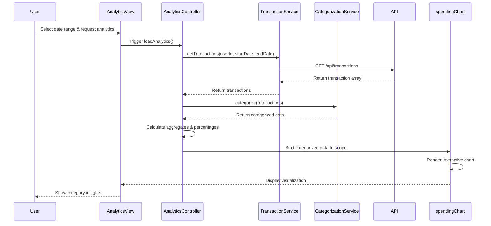

# Low-Level Design: QE-9509 - Spending Analytics and Category Insights

## a. Architecture Mapping

- **Analytics Module** → AngularJS Module (`app.analytics`)
- **Analytics Controller** → AngularJS Controller (`AnalyticsController`) - Manages view state and user interactions
- **Transaction Service** → AngularJS Service (`TransactionService`) - Fetches transaction data via REST API
- **Categorization Service** → AngularJS Service (`CategorizationService`) - Handles category classification logic
- **Visualization Directive** → AngularJS Directive (`spendingChart`) - Renders interactive charts using D3.js/Chart.js
- **KPI Integration Service** → AngularJS Factory (`KPIFactory`) - Provides consolidated metrics from dashboard

**Folder Structure:**
```
/app
  /modules
    /analytics
      analytics.module.js
      analytics.controller.js
      analytics.html
  /services
    transaction.service.js
    categorization.service.js
  /directives
    spending-chart.directive.js
  /factories
    kpi.factory.js
```

## b. Component Specifications

| Component Name | Artifact Type | Responsibility | Key Dependencies |
|----------------|---------------|----------------|------------------|
| AnalyticsController | Controller | Orchestrates analytics view, handles user filter selections, binds chart data to scope | TransactionService, CategorizationService, KPIFactory, $scope |
| TransactionService | Service | Fetches historical and current transaction data from REST API endpoints | $http, $q, API_CONFIG |
| CategorizationService | Service | Classifies transactions into 9 predefined categories with 95% accuracy | TransactionService, CATEGORY_CONSTANTS |
| spendingChart | Directive | Renders responsive interactive charts (bar/pie/line) with touch support for mobile | D3.js/Chart.js library, $window |
| KPIFactory | Factory | Retrieves consolidated dashboard metrics for contextual display | $http, DashboardService |
| AnalyticsModule | Module | Encapsulates all analytics-related components and routing | ui.router, ngAnimate |

## c. Data Model

**SpendingAnalytics (JS Object):**
```javascript
{
  userId: String,
  categories: [
    {
      categoryId: String,
      categoryName: String, // Food & Dining, Fuel, Shopping, Travel, Entertainment, Utilities, Healthcare, Education, Miscellaneous
      totalSpend: Number,
      transactionCount: Number,
      percentageOfTotal: Number
    }
  ],
  timePeriod: {
    startDate: Date,
    endDate: Date
  },
  totalSpend: Number,
  trends: [
    {
      month: String,
      categorySpend: Object // {categoryName: amount}
    }
  ]
}
```

**Transaction (JS Object):**
```javascript
{
  transactionId: String,
  amount: Number,
  date: Date,
  merchant: String,
  category: String,
  cardId: String
}
```

## d. Data Flow

User selects date range and requests analytics view → AnalyticsController initializes and calls TransactionService.getTransactions() → Service makes REST API call to /api/transactions?userId={id}&startDate={date}&endDate={date} → CategorizationService.categorize() processes returned transactions and assigns to 9 predefined categories → Controller aggregates spending by category and calculates percentages → KPIFactory.getConsolidatedMetrics() fetches dashboard context → spendingChart directive receives categorized data via two-way binding and renders interactive visualizations using Chart.js → User interacts with charts (tap/click), triggering scope updates that refresh the view with filtered data.

## e. Primary Sequence Diagram



## f. Implementation Notes

- Use AngularJS Dependency Injection to inject TransactionService, CategorizationService, and KPIFactory into AnalyticsController
- Implement ES6 arrow functions and Promises ($q) for asynchronous API calls with .then()/.catch() chaining
- Use Chart.js library wrapped in AngularJS directive with isolated scope for reusable chart components
- Leverage $http interceptors for adding authentication tokens to all REST API requests
- Implement responsive design using Bootstrap grid system and CSS3 media queries for mobile/tablet/desktop layouts

## g. Error Handling

HTTP interceptor captures API errors (4xx/5xx), displays user-friendly notifications via toastr/ngToast, and logs errors to console for debugging.

## h. Security Notes

Requires token-based auth via existing SSO; all API calls include Authorization header with JWT token.