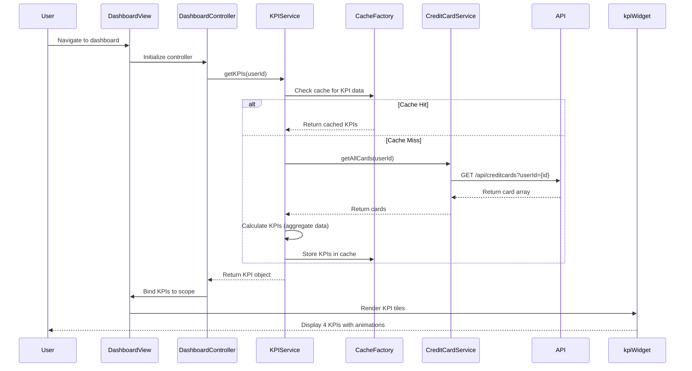

# Low-Level Design: QE-9510 - Dashboard KPIs and Financial Overview

## a. Architecture Mapping

- **Dashboard Module** → AngularJS Module (`app.dashboard`)
- **Dashboard Controller** → AngularJS Controller (`DashboardController`) - Manages KPI display and real-time updates
- **KPI Service** → AngularJS Service (`KPIService`) - Fetches and calculates KPI metrics via REST API
- **Credit Card Service** → AngularJS Service (`CreditCardService`) - Retrieves credit card data (balance, limit, transactions)
- **KPI Widget Directive** → AngularJS Directive (`kpiWidget`) - Displays individual KPI tiles with animations
- **Cache Factory** → AngularJS Factory (`CacheFactory`) - Implements client-side caching for performance

**Folder Structure:**
```
/app
  /modules
    /dashboard
      dashboard.module.js
      dashboard.controller.js
      dashboard.html
  /services
    kpi.service.js
    credit-card.service.js
  /directives
    kpi-widget.directive.js
  /factories
    cache.factory.js
```

## b. Component Specifications

| Component Name | Artifact Type | Responsibility | Key Dependencies |
|----------------|---------------|----------------|------------------|
| DashboardController | Controller | Orchestrates dashboard view, manages KPI refresh logic, handles real-time data updates | KPIService, CreditCardService, $scope, $interval |
| KPIService | Service | Calculates Monthly Spend, Total Credit Limit, Available Credit, Outstanding Amount from raw data | CreditCardService, CacheFactory, $http |
| CreditCardService | Service | Fetches credit card balances, limits, and transaction data from REST API | $http, $q, API_CONFIG |
| kpiWidget | Directive | Renders individual KPI tile with value, label, and trend indicator | $animate, WIDGET_CONFIG |
| CacheFactory | Factory | Provides in-memory caching with TTL for KPI data to meet 2-second load requirement | $cacheFactory, CACHE_CONFIG |
| DashboardModule | Module | Encapsulates dashboard components and configures routing | ui.router, ngAnimate |

## c. Data Model

**DashboardKPI (JS Object):**
```javascript
{
  userId: String,
  monthlySpend: Number,
  totalCreditLimit: Number,
  availableCredit: Number,
  outstandingAmount: Number,
  lastUpdated: Date,
  cards: [
    {
      cardId: String,
      cardNumber: String, // masked
      balance: Number,
      creditLimit: Number,
      availableCredit: Number
    }
  ]
}
```

**CreditCard (JS Object):**
```javascript
{
  cardId: String,
  cardNumber: String,
  cardType: String,
  balance: Number,
  creditLimit: Number,
  availableCredit: Number,
  outstandingAmount: Number
}
```

## d. Data Flow

User logs in and navigates to dashboard → DashboardController initializes and calls KPIService.getKPIs() → Service checks CacheFactory for cached data; if miss, calls CreditCardService.getAllCards() → Service makes REST API call to /api/creditcards?userId={id} → API returns array of credit card objects with balances and limits → KPIService aggregates data to calculate Monthly Spend (sum of recent transactions), Total Credit Limit (sum of all limits), Available Credit (sum of available across cards), Outstanding Amount (sum of balances) → Results are cached with 5-minute TTL → Controller binds KPI data to scope → kpiWidget directives render four KPI tiles with animations → $interval triggers auto-refresh every 30 seconds for real-time updates.

## e. Primary Sequence Diagram



## f. Implementation Notes

- Use AngularJS $cacheFactory for client-side caching with 5-minute TTL to ensure sub-2-second dashboard load
- Implement $interval service for polling API every 30 seconds to achieve near real-time data refresh
- Use ES6 template literals for dynamic API endpoint construction and Promise-based $http calls
- Leverage Bootstrap responsive grid (col-xs/sm/md/lg) for KPI tile layout across devices
- Implement ngAnimate for smooth KPI value transitions when data updates

## g. Error Handling

$http interceptor catches API failures, displays error toast notification, and falls back to cached data if available.

## h. Security Notes

Requires token-based auth via existing SSO; session validation performed by Authentication Service before dashboard load.