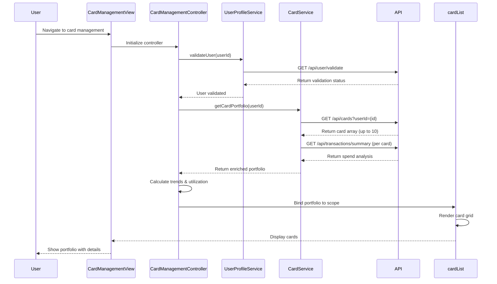

# Low-Level Design: QE-9511 - Multiple Credit Card Management

## a. Architecture Mapping

- **Card Management Module** → AngularJS Module (`app.cardManagement`)
- **Card Management Controller** → AngularJS Controller (`CardManagementController`) - Manages card portfolio view and interactions
- **Card Service** → AngularJS Service (`CardService`) - Fetches card details and spend analysis via REST API
- **User Profile Service** → AngularJS Service (`UserProfileService`) - Validates card ownership
- **Card List Directive** → AngularJS Directive (`cardList`) - Displays multiple cards in responsive grid
- **Card Comparison Factory** → AngularJS Factory (`CardComparisonFactory`) - Provides card comparison logic

**Folder Structure:**
```
/app
  /modules
    /card-management
      card-management.module.js
      card-management.controller.js
      card-management.html
  /services
    card.service.js
    user-profile.service.js
  /directives
    card-list.directive.js
  /factories
    card-comparison.factory.js
```

## b. Component Specifications

| Component Name | Artifact Type | Responsibility | Key Dependencies |
|----------------|---------------|----------------|------------------|
| CardManagementController | Controller | Orchestrates card portfolio view, handles card selection and comparison actions | CardService, UserProfileService, CardComparisonFactory, $scope |
| CardService | Service | Fetches card details, balances, and transaction history from Credit Card Data Aggregation API | $http, $q, API_CONFIG |
| UserProfileService | Service | Validates user identity and card ownership before displaying card data | $http, AUTH_SERVICE |
| cardList | Directive | Renders responsive grid of credit cards with individual card details and spend summaries | $filter, CARD_CONFIG |
| CardComparisonFactory | Factory | Compares multiple cards based on spend, utilization, and trends | CardService, COMPARISON_LOGIC |
| CardManagementModule | Module | Encapsulates card management components and routing | ui.router, ngResource |

## c. Data Model

**CardPortfolio (JS Object):**
```javascript
{
  userId: String,
  cards: [
    {
      cardId: String,
      cardNumber: String, // masked
      cardType: String,
      bankName: String,
      balance: Number,
      creditLimit: Number,
      availableCredit: Number,
      monthlySpend: Number,
      utilizationRate: Number, // percentage
      spendTrends: [
        {
          month: String,
          amount: Number
        }
      ]
    }
  ],
  totalCards: Number
}
```

**CardDetails (JS Object):**
```javascript
{
  cardId: String,
  cardNumber: String,
  cardType: String,
  bankName: String,
  balance: Number,
  creditLimit: Number,
  availableCredit: Number,
  monthlySpend: Number,
  transactions: Array
}
```

## d. Data Flow

User authenticates and navigates to card management view → CardManagementController initializes and calls UserProfileService.validateUser() → Service verifies user session and ownership → Controller calls CardService.getCardPortfolio(userId) → Service makes REST API call to /api/cards?userId={id} → Credit Card Data Aggregation Service returns array of up to 10 cards with details → CardService enriches data with spend analysis by calling /api/transactions/summary?cardId={id} for each card → Controller calculates utilization rates and monthly trends → CardComparisonFactory.compareCards() generates comparison metrics → Controller binds portfolio data to scope → cardList directive renders responsive grid of cards with individual details, spend summaries, and comparison highlights → User can tap/click individual cards to view detailed analysis.

## e. Primary Sequence Diagram



## f. Implementation Notes

- Use AngularJS Dependency Injection to inject CardService, UserProfileService, and CardComparisonFactory into controller
- Implement ES6 Promises with $q.all() to fetch transaction summaries for multiple cards in parallel for performance
- Use ngRepeat with track by cardId in cardList directive for efficient DOM rendering of up to 10 cards
- Leverage Bootstrap card components and responsive grid (col-md-4 col-sm-6 col-xs-12) for multi-device layout
- Implement $filter service for formatting currency values and dates in card display

## g. Error Handling

$http interceptor handles API errors with try/catch blocks, displays user-friendly error messages via ngToast, and logs to console.

## h. Security Notes

Requires token-based auth via existing SSO; UserProfileService validates card ownership before displaying sensitive data.