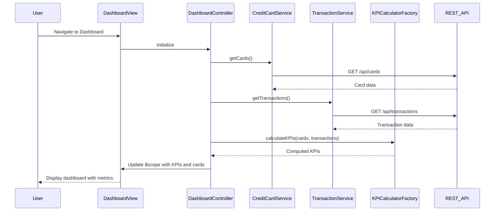

# Low-Level Design: Credit Card Portfolio and Financial Overview Dashboard
**Epic ID:** QE-9512

## a. Architecture Mapping

- **Dashboard Module** → AngularJS Module (`creditCard.dashboard`)
- **Dashboard Controller** → AngularJS Controller (`DashboardController`) - orchestrates dashboard view and KPI display
- **Credit Card Service** → AngularJS Service (`CreditCardService`) - retrieves card data via REST API
- **Transaction Service** → AngularJS Service (`TransactionService`) - fetches transaction and spending data via REST API
- **KPI Calculator** → AngularJS Factory (`KPICalculatorFactory`) - computes financial metrics client-side
- **Authentication Interceptor** → AngularJS HTTP Interceptor (`AuthInterceptor`) - handles token-based authentication

**Recommended Folder Structure:**
```
/app
  /modules
    /dashboard
      dashboard.module.js
      dashboard.controller.js
      dashboard.html
  /services
    creditCard.service.js
    transaction.service.js
  /factories
    kpiCalculator.factory.js
  /interceptors
    auth.interceptor.js
  /models
    creditCard.model.js
    transaction.model.js
```

## b. Component Specifications

| Component Name | Artifact Type | Responsibility | Key Dependencies |
|----------------|---------------|----------------|------------------|
| DashboardController | Controller | Manages dashboard state, fetches data, updates KPIs | CreditCardService, TransactionService, KPICalculatorFactory |
| CreditCardService | Service | Retrieves credit card details and limits from REST API | $http, AuthInterceptor |
| TransactionService | Service | Fetches transaction history and spending data from REST API | $http, AuthInterceptor |
| KPICalculatorFactory | Factory | Computes monthly spend, total limit, available credit, outstanding amount, utilization % | None (pure calculation) |
| AuthInterceptor | HTTP Interceptor | Injects authentication tokens into outgoing API requests | $q, $window (for token storage) |
| DashboardView | HTML Template | Renders consolidated dashboard with responsive layout using Bootstrap grid | Bootstrap CSS, AngularJS directives |

## c. Data Model

**CreditCard Model:**
```javascript
{
  cardId: String,
  cardNumber: String (masked),
  cardType: String,
  issuer: String,
  creditLimit: Number,
  outstandingAmount: Number,
  availableCredit: Number,
  expiryDate: String (ISO 8601)
}
```

**Transaction Model:**
```javascript
{
  transactionId: String,
  cardId: String,
  amount: Number,
  date: String (ISO 8601),
  category: String,
  description: String
}
```

**KPI Model:**
```javascript
{
  monthlySpend: Number,
  totalCreditLimit: Number,
  totalAvailableCredit: Number,
  totalOutstanding: Number,
  creditUtilization: Number (percentage)
}
```

## d. Data Flow

User authenticates and navigates to dashboard → DashboardController initializes and calls CreditCardService.getCards() and TransactionService.getTransactions() → Both services make REST API calls with authentication tokens via AuthInterceptor → API responses return card details and transaction history → KPICalculatorFactory processes raw data to compute monthly spend, total limits, available credit, outstanding amounts, and credit utilization percentage → DashboardController updates $scope with aggregated KPIs and card list → Dashboard view renders consolidated metrics using Bootstrap responsive grid and AngularJS data binding → User views real-time financial health across all cards.

## e. Primary Sequence Diagram



## f. Implementation Notes

- Use AngularJS 1.x dependency injection to inject services into DashboardController via constructor parameters
- Implement KPICalculatorFactory as a stateless factory returning calculation functions for reusability
- Use $http service with promise-based API calls; handle responses with .then() and .catch() for error handling
- Apply Bootstrap responsive grid (col-xs, col-sm, col-md, col-lg) for mobile and desktop viewport support
- Implement periodic data refresh using $interval service (e.g., every 30 seconds) to achieve real-time updates

## g. Error Handling

HTTP interceptor-based error handling with user notification via AngularJS toast/alert directive for API failures.

## h. Security Notes

Requires token-based authentication via existing SSO; AuthInterceptor injects JWT tokens into all API requests.