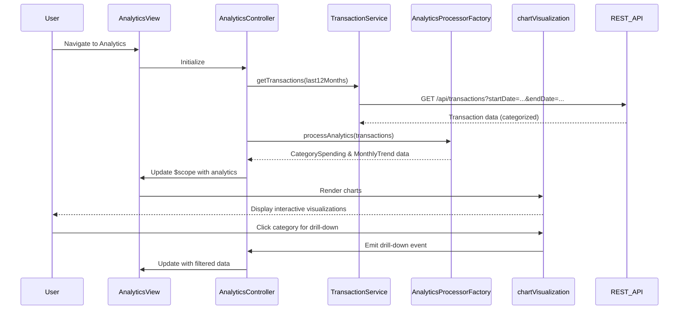

# Low-Level Design: Transaction Analytics and Category-wise Spending Insights
**Epic ID:** QE-9513

## a. Architecture Mapping

- **Analytics Module** → AngularJS Module (`creditCard.analytics`)
- **Analytics Controller** → AngularJS Controller (`AnalyticsController`) - manages analytics view and user interactions
- **Transaction Service** → AngularJS Service (`TransactionService`) - retrieves transaction data via REST API
- **Category Service** → AngularJS Service (`CategoryService`) - fetches category classification data via REST API
- **Analytics Processor** → AngularJS Factory (`AnalyticsProcessorFactory`) - aggregates and processes transaction data
- **Chart Directive** → AngularJS Directive (`chartVisualization`) - renders interactive charts using Chart.js or D3.js

**Recommended Folder Structure:**
```
/app
  /modules
    /analytics
      analytics.module.js
      analytics.controller.js
      analytics.html
  /services
    transaction.service.js
    category.service.js
  /factories
    analyticsProcessor.factory.js
  /directives
    chartVisualization.directive.js
  /models
    transaction.model.js
    categorySpending.model.js
```

## b. Component Specifications

| Component Name | Artifact Type | Responsibility | Key Dependencies |
|----------------|---------------|----------------|------------------|
| AnalyticsController | Controller | Manages analytics view state, fetches data, handles user interactions | TransactionService, CategoryService, AnalyticsProcessorFactory |
| TransactionService | Service | Retrieves historical transaction data (12 months) from REST API | $http, AuthInterceptor |
| CategoryService | Service | Fetches category classification data and rules from REST API | $http, AuthInterceptor |
| AnalyticsProcessorFactory | Factory | Aggregates transactions by category and month, computes trends | None (pure processing) |
| chartVisualization | Directive | Renders interactive charts (pie, bar, line) with drill-down capability | Chart.js or D3.js library |
| AnalyticsView | HTML Template | Displays category-wise and monthly trend visualizations using Bootstrap layout | Bootstrap CSS, chartVisualization directive |

## c. Data Model

**Transaction Model:**
```javascript
{
  transactionId: String,
  cardId: String,
  amount: Number,
  date: String (ISO 8601),
  category: String,
  merchantName: String,
  description: String
}
```

**CategorySpending Model:**
```javascript
{
  category: String,
  totalSpend: Number,
  transactionCount: Number,
  percentage: Number
}
```

**MonthlyTrend Model:**
```javascript
{
  month: String (YYYY-MM),
  totalSpend: Number,
  categoryBreakdown: Array<CategorySpending>
}
```

**Categories (Enum):**
```javascript
['Food & Dining', 'Fuel', 'Shopping', 'Travel', 'Entertainment', 'Utilities', 'Healthcare', 'Education', 'Miscellaneous']
```

## d. Data Flow

User navigates to analytics view → AnalyticsController initializes and calls TransactionService.getTransactions(startDate, endDate) for 12-month historical data → TransactionService makes REST API call with date range parameters → API returns categorized transaction data → AnalyticsProcessorFactory aggregates transactions by category and month, computes spending totals and percentages → AnalyticsController updates $scope with processed analytics data → chartVisualization directive renders interactive pie chart (category-wise) and line chart (monthly trends) → User interacts with charts (hover, click) to drill down into specific categories or time periods → Controller updates view with filtered data based on user interaction.

## e. Primary Sequence Diagram



## f. Implementation Notes

- Use AngularJS directive for chart rendering; isolate scope with two-way binding for data updates
- Implement AnalyticsProcessorFactory using ES6 Array methods (map, filter, reduce) for efficient data aggregation
- Leverage Chart.js or D3.js library for interactive visualizations; configure drill-down via click event handlers
- Use $scope.$watch to monitor date range changes and trigger data refresh automatically
- Cache processed analytics data in AnalyticsController to avoid redundant API calls on view interactions

## g. Error Handling

Try/catch blocks in AnalyticsProcessorFactory with fallback to empty datasets; HTTP errors handled via interceptor with user notification.

## h. Security Notes

Standard input validation and secure API calls assumed; authentication via existing token-based SSO.