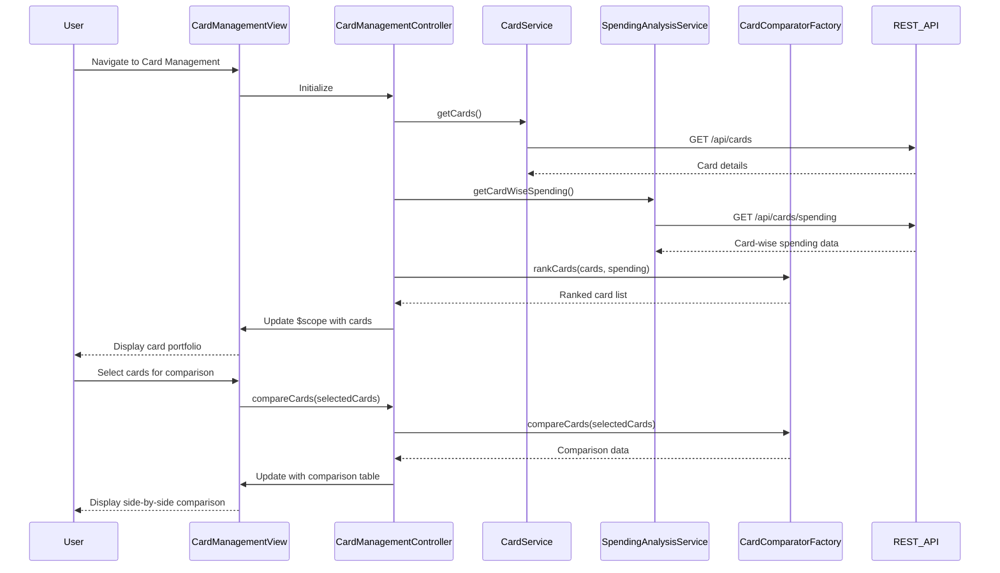

# Low-Level Design: Credit Card Management and Card-wise Analysis
**Epic ID:** QE-9514

## a. Architecture Mapping

- **Card Management Module** → AngularJS Module (`creditCard.management`)
- **Card Management Controller** → AngularJS Controller (`CardManagementController`) - manages card list and card-wise analysis view
- **Card Service** → AngularJS Service (`CardService`) - retrieves card details from REST API
- **Spending Analysis Service** → AngularJS Service (`SpendingAnalysisService`) - fetches card-wise spending data via REST API
- **Card Comparator** → AngularJS Factory (`CardComparatorFactory`) - compares cards based on spending, utilization, and benefits
- **Card Detail Directive** → AngularJS Directive (`cardDetail`) - renders individual card details with spending breakdown

**Recommended Folder Structure:**
```
/app
  /modules
    /cardManagement
      cardManagement.module.js
      cardManagement.controller.js
      cardManagement.html
  /services
    card.service.js
    spendingAnalysis.service.js
  /factories
    cardComparator.factory.js
  /directives
    cardDetail.directive.js
  /models
    card.model.js
    cardSpending.model.js
```

## b. Component Specifications

| Component Name | Artifact Type | Responsibility | Key Dependencies |
|----------------|---------------|----------------|------------------|
| CardManagementController | Controller | Manages card portfolio view, handles card selection and comparison | CardService, SpendingAnalysisService, CardComparatorFactory |
| CardService | Service | Retrieves card master data and issuer details from REST API | $http, AuthInterceptor |
| SpendingAnalysisService | Service | Fetches card-wise spending metrics and transaction summaries from REST API | $http, AuthInterceptor |
| CardComparatorFactory | Factory | Compares multiple cards based on utilization, spending, and benefits | None (pure comparison logic) |
| cardDetail | Directive | Renders individual card details with spending breakdown and utilization chart | None (presentation only) |
| CardManagementView | HTML Template | Displays card portfolio with comparison table using Bootstrap grid | Bootstrap CSS, cardDetail directive |

## c. Data Model

**Card Model:**
```javascript
{
  cardId: String,
  cardNumber: String (masked),
  cardType: String,
  issuer: String,
  issuerLogo: String (URL),
  creditLimit: Number,
  outstandingAmount: Number,
  availableCredit: Number,
  expiryDate: String (ISO 8601),
  status: String
}
```

**CardSpending Model:**
```javascript
{
  cardId: String,
  monthlySpend: Number,
  totalSpend: Number,
  transactionCount: Number,
  utilizationPercentage: Number,
  topCategories: Array<String>
}
```

**CardComparison Model:**
```javascript
{
  cardId: String,
  cardName: String,
  monthlySpend: Number,
  utilization: Number,
  availableCredit: Number,
  rank: Number
}
```

## d. Data Flow

User navigates to card management view → CardManagementController initializes and calls CardService.getCards() and SpendingAnalysisService.getCardWiseSpending() → Both services make REST API calls to retrieve card details and spending metrics → API responses return card master data and card-wise spending analytics → CardComparatorFactory processes data to rank cards by utilization and spending → CardManagementController updates $scope with card list and comparison data → CardManagementView renders card portfolio using cardDetail directive for each card → User selects multiple cards for comparison → Controller invokes CardComparatorFactory.compareCards() → View updates with side-by-side comparison table highlighting key metrics.

## e. Primary Sequence Diagram



## f. Implementation Notes

- Use AngularJS directive (cardDetail) with isolate scope and template for reusable card rendering
- Implement CardComparatorFactory with ES6 comparison functions (sort, filter) for ranking and comparison logic
- Use ng-repeat with track by cardId for efficient card list rendering and dynamic updates
- Apply Bootstrap table component for card comparison view with responsive columns
- Implement card selection using ng-model with checkbox binding for multi-select comparison

## g. Error Handling

HTTP interceptor-based error handling with user notification; empty state handling for users with no cards.

## h. Security Notes

Requires token-based auth via existing SSO; card numbers are masked (last 4 digits only) in all views.