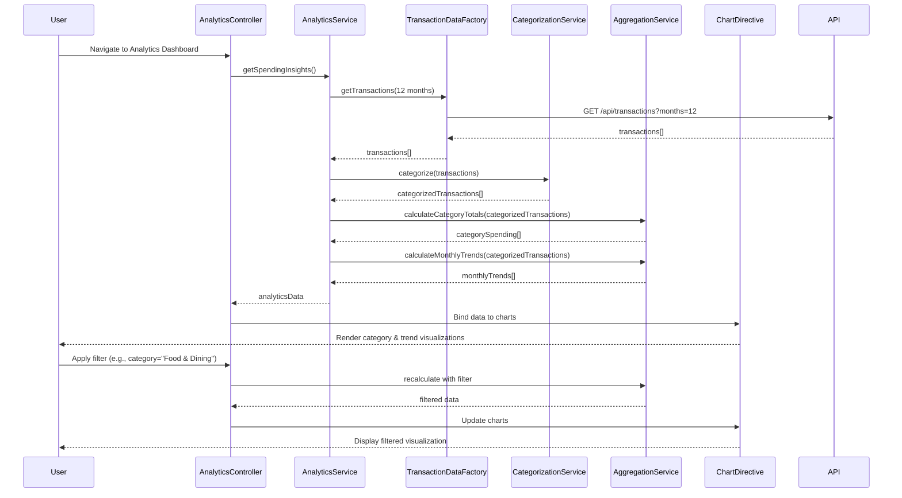

# Low-Level Design: QE-9515 - Analytics and Spending Insights

## a. Architecture Mapping

- **Analytics Dashboard UI** → AngularJS Module (`app.analytics`) + Controller (`AnalyticsController`)
- **Analytics Service** → AngularJS Service (`AnalyticsService`) for business logic and orchestration
- **Transaction Data Service Integration** → AngularJS Factory (`TransactionDataFactory`) for REST API calls
- **Categorization Engine Integration** → AngularJS Service (`CategorizationService`) for transaction classification
- **Data Aggregation** → AngularJS Service (`AggregationService`) for trend and category calculations
- **Charting Library** → Directive (`chartDirective`) wrapping Chart.js/D3.js for visualization rendering

**Recommended Folder Structure:**
```
/app
  /analytics
    analytics.module.js
    analytics.controller.js
    analytics.service.js
    analytics.html
  /common
    /services
      transaction-data.factory.js
      categorization.service.js
      aggregation.service.js
    /directives
      chart.directive.js
```

## b. Component Specifications

| Component Name | Artifact Type | Responsibility | Key Dependencies |
|---|---|---|---|
| `app.analytics` | Module | Define analytics feature module and routing | `ngRoute`, `app.common` |
| `AnalyticsController` | Controller | Manage analytics dashboard state, user interactions, filter/drill-down logic | `AnalyticsService`, `$scope` |
| `AnalyticsService` | Service | Orchestrate data retrieval, categorization, aggregation, and format for UI | `TransactionDataFactory`, `CategorizationService`, `AggregationService` |
| `TransactionDataFactory` | Factory | Fetch 12 months of transaction history via REST API | `$http`, `API_CONFIG` |
| `CategorizationService` | Service | Classify transactions into 9 categories using MCC codes and merchant data | None (pure logic) |
| `AggregationService` | Service | Calculate category totals and monthly trends from categorized transactions | None (pure logic) |
| `chartDirective` | Directive | Render interactive charts (category breakdown, monthly trends) using Chart.js | `Chart.js` library |

## c. Data Model

**Transaction Object:**
```javascript
{
  id: String,
  date: Date,
  amount: Number,
  merchantName: String,
  merchantCode: String,  // MCC
  category: String,      // One of 9 predefined categories
  cardId: String
}
```

**CategorySpending Object:**
```javascript
{
  category: String,      // e.g., "Food & Dining"
  totalAmount: Number,
  transactionCount: Number,
  percentage: Number
}
```

**MonthlyTrend Object:**
```javascript
{
  month: String,         // e.g., "2026-01"
  totalSpend: Number,
  categoryBreakdown: Array<CategorySpending>
}
```

**AnalyticsViewModel:**
```javascript
{
  categorySpending: Array<CategorySpending>,
  monthlyTrends: Array<MonthlyTrend>,
  selectedPeriod: String,
  filters: Object        // { category, dateRange }
}
```

## d. Data Flow

User accesses analytics dashboard → `AnalyticsController` initializes and calls `AnalyticsService.getSpendingInsights()` → Service invokes `TransactionDataFactory.getTransactions(12 months)` via REST API (`GET /api/transactions?months=12`) → Raw transactions returned → `CategorizationService.categorize(transactions)` classifies each transaction into one of 9 categories using MCC codes → `AggregationService.calculateCategoryTotals()` and `calculateMonthlyTrends()` compute spending summaries → Formatted data returned to Controller → Controller binds data to `$scope.analytics` → `chartDirective` renders category pie chart and monthly trend line chart within 1.5 seconds → User applies filters (category, date range) → Controller re-invokes aggregation logic → Charts update dynamically without API call.

## e. Primary Sequence Diagram



## f. Implementation Notes

- Use AngularJS Dependency Injection to inject services into controllers and factories; declare all dependencies explicitly in array notation for minification safety.
- Implement `TransactionDataFactory` with `$http` service; use promises for async API calls and handle errors via `.catch()`.
- `CategorizationService` uses a static mapping object `{ MCC_CODE: CATEGORY }` for 95% accuracy; expose `recategorize(transactionId, newCategory)` method for manual overrides.
- Cache aggregated monthly data in `AnalyticsService` using a simple object store; invalidate cache on current month updates or user-triggered refresh.
- Use Chart.js via `chartDirective` with two-way data binding; directive watches `chartData` attribute and redraws chart on change using `chart.update()`.

## g. Error Handling

Use AngularJS `$http` interceptor to catch API errors (e.g., 500, 404) and display user-friendly notifications via a global `NotificationService`; wrap categorization/aggregation logic in try/catch blocks.

## h. Security Notes

Standard input validation and secure API calls assumed; transaction data fetched via authenticated REST endpoints with token-based auth (existing SSO).