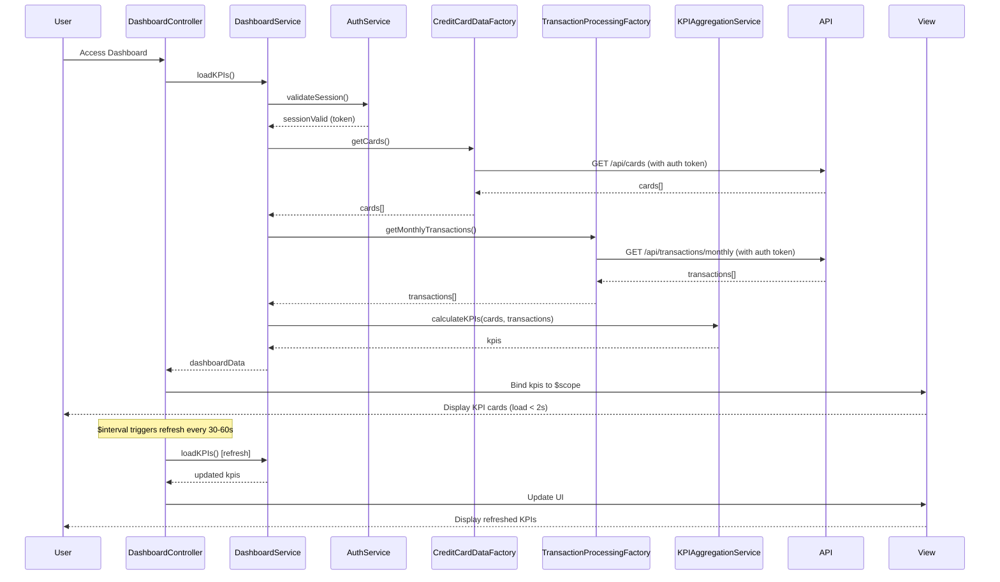

# Low-Level Design: QE-9516 - Dashboard and KPI Management

## a. Architecture Mapping

- **User Web/Mobile Client** → AngularJS Module (`app.dashboard`) + Controller (`DashboardController`) + Responsive HTML5/CSS3 view
- **Dashboard Service** → AngularJS Service (`DashboardService`) for KPI orchestration and business logic
- **KPI Aggregation Engine** → AngularJS Service (`KPIAggregationService`) for calculating metrics
- **Credit Card Data Service Integration** → AngularJS Factory (`CreditCardDataFactory`) for REST API calls
- **Transaction Processing Service Integration** → AngularJS Factory (`TransactionProcessingFactory`) for REST API calls
- **User Authentication Service** → AngularJS Service (`AuthService`) for session validation and secure access

**Recommended Folder Structure:**
```
/app
  /dashboard
    dashboard.module.js
    dashboard.controller.js
    dashboard.service.js
    dashboard.html
  /common
    /services
      auth.service.js
      kpi-aggregation.service.js
    /factories
      credit-card-data.factory.js
      transaction-processing.factory.js
```

## b. Component Specifications

| Component Name | Artifact Type | Responsibility | Key Dependencies |
|---|---|---|---|
| `app.dashboard` | Module | Define dashboard feature module and routing | `ngRoute`, `app.common` |
| `DashboardController` | Controller | Manage dashboard state, trigger KPI load, handle real-time refresh | `DashboardService`, `$scope`, `$interval` |
| `DashboardService` | Service | Orchestrate KPI data retrieval and aggregation from multiple sources | `KPIAggregationService`, `CreditCardDataFactory`, `TransactionProcessingFactory`, `AuthService` |
| `KPIAggregationService` | Service | Calculate total credit limit, available credit, outstanding amounts, monthly spend | None (pure logic) |
| `CreditCardDataFactory` | Factory | Fetch card balances and limits via REST API | `$http`, `API_CONFIG` |
| `TransactionProcessingFactory` | Factory | Fetch monthly transactions for spend calculation via REST API | `$http`, `API_CONFIG` |
| `AuthService` | Service | Validate user session and provide authentication token for API calls | `$http`, `$window` (for token storage) |

## c. Data Model

**CreditCard Object:**
```javascript
{
  cardId: String,
  cardNumber: String,        // Masked (last 4 digits)
  issuer: String,
  creditLimit: Number,
  currentBalance: Number,
  availableCredit: Number
}
```

**Transaction Object:**
```javascript
{
  transactionId: String,
  cardId: String,
  amount: Number,
  date: Date,
  merchantName: String
}
```

**KPI Object:**
```javascript
{
  totalCreditLimit: Number,
  totalAvailableCredit: Number,
  totalOutstanding: Number,
  monthlySpend: Number,
  lastUpdated: Date
}
```

**DashboardViewModel:**
```javascript
{
  kpis: KPI,
  cards: Array<CreditCard>,
  loading: Boolean,
  error: String
}
```

## d. Data Flow

User accesses dashboard → `DashboardController` initializes and calls `DashboardService.loadKPIs()` → Service invokes `AuthService.validateSession()` to ensure user is authenticated → Service calls `CreditCardDataFactory.getCards()` via REST API (`GET /api/cards`) to fetch all user cards with balances and limits → Service calls `TransactionProcessingFactory.getMonthlyTransactions()` via REST API (`GET /api/transactions/monthly`) to fetch current month transactions → `KPIAggregationService.calculateKPIs(cards, transactions)` computes total credit limit (sum of all card limits), available credit (sum of all available credit), outstanding amounts (sum of all balances), and monthly spend (sum of transaction amounts) → Aggregated KPIs returned to Controller → Controller binds data to `$scope.dashboard` → View renders KPI cards with responsive Bootstrap layout within 2 seconds → `$interval` triggers periodic refresh (30-60 seconds) to update KPIs in real-time.

## e. Primary Sequence Diagram



## f. Implementation Notes

- Use AngularJS Dependency Injection with array notation for all services/factories to ensure minification compatibility.
- Implement `CreditCardDataFactory` and `TransactionProcessingFactory` using `$http` service with promise-based async handling; attach auth token from `AuthService` to request headers.
- `KPIAggregationService` uses pure JavaScript reduce/map functions for calculations; ensure precision for financial amounts using fixed-point arithmetic (multiply by 100, calculate, divide by 100).
- Use `$interval` in `DashboardController` for real-time refresh (30-60 second interval); cancel interval on `$scope.$on('$destroy')` to prevent memory leaks.
- Implement responsive UI using Bootstrap grid system (col-md-3 for KPI cards on desktop, col-xs-12 on mobile); use CSS3 media queries for custom breakpoints if needed.

## g. Error Handling

Use AngularJS `$http` interceptor to catch API errors globally and display user-friendly messages via `NotificationService`; wrap KPI calculations in try/catch blocks with fallback to cached values.

## h. Security Notes

Requires token-based auth via existing SSO; `AuthService` manages session tokens stored in `sessionStorage` and attaches tokens to all API requests via `$http` interceptor.