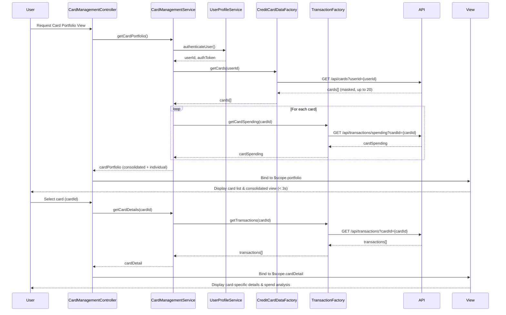

# Low-Level Design: QE-9517 - Multiple Credit Card Management and Monitoring

## a. Architecture Mapping

- **User Interface** → AngularJS Module (`app.cardManagement`) + Controller (`CardManagementController`) + HTML5/CSS3 views
- **Card Management Service** → AngularJS Service (`CardManagementService`) for business logic and orchestration
- **Credit Card Data Repository Integration** → AngularJS Factory (`CreditCardDataFactory`) for REST API calls
- **User Profile Service Integration** → AngularJS Service (`UserProfileService`) for authentication and card-user linking
- **Transaction Service Integration** → AngularJS Factory (`TransactionFactory`) for card-specific spending data

**Recommended Folder Structure:**
```
/app
  /card-management
    card-management.module.js
    card-management.controller.js
    card-management.service.js
    card-list.html
    card-detail.html
  /common
    /services
      user-profile.service.js
    /factories
      credit-card-data.factory.js
      transaction.factory.js
```

## b. Component Specifications

| Component Name | Artifact Type | Responsibility | Key Dependencies |
|---|---|---|---|
| `app.cardManagement` | Module | Define card management feature module and routing | `ngRoute`, `app.common` |
| `CardManagementController` | Controller | Manage card list/detail views, handle card selection, trigger data load | `CardManagementService`, `$scope`, `$routeParams` |
| `CardManagementService` | Service | Orchestrate card data retrieval, aggregation, and card-wise spend analysis | `CreditCardDataFactory`, `TransactionFactory`, `UserProfileService` |
| `CreditCardDataFactory` | Factory | Fetch card information (up to 20 cards) via REST API with masking | `$http`, `API_CONFIG` |
| `TransactionFactory` | Factory | Fetch card-specific spending data via REST API | `$http`, `API_CONFIG` |
| `UserProfileService` | Service | Authenticate user and link cards to user profile | `$http`, `$window` (for token storage) |

## c. Data Model

**CreditCard Object:**
```javascript
{
  cardId: String,
  cardNumber: String,        // Masked (e.g., "****1234")
  issuer: String,
  cardType: String,          // e.g., "Visa", "Mastercard"
  creditLimit: Number,
  currentBalance: Number,
  availableCredit: Number,
  expiryDate: String,        // MM/YY
  status: String             // "Active", "Blocked", "Expired"
}
```

**CardSpending Object:**
```javascript
{
  cardId: String,
  monthlySpend: Number,
  totalTransactions: Number,
  lastTransactionDate: Date
}
```

**CardPortfolio Object:**
```javascript
{
  userId: String,
  cards: Array<CreditCard>,
  totalCards: Number,
  consolidatedBalance: Number,
  consolidatedLimit: Number
}
```

**CardDetailViewModel:**
```javascript
{
  card: CreditCard,
  spending: CardSpending,
  transactions: Array<Transaction>
}
```

## d. Data Flow

User requests card portfolio view → `CardManagementController` initializes and calls `CardManagementService.getCardPortfolio()` → Service invokes `UserProfileService.authenticateUser()` to validate session and retrieve userId → Service calls `CreditCardDataFactory.getCards(userId)` via REST API (`GET /api/cards?userId={userId}`) to fetch up to 20 cards with masked card numbers (PCI-DSS compliant) → Service calls `TransactionFactory.getCardSpending(cardId)` for each card via REST API (`GET /api/transactions/spending?cardId={cardId}`) → Service aggregates card data and spending into consolidated and individual views → Data returned to Controller within 3 seconds → Controller binds data to `$scope.portfolio` → View renders card list with consolidated overview using Bootstrap cards → User selects a card → Controller navigates to card detail view (`/cards/:cardId`) → Controller calls `CardManagementService.getCardDetails(cardId)` → Service fetches detailed transactions for selected card → Controller binds to `$scope.cardDetail` → View displays card-specific details and card-wise spend analysis.

## e. Primary Sequence Diagram



## f. Implementation Notes

- Use AngularJS Dependency Injection with array notation for minification safety; inject all services/factories explicitly.
- Implement `CreditCardDataFactory` with `$http` service; ensure card numbers are masked server-side (only last 4 digits exposed) per PCI-DSS standards; factory does not perform masking.
- `CardManagementService` uses `$q.all()` to parallelize `getCardSpending()` calls for multiple cards to meet 3-second retrieval NFR.
- Use `ngRoute` for navigation between card list (`/cards`) and card detail (`/cards/:cardId`) views; pass `cardId` via `$routeParams`.
- Implement card list view using Bootstrap card components with responsive grid (col-md-4 for desktop, col-xs-12 for mobile); display consolidated metrics at top.

## g. Error Handling

Use AngularJS `$http` interceptor for global API error handling; display user-friendly error messages via `NotificationService` for failed card retrieval or timeout (> 3 seconds).

## h. Security Notes

Requires token-based auth via existing SSO; card numbers masked server-side per PCI-DSS (only last 4 digits exposed); `UserProfileService` manages session tokens and attaches to all API requests.