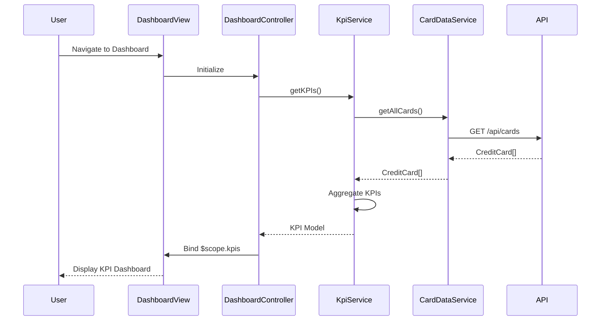

# Low-Level Design: QE-9518 - Credit Card Overview and KPI Dashboard

## a. Architecture Mapping

**HLD Component → AngularJS Artifact:**
- User Browser → Main Application Module (`app.module.js`)
- Authentication Service → Auth Service Factory (`auth.service.js`)
- Dashboard UI Component → Dashboard Controller + View (`dashboard.controller.js`, `dashboard.html`)
- KPI Calculation Engine → KPI Service (`kpi.service.js`)
- Credit Card Data Service → Card Data Service (`cardData.service.js`)
- Data Repository → REST API integration layer

**Recommended Folder Structure:**
```
app/
├── modules/
│   └── dashboard/
│       ├── controllers/
│       │   └── dashboard.controller.js
│       ├── services/
│       │   ├── kpi.service.js
│       │   └── cardData.service.js
│       └── views/
│           └── dashboard.html
├── shared/
│   └── services/
│       └── auth.service.js
├── assets/
│   ├── css/
│   └── js/
└── app.module.js
```

## b. Component Specifications

| Component Name | Artifact Type | Responsibility | Key Dependencies |
|----------------|---------------|----------------|------------------|
| DashboardModule | Module | Root module for dashboard feature | angular, ngRoute, ngResource |
| DashboardController | Controller | Orchestrates dashboard view, binds KPI data to scope | $scope, KpiService, CardDataService |
| KpiService | Service | Calculates monthly spend, available credit, outstanding amounts from card data | CardDataService, $q |
| CardDataService | Factory | Fetches credit card data from REST API, caches card details | $http, $resource |
| AuthService | Factory | Manages user authentication token and session | $http, $window |
| DashboardView | HTML Template | Displays KPI cards with Bootstrap grid, responsive layout | Bootstrap CSS, AngularJS directives |

## c. Data Model

**CreditCard Model:**
```javascript
{
  cardId: String,
  cardNumber: String (masked),
  cardType: String,
  creditLimit: Number,
  currentBalance: Number,
  availableCredit: Number,
  outstandingAmount: Number,
  monthlySpend: Number,
  lastUpdated: Date
}
```

**KPI Model:**
```javascript
{
  totalMonthlySpend: Number,
  totalCreditLimit: Number,
  totalAvailableCredit: Number,
  totalOutstanding: Number,
  cardCount: Number
}
```

## d. Data Flow

User navigates to dashboard → DashboardController initializes and calls KpiService.getKPIs() → KpiService requests card data via CardDataService.getAllCards() → CardDataService makes REST API call to /api/cards endpoint with auth token → API returns array of CreditCard objects → KpiService aggregates data (sum limits, calculate totals) → Controller binds KPI model to $scope → DashboardView renders KPI cards using ng-repeat and Bootstrap grid → Data auto-refreshes every 5 minutes via $interval or user-triggered refresh button.

## e. Primary Sequence Diagram



## f. Implementation Notes

- Use AngularJS module pattern with dependency injection for all services and controllers.
- Implement $http interceptor for attaching auth tokens to all API requests.
- Use $resource for RESTful API integration with CardDataService for cleaner CRUD operations.
- Apply Bootstrap responsive grid (col-xs, col-sm, col-md) for KPI card layout to meet mobile/tablet/desktop NFR.
- Implement $interval service for auto-refresh every 5 minutes; clear interval on $scope.$on('$destroy').

## g. Error Handling

HTTP interceptor captures API errors; display user-friendly notifications using Bootstrap alerts or toast service; retry logic with exponential backoff for transient failures.

## h. Security Notes

Requires token-based authentication via existing SSO; auth token included in HTTP headers for all API calls; card numbers displayed in masked format.