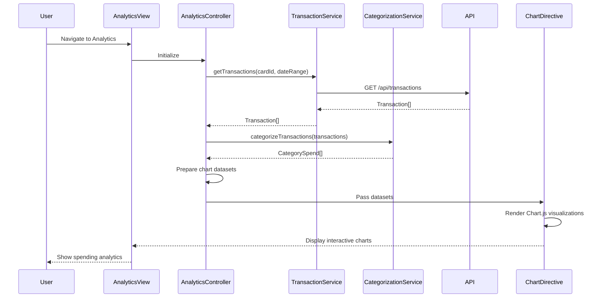

# Low-Level Design: QE-9519 - Spending Analytics and Visualization

## a. Architecture Mapping

**HLD Component → AngularJS Artifact:**
- User Dashboard → Analytics Module (`analytics.module.js`)
- Analytics UI Component → Analytics Controller + View (`analytics.controller.js`, `analytics.html`)
- Data Visualization Engine → Chart Directive (`chart.directive.js`) using Chart.js or D3.js
- Transaction Categorization Service → Categorization Service (`categorization.service.js`)
- Transaction Data Service → Transaction Service (`transaction.service.js`)
- Transaction Repository → REST API integration

**Recommended Folder Structure:**
```
app/
├── modules/
│   └── analytics/
│       ├── controllers/
│       │   └── analytics.controller.js
│       ├── services/
│       │   ├── transaction.service.js
│       │   └── categorization.service.js
│       ├── directives/
│       │   └── chart.directive.js
│       └── views/
│           └── analytics.html
├── shared/
│   └── services/
└── app.module.js
```

## b. Component Specifications

| Component Name | Artifact Type | Responsibility | Key Dependencies |
|----------------|---------------|----------------|------------------|
| AnalyticsModule | Module | Root module for analytics feature | angular, ngRoute, chart.js |
| AnalyticsController | Controller | Manages analytics view, fetches transaction data, prepares chart datasets | $scope, TransactionService, CategorizationService |
| TransactionService | Factory | Retrieves transaction history from REST API, filters by date/card | $http, $q |
| CategorizationService | Service | Categorizes transactions into 9 predefined categories, calculates category totals | None |
| ChartDirective | Directive | Renders interactive charts (pie, bar, line) using Chart.js library | chart.js |
| AnalyticsView | HTML Template | Displays category charts, monthly trends, card-wise spend with responsive layout | Bootstrap, ChartDirective |

## c. Data Model

**Transaction Model:**
```javascript
{
  transactionId: String,
  cardId: String,
  amount: Number,
  category: String,
  merchant: String,
  transactionDate: Date,
  description: String
}
```

**CategorySpend Model:**
```javascript
{
  category: String,
  totalSpend: Number,
  transactionCount: Number,
  percentage: Number
}
```

**MonthlyTrend Model:**
```javascript
{
  month: String,
  totalSpend: Number,
  cardWiseSpend: Object // { cardId: amount }
}
```

## d. Data Flow

User navigates to analytics page → AnalyticsController initializes and calls TransactionService.getTransactions(cardId, dateRange) → TransactionService makes REST API call to /api/transactions → API returns Transaction[] → CategorizationService.categorizeTransactions() processes array and groups by 9 categories → Controller prepares chart datasets (labels, data, colors) → ChartDirective receives dataset via isolated scope and renders interactive Chart.js visualizations → User interacts with charts (hover, click) for drill-down → Controller updates view with filtered data.

## e. Primary Sequence Diagram



## f. Implementation Notes

- Use Chart.js library integrated via custom AngularJS directive with isolated scope for reusability.
- Implement CategorizationService with predefined category mapping (merchant patterns or API-provided categories).
- Use $filter for date range filtering and sorting transactions by date/amount.
- Apply lazy loading for transaction data (paginate API calls) to handle 1000+ transactions per card efficiently.
- Ensure chart responsiveness using Chart.js responsive options and Bootstrap container classes.

## g. Error Handling

HTTP interceptor handles API failures; display error message in analytics view if data unavailable; gracefully degrade to "No data available" state with retry option.

## h. Security Notes

Standard input validation and secure API calls assumed; transaction data filtered by authenticated user's card ownership.