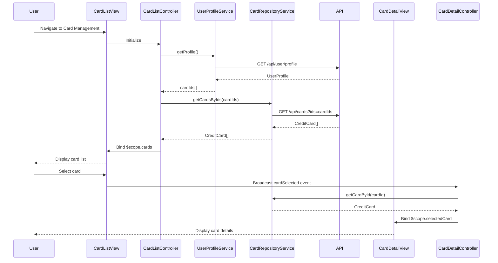

# Low-Level Design: QE-9520 - Multiple Credit Card Management

## a. Architecture Mapping

**HLD Component → AngularJS Artifact:**
- User Interface → Card Management Module (`cardManagement.module.js`)
- Card Selection Component → Card Selector Directive (`cardSelector.directive.js`)
- Card List Manager → Card List Controller (`cardList.controller.js`)
- Card Detail View → Card Detail Controller + View (`cardDetail.controller.js`, `cardDetail.html`)
- User Profile Service → User Profile Service (`userProfile.service.js`)
- Credit Card Data Repository → Card Repository Service (`cardRepository.service.js`)

**Recommended Folder Structure:**
```
app/
├── modules/
│   └── cardManagement/
│       ├── controllers/
│       │   ├── cardList.controller.js
│       │   └── cardDetail.controller.js
│       ├── services/
│       │   ├── cardRepository.service.js
│       │   └── userProfile.service.js
│       ├── directives/
│       │   └── cardSelector.directive.js
│       └── views/
│           ├── cardList.html
│           └── cardDetail.html
├── shared/
└── app.module.js
```

## b. Component Specifications

| Component Name | Artifact Type | Responsibility | Key Dependencies |
|----------------|---------------|----------------|------------------|
| CardManagementModule | Module | Root module for card management feature | angular, ngRoute |
| CardListController | Controller | Manages list of user's credit cards, handles card selection | $scope, CardRepositoryService, UserProfileService |
| CardDetailController | Controller | Displays detailed metrics for selected card, handles card-specific data binding | $scope, $routeParams, CardRepositoryService |
| CardSelectorDirective | Directive | Renders card selection UI (dropdown/tabs), emits card selection events | None |
| CardRepositoryService | Factory | Fetches card data from REST API, caches card list, retrieves card by ID | $http, $q, $cacheFactory |
| UserProfileService | Service | Retrieves user profile and linked card IDs, manages card ownership | $http |

## c. Data Model

**CreditCard Model:**
```javascript
{
  cardId: String,
  cardNumber: String (masked),
  cardType: String,
  bankName: String,
  creditLimit: Number,
  currentBalance: Number,
  availableCredit: Number,
  status: String,
  expiryDate: String,
  isPrimary: Boolean
}
```

**UserProfile Model:**
```javascript
{
  userId: String,
  userName: String,
  cardIds: Array<String>
}
```

## d. Data Flow

User navigates to card management page → CardListController initializes and calls UserProfileService.getProfile() to retrieve user's linked cardIds → CardRepositoryService.getCardsByIds(cardIds) makes REST API call to /api/cards → API returns CreditCard[] → Controller binds card list to $scope.cards → CardSelectorDirective renders card list as tabs/dropdown → User selects a card → Directive broadcasts 'cardSelected' event with cardId → CardDetailController listens for event and calls CardRepositoryService.getCardById(cardId) → Service retrieves card details from cache or API → Controller binds card details to $scope.selectedCard → CardDetailView renders card-specific metrics and information.

## e. Primary Sequence Diagram



## f. Implementation Notes

- Use $cacheFactory in CardRepositoryService to cache card data and achieve <500ms card switching performance.
- Implement CardSelectorDirective with isolated scope and two-way binding for selected card model.
- Use $broadcast/$on pattern for card selection events to decouple card list and detail views.
- Apply ng-class for visual distinction between cards (color coding by card type or bank).
- Ensure data isolation by filtering API responses based on authenticated user's cardIds from UserProfileService.

## g. Error Handling

HTTP interceptor captures API errors; display user-friendly error message if card data fails to load; implement retry mechanism with user prompt.

## h. Security Notes

Requires token-based auth via existing SSO; API enforces card ownership validation; card numbers displayed in masked format (last 4 digits only).